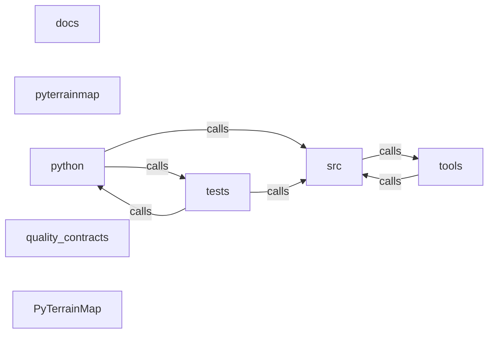

_Generated by CodeAtlas._

## Details

Architecture map of PyTerrainMap.

### docs

Owns 0 symbols across 43 file(s).

**Related Classes/Methods:** _None_

### pyterrainmap

Owns 6 symbols across 1 file(s).

**Related Classes/Methods:** _None_

**Source Files:**

- `pyterrainmap/okf_sensor_profiles.py`
  - `pyterrainmap.okf_sensor_profiles.OKFSensorProfiles`
  - `pyterrainmap.okf_sensor_profiles.OKFSensorProfiles.__init__`
  - `pyterrainmap.okf_sensor_profiles.OKFSensorProfiles.get_reliable_sensors`
  - `pyterrainmap.okf_sensor_profiles.OKFSensorProfiles.needs_calibration`
  - `pyterrainmap.okf_sensor_profiles.OKFSensorProfiles.save_sensor`
  - `pyterrainmap.okf_sensor_profiles.SensorProfile`

### python

Owns 0 symbols across 0 file(s).

**Related Classes/Methods:** _None_

### quality_contracts

Owns 0 symbols across 4 file(s).

**Related Classes/Methods:** _None_

### src

Owns 377 symbols across 10 file(s).

**Related Classes/Methods:** _None_

**Source Files:**

- `src/late_arrival.rs`
  - `src.late_arrival.LateArrivalBatch`
  - `src.late_arrival.LateArrivalBatch.add`
  - `src.late_arrival.LateArrivalBatch.average_latency_ms`
  - `src.late_arrival.LateArrivalBatch.is_empty`
  - `src.late_arrival.LateArrivalBatch.len`
  - `src.late_arrival.LateArrivalBatch.new`
  - `src.late_arrival.LateArrivalProcessor`
  - `src.late_arrival.LateArrivalProcessor.clear_affected`
  - `src.late_arrival.LateArrivalProcessor.compute_affected_cells`
  - `src.late_arrival.LateArrivalProcessor.default`
  - `src.late_arrival.LateArrivalProcessor.estimate_reprocess_cost_ms`
  - `src.late_arrival.LateArrivalProcessor.get_affected_queries`
  - `src.late_arrival.LateArrivalProcessor.get_affected_regions`
  - `src.late_arrival.LateArrivalProcessor.last_reprocess_time`
  - `src.late_arrival.LateArrivalProcessor.mark_query_affected`
  - `src.late_arrival.LateArrivalProcessor.mark_reprocessing_done`
  - `src.late_arrival.LateArrivalProcessor.new`
  - `src.late_arrival.LateArrivalProcessor.process_late_arrival`
  - `src.late_arrival.tests.create_test_observation`
  - `src.late_arrival.tests.test_late_arrival_batch_add`
  - `src.late_arrival.tests.test_late_arrival_batch_creation`
  - `src.late_arrival.tests.test_late_arrival_batch_latency`
  - `src.late_arrival.tests.test_late_arrival_processor_clear`
  - `src.late_arrival.tests.test_late_arrival_processor_creation`
  - `src.late_arrival.tests.test_late_arrival_processor_mark_query`
  - `src.late_arrival.tests.test_late_arrival_processor_reprocess_cost`
- `src/lib.rs`
  - `src.lib.tests.it_works`
- `src/py.rs`
  - `src.py.py_persona_dict`
  - `src.py.pyterrain_map`
- `src/py_api.rs`
  - `src.py_api.PyDataExplanation`
  - `src.py_api.PyDataExplanation.__repr__`
  - `src.py_api.PyDataExplanation.add_application`
  - `src.py_api.PyDataExplanation.applications`
  - `src.py_api.PyDataExplanation.confidence`
  - `src.py_api.PyDataExplanation.description`
  - `src.py_api.PyDataExplanation.field`
  - `src.py_api.PyDataExplanation.new`
  - `src.py_api.PyDataExplanation.normal_range`
  - `src.py_api.PyDataExplanation.slope`
  - `src.py_api.PyDataExplanation.soil_moisture`
  - `src.py_api.PyDataExplanation.source`
  - `src.py_api.PyDataExplanation.temperature`
  - `src.py_api.PyDataExplanation.units`
  - `src.py_api.PyDataExplanation.visibility`
  - `src.py_api.PyEnvironmentalConditions`
  - `src.py_api.PyEnvironmentalConditions.__repr__`
  - `src.py_api.PyEnvironmentalConditions.location`
  - `src.py_api.PyEnvironmentalConditions.mission_suitability`
  - `src.py_api.PyEnvironmentalConditions.new`
  - `src.py_api.PyEnvironmentalConditions.set_mission_suitability`
  - `src.py_api.PyEnvironmentalConditions.update_suitability`
  - `src.py_api.PyGeoPoint`
  - `src.py_api.PyGeoPoint.__eq__`
  - `src.py_api.PyGeoPoint.__repr__`
  - `src.py_api.PyGeoPoint.distance_m`
  - `src.py_api.PyGeoPoint.lat`
  - `src.py_api.PyGeoPoint.lon`
  - `src.py_api.PyGeoPoint.new`
  - `src.py_api.PyMobilityAssessment`
  - `src.py_api.PyMobilityAssessment.__repr__`
  - `src.py_api.PyMobilityAssessment.add_hazard`
  - `src.py_api.PyMobilityAssessment.battery_impact`
  - `src.py_api.PyMobilityAssessment.default`
  - `src.py_api.PyMobilityAssessment.difficulty`
  - `src.py_api.PyMobilityAssessment.difficulty_label`
  - `src.py_api.PyMobilityAssessment.hazards`
  - `src.py_api.PyMobilityAssessment.new`
  - `src.py_api.PyMobilityAssessment.recommended_speed_ms`
  - `src.py_api.PyMobilityAssessment.set_battery_impact`
  - `src.py_api.PyMobilityAssessment.set_difficulty`
  - `src.py_api.PyMobilityAssessment.set_recommended_speed_ms`
  - `src.py_api.PyMobilityAssessment.set_time_to_cross_100m_seconds`
  - `src.py_api.PyMobilityAssessment.set_traversable`
  - `src.py_api.PyMobilityAssessment.time_to_cross_100m_seconds`
  - `src.py_api.PyMobilityAssessment.traversable`
  - `src.py_api.PyObservation`
  - `src.py_api.PyObservation.__repr__`
  - `src.py_api.PyObservation.confidence`
  - `src.py_api.PyObservation.location`
  - `src.py_api.PyObservation.new`
  - `src.py_api.PyObservation.robot_id`
  - `src.py_api.PyObservation.sensor_type`
  - `src.py_api.PyObservation.timestamp`
  - `src.py_api.PyObservation.value`
  - `src.py_api.PyQueryResult`
  - `src.py_api.PyQueryResult.__getitem__`
  - `src.py_api.PyQueryResult.__len__`
  - `src.py_api.PyQueryResult.__repr__`
  - `src.py_api.PyQueryResult.avg_confidence`
  - `src.py_api.PyQueryResult.count`
  - `src.py_api.PyQueryResult.is_empty`
  - `src.py_api.PyQueryResult.len`
  - `src.py_api.PyQueryResult.observations`
  - `src.py_api.PyQueryResult.to_dict`
  - `src.py_api.PyRegion`
  - `src.py_api.PyRegion.__repr__`
  - `src.py_api.PyRegion.center`
  - `src.py_api.PyRegion.contains`
  - `src.py_api.PyRegion.new`
  - `src.py_api.PyRegion.world`
  - `src.py_api.PyRisk`
  - `src.py_api.PyRisk.__repr__`
  - `src.py_api.PyRisk.affected_personas`
  - `src.py_api.PyRisk.affects`
  - `src.py_api.PyRisk.description`
  - `src.py_api.PyRisk.mitigations`
  - `src.py_api.PyRisk.new`
  - `src.py_api.PyRisk.risk_type`
  - `src.py_api.PyRisk.set_severity`
  - `src.py_api.PyRisk.severity`
  - `src.py_api.PyRisk.severity_label`
  - `src.py_api.PyRisk.with_mitigation`
  - `src.py_api.PyTerrainAnalysis`
  - `src.py_api.PyTerrainAnalysis.__repr__`
  - `src.py_api.PyTerrainAnalysis.add_observation`
  - `src.py_api.PyTerrainAnalysis.add_recommendation`
  - `src.py_api.PyTerrainAnalysis.add_risk`
  - `src.py_api.PyTerrainAnalysis.advice_for`
  - `src.py_api.PyTerrainAnalysis.confidence`
  - `src.py_api.PyTerrainAnalysis.elevation_m`
  - `src.py_api.PyTerrainAnalysis.location`
  - `src.py_api.PyTerrainAnalysis.max_slope_degrees`
  - `src.py_api.PyTerrainAnalysis.new`
  - `src.py_api.PyTerrainAnalysis.observations`
  - `src.py_api.PyTerrainAnalysis.risks`
  - `src.py_api.PyTerrainAnalysis.set_confidence`
  - `src.py_api.PyTerrainAnalysis.set_summary`
  - `src.py_api.PyTerrainAnalysis.summary`
  - `src.py_api.PyTerrainMap`
  - `src.py_api.PyTerrainMap.__len__`
  - `src.py_api.PyTerrainMap.__repr__`
  - `src.py_api.PyTerrainMap.default`
  - `src.py_api.PyTerrainMap.has_persistent_backend`
  - `src.py_api.PyTerrainMap.new`
  - `src.py_api.PyTerrainMap.observations`
  - `src.py_api.PyTerrainMap.push_batch`
  - `src.py_api.PyTerrainMap.push_observation`
  - `src.py_api.PyTerrainMap.query`
  - `src.py_api.PyTerrainMap.region_stats`
  - `src.py_api.PyTerrainMap.restore_from_backend`
  - `src.py_api.PyTerrainMap.with_postgres`
  - `src.py_api.PyTerrainMap.write_through`
- `src/py_gaussian_splatting.rs`
  - `src.py_gaussian_splatting.PyBotObservationMessage`
  - `src.py_gaussian_splatting.PyBotObservationMessage.__repr__`
  - `src.py_gaussian_splatting.PyBotObservationMessage.bot_id`
  - `src.py_gaussian_splatting.PyBotObservationMessage.confidence`
  - `src.py_gaussian_splatting.PyBotObservationMessage.new`
  - `src.py_gaussian_splatting.PyBotObservationMessage.traversability`
  - `src.py_gaussian_splatting.PyBotStatus`
  - `src.py_gaussian_splatting.PyBotStatus.__repr__`
  - `src.py_gaussian_splatting.PyBotStatus.bot_id`
  - `src.py_gaussian_splatting.PyBotStatus.is_active`
  - `src.py_gaussian_splatting.PyBotStatus.observations_contributed`
  - `src.py_gaussian_splatting.PyChangeEvent`
  - `src.py_gaussian_splatting.PyChangeEvent.__repr__`
  - `src.py_gaussian_splatting.PyChangeEvent.detected_by`
  - `src.py_gaussian_splatting.PyChangeEvent.event_type`
  - `src.py_gaussian_splatting.PyChangeEvent.id`
  - `src.py_gaussian_splatting.PyChangeEvent.to_dict`
  - `src.py_gaussian_splatting.PyDynamicObjectSplat`
  - `src.py_gaussian_splatting.PyDynamicObjectSplat.__repr__`
  - `src.py_gaussian_splatting.PyDynamicObjectSplat.confidence`
  - `src.py_gaussian_splatting.PyDynamicObjectSplat.decayed_confidence`
  - `src.py_gaussian_splatting.PyDynamicObjectSplat.id`
  - `src.py_gaussian_splatting.PyDynamicObjectSplat.new`
  - `src.py_gaussian_splatting.PyDynamicObjectSplat.object_class`
  - `src.py_gaussian_splatting.PyDynamicObjectSplat.position_elev`
  - `src.py_gaussian_splatting.PyDynamicObjectSplat.position_lat`
  - `src.py_gaussian_splatting.PyDynamicObjectSplat.position_lon`
  - `src.py_gaussian_splatting.PyDynamicObjectSplat.source_bots`
  - `src.py_gaussian_splatting.PyDynamicObjectSplat.to_dict`
  - `src.py_gaussian_splatting.PyFleetCoordinator`
  - `src.py_gaussian_splatting.PyFleetCoordinator.__repr__`
  - `src.py_gaussian_splatting.PyFleetCoordinator.all_bot_statuses`
  - `src.py_gaussian_splatting.PyFleetCoordinator.broadcast_observation`
  - `src.py_gaussian_splatting.PyFleetCoordinator.fleet_health`
  - `src.py_gaussian_splatting.PyFleetCoordinator.fleet_state`
  - `src.py_gaussian_splatting.PyFleetCoordinator.get_bot_status`
  - `src.py_gaussian_splatting.PyFleetCoordinator.ingest_observation`
  - `src.py_gaussian_splatting.PyFleetCoordinator.new`
  - `src.py_gaussian_splatting.PyFleetCoordinator.register_bot`
  - `src.py_gaussian_splatting.PyFrontier`
  - `src.py_gaussian_splatting.PyFrontier.__repr__`
  - `src.py_gaussian_splatting.PyFrontier.confidence`
  - `src.py_gaussian_splatting.PyFrontier.curiosity_score`
  - `src.py_gaussian_splatting.PyFrontier.expected_information_gain`
  - `src.py_gaussian_splatting.PyFrontier.exploration_cost`
  - `src.py_gaussian_splatting.PyFrontier.id`
  - `src.py_gaussian_splatting.PyFrontier.location_lat`
  - `src.py_gaussian_splatting.PyFrontier.location_lon`
  - `src.py_gaussian_splatting.PyFrontier.new`
  - `src.py_gaussian_splatting.PyFrontier.priority`
  - `src.py_gaussian_splatting.PyFrontier.risk_estimate`
  - `src.py_gaussian_splatting.PyFrontier.to_dict`
  - `src.py_gaussian_splatting.PyGaussianCacheManager`
  - `src.py_gaussian_splatting.PyGaussianCacheManager.__repr__`
  - `src.py_gaussian_splatting.PyGaussianCacheManager.default`
  - `src.py_gaussian_splatting.PyGaussianCacheManager.get_context`
  - `src.py_gaussian_splatting.PyGaussianCacheManager.get_facts`
  - `src.py_gaussian_splatting.PyGaussianCacheManager.get_summary`
  - `src.py_gaussian_splatting.PyGaussianCacheManager.invalidate_region`
  - `src.py_gaussian_splatting.PyGaussianCacheManager.new`
  - `src.py_gaussian_splatting.PyGaussianCacheManager.stats`
  - `src.py_gaussian_splatting.PyGaussianCovariance`
  - `src.py_gaussian_splatting.PyGaussianCovariance.__repr__`
  - `src.py_gaussian_splatting.PyGaussianCovariance.determinant`
  - `src.py_gaussian_splatting.PyGaussianCovariance.diagonal`
  - `src.py_gaussian_splatting.PyGaussianCovariance.isotropic`
  - `src.py_gaussian_splatting.PyGaussianCovariance.to_dict`
  - `src.py_gaussian_splatting.PyGaussianCovariance.uncertainty_volume`
  - `src.py_gaussian_splatting.PyGaussianFrontierScorer`
  - `src.py_gaussian_splatting.PyGaussianFrontierScorer.__repr__`
  - `src.py_gaussian_splatting.PyGaussianFrontierScorer.default`
  - `src.py_gaussian_splatting.PyGaussianFrontierScorer.new`
  - `src.py_gaussian_splatting.PyGaussianFrontierScorer.score_frontier`
  - `src.py_gaussian_splatting.PyGaussianFrontierScorer.score_frontiers`
  - `src.py_gaussian_splatting.PyGaussianSplatStore`
  - `src.py_gaussian_splatting.PyGaussianSplatStore.apply_temporal_decay`
  - `src.py_gaussian_splatting.PyGaussianSplatStore.clone`
  - `src.py_gaussian_splatting.PyGaussianSplatStore.default`
  - `src.py_gaussian_splatting.PyGaussianSplatStore.ingest_object_observation`
  - `src.py_gaussian_splatting.PyGaussianSplatStore.insert_splat`
  - `src.py_gaussian_splatting.PyGaussianSplatStore.new`
  - `src.py_gaussian_splatting.PyGaussianSplatStore.objects_near`
  - `src.py_gaussian_splatting.PyGaussianSplatStore.path_cost`
  - `src.py_gaussian_splatting.PyGaussianSplatStore.query_radius`
  - `src.py_gaussian_splatting.PyGaussianSplatStore.stats`
  - `src.py_gaussian_splatting.PyGaussianSplatStore.uncertainty_at`
  - `src.py_gaussian_splatting.PyObjectObservation`
  - `src.py_gaussian_splatting.PyObjectObservation.__repr__`
  - `src.py_gaussian_splatting.PyObjectObservation.confidence`
  - `src.py_gaussian_splatting.PyObjectObservation.new`
  - `src.py_gaussian_splatting.PyObjectObservation.object_class`
  - `src.py_gaussian_splatting.PyObjectObservation.position_elev`
  - `src.py_gaussian_splatting.PyObjectObservation.position_lat`
  - `src.py_gaussian_splatting.PyObjectObservation.position_lon`
  - `src.py_gaussian_splatting.PyObjectObservation.timestamp`
  - `src.py_gaussian_splatting.PyObjectState`
  - `src.py_gaussian_splatting.PyObjectState.__repr__`
  - `src.py_gaussian_splatting.PyObjectState.id`
  - `src.py_gaussian_splatting.PyObjectState.object_class`
  - `src.py_gaussian_splatting.PyObjectState.to_dict`
  - `src.py_gaussian_splatting.PyPathCost`
  - `src.py_gaussian_splatting.PyPathCost.__repr__`
  - `src.py_gaussian_splatting.PyPathCost.breakdown`
  - `src.py_gaussian_splatting.PyPathCost.distance_cost`
  - `src.py_gaussian_splatting.PyPathCost.elevation_cost`
  - `src.py_gaussian_splatting.PyPathCost.passage_cost`
  - `src.py_gaussian_splatting.PyPathCost.terrain_cost`
  - `src.py_gaussian_splatting.PyPathCost.total`
  - `src.py_gaussian_splatting.PyPathCost.uncertainty_cost`
  - `src.py_gaussian_splatting.PyTerrainGaussian`
  - `src.py_gaussian_splatting.PyTerrainGaussian.__repr__`
  - `src.py_gaussian_splatting.PyTerrainGaussian.confidence`
  - `src.py_gaussian_splatting.PyTerrainGaussian.from_point_observation`
  - `src.py_gaussian_splatting.PyTerrainGaussian.id`
  - `src.py_gaussian_splatting.PyTerrainGaussian.position_elev`
  - `src.py_gaussian_splatting.PyTerrainGaussian.position_lat`
  - `src.py_gaussian_splatting.PyTerrainGaussian.position_lon`
  - `src.py_gaussian_splatting.PyTerrainGaussian.source_bots`
  - `src.py_gaussian_splatting.PyTerrainGaussian.terrain_type`
  - `src.py_gaussian_splatting.PyTerrainGaussian.to_dict`
  - `src.py_gaussian_splatting.PyTerrainGaussian.traversability`
  - `src.py_gaussian_splatting.PyUnifiedPathCost`
  - `src.py_gaussian_splatting.PyUnifiedPathCost.__repr__`
  - `src.py_gaussian_splatting.PyUnifiedPathCost.confidence`
  - `src.py_gaussian_splatting.PyUnifiedPathCost.gaussian_cost`
  - `src.py_gaussian_splatting.PyUnifiedPathCost.graph_cost`
  - `src.py_gaussian_splatting.PyUnifiedPathCost.passage_cost`
  - `src.py_gaussian_splatting.PyUnifiedPathCost.to_dict`
  - `src.py_gaussian_splatting.PyUnifiedPathCost.total_cost`
- `src/py_query_functions.rs`
  - `src.py_query_functions.analyze_terrain`
  - `src.py_query_functions.assess_mobility`
  - `src.py_query_functions.detect_changes`
  - `src.py_query_functions.explain_field`
  - `src.py_query_functions.fuse_observations`
  - `src.py_query_functions.is_accessible`
  - `src.py_query_functions.query_by_sensor`
- `src/py_server.rs`
  - `src.py_server.PyServerHandle`
  - `src.py_server.PyServerHandle.__enter__`
  - `src.py_server.PyServerHandle.__exit__`
  - `src.py_server.PyServerHandle.__repr__`
  - `src.py_server.PyServerHandle.is_running`
  - `src.py_server.PyServerHandle.stop`
  - `src.py_server.start_server`
- `src/server.rs`
  - `src.server.ServerState`
  - `src.server.ServerState.default`
  - `src.server.ServerState.has_persistent_backend`
  - `src.server.ServerState.new`
  - `src.server.ServerState.restore_from_backend`
  - `src.server.ServerState.with_backend`
  - `src.server.check_write_token`
  - `src.server.configured_api_token`
  - `src.server.dev_or_file_tls_acceptor`
  - `src.server.error_response`
  - `src.server.generate_dev_certificate`
  - `src.server.handle`
  - `src.server.handle_spatial_query`
  - `src.server.handle_submit`
  - `src.server.json_response`
  - `src.server.read_body_json`
  - `src.server.run_http`
  - `src.server.run_http_from_listener`
  - `src.server.run_https`
  - `src.server.run_https_from_listener`
  - `src.server.tests.oversized_request_body_is_rejected`
  - `src.server.tests.restore_from_backend_is_a_noop_without_a_configured_backend`
  - `src.server.tests.restore_from_backend_repopulates_the_in_memory_store`
  - `src.server.tests.sample_submit`
  - `src.server.tests.submitted_observations_are_written_through_to_the_configured_backend`
  - `src.server.tests.test_generate_dev_certificate`
  - `src.server.tests.test_server_state_new_has_no_persistent_backend`
  - `src.server.tests.test_server_state_starts_empty`
  - `src.server.tests.test_tls_acceptor_from_generated_cert`
  - `src.server.tests.test_tls_acceptor_rejects_garbage`
  - `src.server.tests.write_token_is_optional_by_default`
  - `src.server.tests.write_token_is_required_when_configured`
  - `src.server.tls_acceptor_from_pem`
- `src/temporal_anomaly.rs`
  - `src.temporal_anomaly.TemporalAnomalyDetector`
  - `src.temporal_anomaly.TemporalAnomalyDetector.anomaly_severity`
  - `src.temporal_anomaly.TemporalAnomalyDetector.detect_with_quality`
  - `src.temporal_anomaly.TemporalAnomalyDetector.latency_penalty_factor`
  - `src.temporal_anomaly.TemporalAnomalyDetector.new`
  - `src.temporal_anomaly.TemporalAnomalyDetector.passes_temporal_quality_gate`
  - `src.temporal_anomaly.TemporalAnomalyDetector.temporal_quality`
  - `src.temporal_anomaly.tests.create_test_observation`
  - `src.temporal_anomaly.tests.test_latency_penalty_fresh`
  - `src.temporal_anomaly.tests.test_latency_penalty_interpolation`
  - `src.temporal_anomaly.tests.test_latency_penalty_stale`
  - `src.temporal_anomaly.tests.test_temporal_quality_fresh_observation`
  - `src.temporal_anomaly.tests.test_temporal_quality_gate`
  - `src.temporal_anomaly.tests.test_temporal_quality_late_arrival`
- `src/types.rs`
  - `src.types.BaselineStatistics`
  - `src.types.ClockSource`
  - `src.types.ClockSource.fmt`
  - `src.types.ElevationBucket`
  - `src.types.ElevationBucket.contains`
  - `src.types.ElevationBucket.from_elevation_1m`
  - `src.types.ElevationBucket.from_elevation_2m`
  - `src.types.ElevationBucket.hash`
  - `src.types.Error`
  - `src.types.Error.fmt`
  - `src.types.FusedData`
  - `src.types.FusedDetection`
  - `src.types.GeoPoint`
  - `src.types.GeoPoint.distance_m`
  - `src.types.GeoPoint.is_valid`
  - `src.types.GeoPoint.new`
  - `src.types.GridCell`
  - `src.types.ObjectDetection`
  - `src.types.Observation`
  - `src.types.Observation.check_late_arrival`
  - `src.types.Observation.event_occurred_before`
  - `src.types.Observation.is_valid`
  - `src.types.Observation.new`
  - `src.types.Observation.with_clock_source`
  - `src.types.Observation.with_metadata`
  - `src.types.Observation.with_temporal`
  - `src.types.SensorType`
  - `src.types.SensorType.fmt`
  - `src.types.SensorValue`
  - `src.types.TemperatureEstimate`
  - `src.types.TemporalMetadata`
  - `src.types.TemporalMetadata.from_event_time`
  - `src.types.TemporalMetadata.is_temporally_valid`
  - `src.types.TemporalMetadata.mark_processed`
  - `src.types.TemporalMetadata.total_latency_us`
  - `src.types.TemporalMetadata.transmission_latency_us`
  - `src.types.TemporalTrend`
  - `src.types.tests.test_baseline_statistics`
  - `src.types.tests.test_elevation_bucket`
  - `src.types.tests.test_geopoint_creation`
  - `src.types.tests.test_geopoint_invalid`
  - `src.types.tests.test_observation_creation`
  - `src.types.tests.test_observation_with_metadata`
  - `src.types.tests.test_sensor_type_display`
  - `src.types.tests.test_serialization`

### tests

Owns 344 symbols across 17 file(s).

**Related Classes/Methods:** _None_

**Source Files:**

- `tests/server_integration.rs`
  - `tests.server_integration.bind_ephemeral`
  - `tests.server_integration.send_raw_http`
  - `tests.server_integration.test_http_health_and_submit_and_query_end_to_end`
  - `tests.server_integration.test_https_real_tls_handshake_and_request_end_to_end`
- `tests/test_cli_query.py`
  - `tests.test_cli_query._args`
  - `tests.test_cli_query._obs`
  - `tests.test_cli_query._seed`
  - `tests.test_cli_query.test_parse_timestamp_accepts_micros_iso_and_date`
  - `tests.test_cli_query.test_query_all_observations`
  - `tests.test_cli_query.test_query_empty_store_returns_zero`
  - `tests.test_cli_query.test_query_filters_sensor_and_robot`
  - `tests.test_cli_query.test_query_invalid_time_is_error`
  - `tests.test_cli_query.test_query_json_output_has_count_and_confidence`
  - `tests.test_cli_query.test_query_missing_lon_is_error`
  - `tests.test_cli_query.test_query_radius_excludes_far_observations`
  - `tests.test_cli_query.test_query_time_window`
  - `tests.test_cli_query.test_storage_package_imports_and_registers_backends`
- `tests/test_codeatlas_adapter.py`
  - `tests.test_codeatlas_adapter._run`
  - `tests.test_codeatlas_adapter.test_check_reports_the_embedded_engine_available`
  - `tests.test_codeatlas_adapter.test_diagnose_summarises_the_architecture_map`
  - `tests.test_codeatlas_adapter.test_explain_reports_an_unknown_node_as_an_error`
  - `tests.test_codeatlas_adapter.test_god_nodes_are_ranked_by_degree`
- `tests/test_gaussian_benchmarks.py`
  - `tests.test_gaussian_benchmarks.TestCachingBenchmarks`
  - `tests.test_gaussian_benchmarks.TestCachingBenchmarks.test_cache_hit_speedup`
  - `tests.test_gaussian_benchmarks.TestFleetCoordinationBenchmarks`
  - `tests.test_gaussian_benchmarks.TestFleetCoordinationBenchmarks.test_broadcast_to_fleet`
  - `tests.test_gaussian_benchmarks.TestFleetCoordinationBenchmarks.test_fleet_state_query`
  - `tests.test_gaussian_benchmarks.TestFleetCoordinationBenchmarks.test_single_observation_ingestion`
  - `tests.test_gaussian_benchmarks.TestFrontierScoringBenchmarks`
  - `tests.test_gaussian_benchmarks.TestFrontierScoringBenchmarks.test_batch_frontier_scoring`
  - `tests.test_gaussian_benchmarks.TestFrontierScoringBenchmarks.test_single_frontier_score`
  - `tests.test_gaussian_benchmarks.TestInsertBenchmarks`
  - `tests.test_gaussian_benchmarks.TestInsertBenchmarks.test_batch_insert_throughput`
  - `tests.test_gaussian_benchmarks.TestInsertBenchmarks.test_single_insert_latency`
  - `tests.test_gaussian_benchmarks.TestMemoryBenchmarks`
  - `tests.test_gaussian_benchmarks.TestMemoryBenchmarks.test_store_memory_per_splat`
  - `tests.test_gaussian_benchmarks.TestPathCostBenchmarks`
  - `tests.test_gaussian_benchmarks.TestPathCostBenchmarks.test_path_cost_latency`
  - `tests.test_gaussian_benchmarks.TestQueryBenchmarks`
  - `tests.test_gaussian_benchmarks.TestQueryBenchmarks.test_radius_query_small`
  - `tests.test_gaussian_benchmarks.TestQueryBenchmarks.test_uncertainty_query`
  - `tests.test_gaussian_benchmarks.TestScalabilityBenchmarks`
  - `tests.test_gaussian_benchmarks.TestScalabilityBenchmarks.test_scalability_fleet`
  - `tests.test_gaussian_benchmarks.TestScalabilityBenchmarks.test_scalability_inserts`
  - `tests.test_gaussian_benchmarks.TestScalabilityBenchmarks.test_scalability_queries`
- `tests/test_gaussian_cache_integration_python.py`
  - `tests.test_gaussian_cache_integration_python.TestCacheEfficiency`
  - `tests.test_gaussian_cache_integration_python.TestCacheEfficiency.test_large_number_of_regions`
  - `tests.test_gaussian_cache_integration_python.TestCacheEfficiency.test_same_region_hits_increase`
  - `tests.test_gaussian_cache_integration_python.TestCacheHitsAndMisses`
  - `tests.test_gaussian_cache_integration_python.TestCacheHitsAndMisses.test_cache_hit_on_second_access`
  - `tests.test_gaussian_cache_integration_python.TestCacheHitsAndMisses.test_cache_miss_on_first_access`
  - `tests.test_gaussian_cache_integration_python.TestCacheHitsAndMisses.test_different_regions_tracked_separately`
  - `tests.test_gaussian_cache_integration_python.TestCacheInvalidation`
  - `tests.test_gaussian_cache_integration_python.TestCacheInvalidation.test_invalidate_region_clears_cache`
  - `tests.test_gaussian_cache_integration_python.TestCacheInvalidation.test_invalidation_counter_increments`
  - `tests.test_gaussian_cache_integration_python.TestCacheLayers`
  - `tests.test_gaussian_cache_integration_python.TestCacheLayers.test_get_context_layer2`
  - `tests.test_gaussian_cache_integration_python.TestCacheLayers.test_get_facts_layer1`
  - `tests.test_gaussian_cache_integration_python.TestCacheLayers.test_get_summary_layer0`
  - `tests.test_gaussian_cache_integration_python.TestCacheManagerBasics`
  - `tests.test_gaussian_cache_integration_python.TestCacheManagerBasics.test_cache_manager_repr`
  - `tests.test_gaussian_cache_integration_python.TestCacheManagerBasics.test_create_cache_manager`
  - `tests.test_gaussian_cache_integration_python.TestCacheManagerBasics.test_initial_stats_empty`
  - `tests.test_gaussian_cache_integration_python.TestCacheStats`
  - `tests.test_gaussian_cache_integration_python.TestCacheStats.test_stats_has_required_fields`
  - `tests.test_gaussian_cache_integration_python.TestCacheStats.test_stats_update_on_operations`
  - `tests.test_gaussian_cache_integration_python.TestCacheWithVariousObservations`
  - `tests.test_gaussian_cache_integration_python.TestCacheWithVariousObservations.test_cache_tracks_splat_count`
  - `tests.test_gaussian_cache_integration_python.TestCacheWithVariousObservations.test_cache_with_dense_observations`
  - `tests.test_gaussian_cache_integration_python.TestCacheWithVariousObservations.test_cache_with_empty_store`
  - `tests.test_gaussian_cache_integration_python.TestMultipleLayers`
  - `tests.test_gaussian_cache_integration_python.TestMultipleLayers.test_all_layers_accessible`
  - `tests.test_gaussian_cache_integration_python.TestMultipleLayers.test_layer_consistency_across_calls`
- `tests/test_gaussian_frontier_integration_python.py`
  - `tests.test_gaussian_frontier_integration_python.TestFrontierCreation`
  - `tests.test_gaussian_frontier_integration_python.TestFrontierCreation.test_create_frontier`
  - `tests.test_gaussian_frontier_integration_python.TestFrontierCreation.test_frontier_default_scores`
  - `tests.test_gaussian_frontier_integration_python.TestFrontierCreation.test_frontier_repr`
  - `tests.test_gaussian_frontier_integration_python.TestFrontierCreation.test_frontier_to_dict`
  - `tests.test_gaussian_frontier_integration_python.TestGaussianFrontierScorer`
  - `tests.test_gaussian_frontier_integration_python.TestGaussianFrontierScorer.test_create_scorer`
  - `tests.test_gaussian_frontier_integration_python.TestGaussianFrontierScorer.test_frontier_confidence_inverse_of_uncertainty`
  - `tests.test_gaussian_frontier_integration_python.TestGaussianFrontierScorer.test_frontier_scoring_consistency`
  - `tests.test_gaussian_frontier_integration_python.TestGaussianFrontierScorer.test_frontier_uncertainty_drives_priority`
  - `tests.test_gaussian_frontier_integration_python.TestGaussianFrontierScorer.test_multiple_bots_reduce_frontier_priority`
  - `tests.test_gaussian_frontier_integration_python.TestGaussianFrontierScorer.test_score_frontier_known_region`
  - `tests.test_gaussian_frontier_integration_python.TestGaussianFrontierScorer.test_score_frontier_unknown_region`
  - `tests.test_gaussian_frontier_integration_python.TestGaussianFrontierScorer.test_score_multiple_frontiers_ranking`
  - `tests.test_gaussian_frontier_integration_python.TestGaussianFrontierScorer.test_scored_frontiers_descending_priority`
- `tests/test_gaussian_observability.py`
  - `tests.test_gaussian_observability.TestGaussianObservability`
  - `tests.test_gaussian_observability.TestGaussianObservability.test_alerting_thresholds`
  - `tests.test_gaussian_observability.TestGaussianObservability.test_change_event_logging`
  - `tests.test_gaussian_observability.TestGaussianObservability.test_fleet_observability_aggregation`
  - `tests.test_gaussian_observability.TestGaussianObservability.test_latency_tracking`
  - `tests.test_gaussian_observability.TestGaussianObservability.test_metrics_export_openmetrics`
  - `tests.test_gaussian_observability.TestGaussianObservability.test_metrics_recording`
  - `tests.test_gaussian_observability.TestGaussianObservability.test_observability_context_creation`
  - `tests.test_gaussian_observability.TestGaussianObservability.test_observability_integration_points`
  - `tests.test_gaussian_observability.TestGaussianObservability.test_trace_correlation`
  - `tests.test_gaussian_observability.TestObservabilityPerformance`
  - `tests.test_gaussian_observability.TestObservabilityPerformance.test_event_buffering_efficiency`
  - `tests.test_gaussian_observability.TestObservabilityPerformance.test_observability_overhead`
- `tests/test_gaussian_splatting_python.py`
  - `tests.test_gaussian_splatting_python.TestChangeEvents`
  - `tests.test_gaussian_splatting_python.TestChangeEvents.test_object_appeared_event`
  - `tests.test_gaussian_splatting_python.TestChangeEvents.test_object_moved_event`
  - `tests.test_gaussian_splatting_python.TestDynamicObjectSplat`
  - `tests.test_gaussian_splatting_python.TestDynamicObjectSplat.test_create_object`
  - `tests.test_gaussian_splatting_python.TestDynamicObjectSplat.test_decayed_confidence`
  - `tests.test_gaussian_splatting_python.TestGaussianCovariance`
  - `tests.test_gaussian_splatting_python.TestGaussianCovariance.test_diagonal_creation`
  - `tests.test_gaussian_splatting_python.TestGaussianCovariance.test_isotropic_creation`
  - `tests.test_gaussian_splatting_python.TestGaussianCovariance.test_to_dict`
  - `tests.test_gaussian_splatting_python.TestGaussianCovariance.test_uncertainty_volume`
  - `tests.test_gaussian_splatting_python.TestGaussianSplatStore`
  - `tests.test_gaussian_splatting_python.TestGaussianSplatStore.test_apply_temporal_decay`
  - `tests.test_gaussian_splatting_python.TestGaussianSplatStore.test_ingest_object_observation`
  - `tests.test_gaussian_splatting_python.TestGaussianSplatStore.test_insert_splat`
  - `tests.test_gaussian_splatting_python.TestGaussianSplatStore.test_objects_near`
  - `tests.test_gaussian_splatting_python.TestGaussianSplatStore.test_path_cost`
  - `tests.test_gaussian_splatting_python.TestGaussianSplatStore.test_query_radius`
  - `tests.test_gaussian_splatting_python.TestGaussianSplatStore.test_stats`
  - `tests.test_gaussian_splatting_python.TestGaussianSplatStore.test_store_creation`
  - `tests.test_gaussian_splatting_python.TestGaussianSplatStore.test_uncertainty_at`
  - `tests.test_gaussian_splatting_python.TestMultiBotCoordination`
  - `tests.test_gaussian_splatting_python.TestMultiBotCoordination.test_fleet_convergence`
  - `tests.test_gaussian_splatting_python.TestMultiBotCoordination.test_one_bot_learns_all_know`
  - `tests.test_gaussian_splatting_python.TestObjectObservation`
  - `tests.test_gaussian_splatting_python.TestObjectObservation.test_create_observation`
  - `tests.test_gaussian_splatting_python.TestTerrainGaussian`
  - `tests.test_gaussian_splatting_python.TestTerrainGaussian.test_from_point_observation`
  - `tests.test_gaussian_splatting_python.TestTerrainGaussian.test_gaussian_repr`
  - `tests.test_gaussian_splatting_python.TestTerrainGaussian.test_gaussian_to_dict`
- `tests/test_mission_scenarios_python.py`
  - `tests.test_mission_scenarios_python.TestAgricultureMonitoringMission`
  - `tests.test_mission_scenarios_python.TestAgricultureMonitoringMission.test_agriculture_robots_map_field_conditions`
  - `tests.test_mission_scenarios_python.TestCachingInMission`
  - `tests.test_mission_scenarios_python.TestCachingInMission.test_cache_accelerates_repeated_queries`
  - `tests.test_mission_scenarios_python.TestComplexMissionScenario`
  - `tests.test_mission_scenarios_python.TestComplexMissionScenario.test_multi_team_warehouse_coordination`
  - `tests.test_mission_scenarios_python.TestDisasterResponseMission`
  - `tests.test_mission_scenarios_python.TestDisasterResponseMission.test_disaster_response_robots_map_hazards`
  - `tests.test_mission_scenarios_python.TestExplorationMission`
  - `tests.test_mission_scenarios_python.TestExplorationMission.test_exploration_robots_discover_and_share_frontier`
  - `tests.test_mission_scenarios_python.TestFleetLearning`
  - `tests.test_mission_scenarios_python.TestFleetLearning.test_convergence_through_repeated_observation`
  - `tests.test_mission_scenarios_python.TestFleetLearning.test_one_bot_learns_all_benefit`
  - `tests.test_mission_scenarios_python.TestSurveillanceMission`
  - `tests.test_mission_scenarios_python.TestSurveillanceMission.test_surveillance_robots_build_visibility_map`
  - `tests.test_mission_scenarios_python.TestWarehouseDeliveryMission`
  - `tests.test_mission_scenarios_python.TestWarehouseDeliveryMission.test_delivery_mission_consensus_mapping`
  - `tests.test_mission_scenarios_python.TestWarehouseDeliveryMission.test_delivery_robots_coordinate_on_obstacle`
- `tests/test_multi_bot_sync_python.py`
  - `tests.test_multi_bot_sync_python.TestBotObservationMessage`
  - `tests.test_multi_bot_sync_python.TestBotObservationMessage.test_create_message`
  - `tests.test_multi_bot_sync_python.TestBotObservationMessage.test_message_repr`
  - `tests.test_multi_bot_sync_python.TestBotObservationMessage.test_message_with_none_terrain_type`
  - `tests.test_multi_bot_sync_python.TestBotStatus`
  - `tests.test_multi_bot_sync_python.TestBotStatus.test_get_all_bot_statuses`
  - `tests.test_multi_bot_sync_python.TestBotStatus.test_get_bot_status_after_observation`
  - `tests.test_multi_bot_sync_python.TestBroadcast`
  - `tests.test_multi_bot_sync_python.TestBroadcast.test_broadcast_to_empty_fleet`
  - `tests.test_multi_bot_sync_python.TestBroadcast.test_broadcast_to_multi_bot_fleet`
  - `tests.test_multi_bot_sync_python.TestConsensusBuilding`
  - `tests.test_multi_bot_sync_python.TestConsensusBuilding.test_converging_observations_improve_confidence`
  - `tests.test_multi_bot_sync_python.TestConsensusBuilding.test_multiple_bots_observe_same_location`
  - `tests.test_multi_bot_sync_python.TestFleetCoordinator`
  - `tests.test_multi_bot_sync_python.TestFleetCoordinator.test_coordinator_repr`
  - `tests.test_multi_bot_sync_python.TestFleetCoordinator.test_create_coordinator`
  - `tests.test_multi_bot_sync_python.TestFleetCoordinator.test_register_multiple_bots`
  - `tests.test_multi_bot_sync_python.TestFleetCoordinator.test_register_single_bot`
  - `tests.test_multi_bot_sync_python.TestFleetHealth`
  - `tests.test_multi_bot_sync_python.TestFleetHealth.test_fleet_health_improves_with_bots`
  - `tests.test_multi_bot_sync_python.TestFleetHealth.test_fleet_health_score`
  - `tests.test_multi_bot_sync_python.TestFleetState`
  - `tests.test_multi_bot_sync_python.TestFleetState.test_fleet_state_empty`
  - `tests.test_multi_bot_sync_python.TestFleetState.test_fleet_state_updates_on_observations`
  - `tests.test_multi_bot_sync_python.TestObservationIngestion`
  - `tests.test_multi_bot_sync_python.TestObservationIngestion.test_ingest_multiple_observations_same_bot`
  - `tests.test_multi_bot_sync_python.TestObservationIngestion.test_ingest_observations_different_bots`
  - `tests.test_multi_bot_sync_python.TestObservationIngestion.test_ingest_single_observation`
  - `tests.test_multi_bot_sync_python.TestOneToMany`
  - `tests.test_multi_bot_sync_python.TestOneToMany.test_observation_sharing_across_fleet`
- `tests/test_pyterrain_map_ros_bridge.py`
  - `tests.test_pyterrain_map_ros_bridge.TestPyTerrainROSBridge`
  - `tests.test_pyterrain_map_ros_bridge.TestPyTerrainROSBridge.test_attach_to_node_wires_every_topic_plus_tf`
  - `tests.test_pyterrain_map_ros_bridge.TestPyTerrainROSBridge.test_on_message_dispatches_to_correct_adapter`
  - `tests.test_pyterrain_map_ros_bridge.TestPyTerrainROSBridge.test_on_message_for_unregistered_topic_logs_and_returns_empty`
  - `tests.test_pyterrain_map_ros_bridge.TestPyTerrainROSBridge.test_registers_adapters_from_platform_config`
  - `tests.test_pyterrain_map_ros_bridge.TestPyTerrainROSBridge.test_set_origin_enables_geodetic_conversion_for_rgb`
  - `tests.test_pyterrain_map_ros_bridge.TestPyTerrainROSBridge.test_unknown_adapter_key_is_logged_not_silently_dropped`
  - `tests.test_pyterrain_map_ros_bridge.TestRGBAdapter`
  - `tests.test_pyterrain_map_ros_bridge.TestRGBAdapter._built_adapter`
  - `tests.test_pyterrain_map_ros_bridge.TestRGBAdapter._settle_background`
  - `tests.test_pyterrain_map_ros_bridge.TestRGBAdapter.test_detects_real_foreground_object`
  - `tests.test_pyterrain_map_ros_bridge.TestRGBAdapter.test_sensor_type_matches_storage_convention`
  - `tests.test_pyterrain_map_ros_bridge.TestRGBAdapter.test_static_scene_is_a_real_empty_result_not_a_dropped_message`
  - `tests.test_pyterrain_map_ros_bridge.TestRGBAdapter.test_undecodable_frame_is_a_real_failure_distinct_from_empty`
  - `tests.test_pyterrain_map_ros_bridge.TestStorageObservationIdRegression`
  - `tests.test_pyterrain_map_ros_bridge.TestStorageObservationIdRegression.test_lidar_adapter_produces_real_observations`
  - `tests.test_pyterrain_map_ros_bridge.TestStorageObservationIdRegression.test_thermal_adapter_produces_real_observations`
  - `tests.test_pyterrain_map_ros_bridge.ros_image_msg`
  - `tests.test_pyterrain_map_ros_bridge.ros_laser_scan_msg`
- `tests/test_python_phase2.py`
  - `tests.test_python_phase2.TestComplexWorkflow`
  - `tests.test_python_phase2.TestComplexWorkflow.test_multi_risk_analysis`
  - `tests.test_python_phase2.TestComplexWorkflow.test_robot_mission_planning`
  - `tests.test_python_phase2.TestPyDataExplanation`
  - `tests.test_python_phase2.TestPyDataExplanation.test_add_application`
  - `tests.test_python_phase2.TestPyDataExplanation.test_custom_creation`
  - `tests.test_python_phase2.TestPyDataExplanation.test_slope`
  - `tests.test_python_phase2.TestPyDataExplanation.test_soil_moisture`
  - `tests.test_python_phase2.TestPyDataExplanation.test_temperature`
  - `tests.test_python_phase2.TestPyDataExplanation.test_visibility`
  - `tests.test_python_phase2.TestPyEnvironmentalConditions`
  - `tests.test_python_phase2.TestPyEnvironmentalConditions.test_creation`
  - `tests.test_python_phase2.TestPyEnvironmentalConditions.test_update_suitability`
  - `tests.test_python_phase2.TestPyMobilityAssessment`
  - `tests.test_python_phase2.TestPyMobilityAssessment.test_creation`
  - `tests.test_python_phase2.TestPyMobilityAssessment.test_difficulty_labels`
  - `tests.test_python_phase2.TestPyMobilityAssessment.test_hazards`
  - `tests.test_python_phase2.TestPyMobilityAssessment.test_properties`
  - `tests.test_python_phase2.TestPyRisk`
  - `tests.test_python_phase2.TestPyRisk.test_affects`
  - `tests.test_python_phase2.TestPyRisk.test_all_risk_types`
  - `tests.test_python_phase2.TestPyRisk.test_creation`
  - `tests.test_python_phase2.TestPyRisk.test_severity_labels`
  - `tests.test_python_phase2.TestPyRisk.test_with_mitigation`
  - `tests.test_python_phase2.TestPyTerrainAnalysis`
  - `tests.test_python_phase2.TestPyTerrainAnalysis.test_confidence`
  - `tests.test_python_phase2.TestPyTerrainAnalysis.test_creation`
  - `tests.test_python_phase2.TestPyTerrainAnalysis.test_observations`
  - `tests.test_python_phase2.TestPyTerrainAnalysis.test_recommendations`
  - `tests.test_python_phase2.TestPyTerrainAnalysis.test_risks`
  - `tests.test_python_phase2.TestPyTerrainAnalysis.test_summary`
- `tests/test_server.py`
  - `tests.test_server.TestHttpServer`
  - `tests.test_server.TestHttpServer.test_handle_reports_running_immediately`
  - `tests.test_server.TestHttpServer.test_health_endpoint_returns_real_response`
  - `tests.test_server.TestHttpServer.test_invalid_observation_is_rejected_with_400`
  - `tests.test_server.TestHttpServer.test_stop_actually_stops_the_server`
  - `tests.test_server.TestHttpServer.test_submit_then_query_round_trip`
  - `tests.test_server.TestHttpServer.test_unknown_route_returns_404`
  - `tests.test_server.TestHttpsServer`
  - `tests.test_server.TestHttpsServer.test_real_tls_handshake_and_request`
  - `tests.test_server._free_port`
  - `tests.test_server.http_server`
  - `tests.test_server.https_server`
- `tests/test_statguardian_integration.py`
  - `tests.test_statguardian_integration.TestMultiSensorConsistencyContract`
  - `tests.test_statguardian_integration.TestMultiSensorConsistencyContract.setup_method`
  - `tests.test_statguardian_integration.TestMultiSensorConsistencyContract.test_empty_sensor_list`
  - `tests.test_statguardian_integration.TestMultiSensorConsistencyContract.test_high_reading_variance`
  - `tests.test_statguardian_integration.TestMultiSensorConsistencyContract.test_outlier_detection`
  - `tests.test_statguardian_integration.TestMultiSensorConsistencyContract.test_single_sensor`
  - `tests.test_statguardian_integration.TestMultiSensorConsistencyContract.test_timestamp_misalignment`
  - `tests.test_statguardian_integration.TestMultiSensorConsistencyContract.test_valid_consistency`
  - `tests.test_statguardian_integration.TestSensorCalibrationContract`
  - `tests.test_statguardian_integration.TestSensorCalibrationContract.setup_method`
  - `tests.test_statguardian_integration.TestSensorCalibrationContract.test_excessive_drift`
  - `tests.test_statguardian_integration.TestSensorCalibrationContract.test_low_confidence`
  - `tests.test_statguardian_integration.TestSensorCalibrationContract.test_poor_accuracy`
  - `tests.test_statguardian_integration.TestSensorCalibrationContract.test_stale_calibration`
  - `tests.test_statguardian_integration.TestSensorCalibrationContract.test_valid_calibration`
  - `tests.test_statguardian_integration.TestStatGuardianTerrainMapper`
  - `tests.test_statguardian_integration.TestStatGuardianTerrainMapper.test_compliance_score_calculation`
  - `tests.test_statguardian_integration.TestStatGuardianTerrainMapper.test_compliance_score_calculation.MockMapper`
  - `tests.test_statguardian_integration.TestStatGuardianTerrainMapper.test_quality_region_generation`
  - `tests.test_statguardian_integration.TestStatGuardianTerrainMapper.test_quality_region_generation.MockMapper`
  - `tests.test_statguardian_integration.TestStatGuardianTerrainMapper.test_quality_region_generation.MockMapper.sensor_count`
  - `tests.test_statguardian_integration.TestStatGuardianTerrainMapper.test_sensor_acceptance`
  - `tests.test_statguardian_integration.TestStatGuardianTerrainMapper.test_sensor_acceptance.MockMapper`
  - `tests.test_statguardian_integration.TestStatGuardianTerrainMapper.test_sensor_acceptance.MockMapper.__init__`
  - `tests.test_statguardian_integration.TestStatGuardianTerrainMapper.test_sensor_acceptance.MockMapper.add_sensor_data`
  - `tests.test_statguardian_integration.TestStatGuardianTerrainMapper.test_sensor_acceptance.MockMapper.get_current_readings`
  - `tests.test_statguardian_integration.TestStatGuardianTerrainMapper.test_sensor_acceptance.MockMapper.sensor_count`
  - `tests.test_statguardian_integration.TestStatGuardianTerrainMapper.test_sensor_rejection`
  - `tests.test_statguardian_integration.TestStatGuardianTerrainMapper.test_sensor_rejection.MockMapper`
  - `tests.test_statguardian_integration.TestStatGuardianTerrainMapper.test_sensor_rejection.MockMapper.get_current_readings`
  - `tests.test_statguardian_integration.TestStatGuardianTerrainMapper.test_sensor_rejection.MockMapper.sensor_count`
  - `tests.test_statguardian_integration.TestStatGuardianTerrainMapper.test_terrain_finalization`
  - `tests.test_statguardian_integration.TestStatGuardianTerrainMapper.test_terrain_finalization.MockMapper`
  - `tests.test_statguardian_integration.TestStatGuardianTerrainMapper.test_terrain_finalization.MockMapper.get_current_readings`
  - `tests.test_statguardian_integration.TestStatGuardianTerrainMapper.test_terrain_finalization.MockMapper.sensor_count`
  - `tests.test_statguardian_integration.TestStatGuardianTerrainMapper.test_wrapper_initialization`
  - `tests.test_statguardian_integration.TestStatGuardianTerrainMapper.test_wrapper_initialization.MockMapper`
  - `tests.test_statguardian_integration.TestStatGuardianTerrainMapper.test_wrapper_initialization.MockMapper.get_current_readings`
  - `tests.test_statguardian_integration.TestStatGuardianTerrainMapper.test_wrapper_initialization.MockMapper.sensor_count`
  - `tests.test_statguardian_integration.TestTemporalCoordinateContract`
  - `tests.test_statguardian_integration.TestTemporalCoordinateContract.setup_method`
  - `tests.test_statguardian_integration.TestTemporalCoordinateContract.test_coordinate_out_of_bounds`
  - `tests.test_statguardian_integration.TestTemporalCoordinateContract.test_empty_coordinates`
  - `tests.test_statguardian_integration.TestTemporalCoordinateContract.test_low_quality_score`
  - `tests.test_statguardian_integration.TestTemporalCoordinateContract.test_temporal_disorder`
  - `tests.test_statguardian_integration.TestTemporalCoordinateContract.test_temporal_gap_warning`
  - `tests.test_statguardian_integration.TestTemporalCoordinateContract.test_valid_coordinates`
  - `tests.test_statguardian_integration.TestTerrainMappingAnomalyContract`
  - `tests.test_statguardian_integration.TestTerrainMappingAnomalyContract.setup_method`
  - `tests.test_statguardian_integration.TestTerrainMappingAnomalyContract.test_impossible_slope`
  - `tests.test_statguardian_integration.TestTerrainMappingAnomalyContract.test_inconsistent_color`
  - `tests.test_statguardian_integration.TestTerrainMappingAnomalyContract.test_noisy_surface`
  - `tests.test_statguardian_integration.TestTerrainMappingAnomalyContract.test_sparse_coverage`
  - `tests.test_statguardian_integration.TestTerrainMappingAnomalyContract.test_valid_terrain`
- `tests/test_terrain_map_core.py`
  - `tests.test_terrain_map_core.TestTerrainMapImmutability`
  - `tests.test_terrain_map_core.TestTerrainMapImmutability.test_no_clear_method_exists`
  - `tests.test_terrain_map_core.TestTerrainMapImmutability.test_observations_only_grow`
  - `tests.test_terrain_map_core.TestTerrainMapQuery`
  - `tests.test_terrain_map_core.TestTerrainMapQuery.test_query_excludes_observations_outside_radius`
  - `tests.test_terrain_map_core.TestTerrainMapQuery.test_query_finds_observation_at_exact_location`
  - `tests.test_terrain_map_core.TestTerrainMapQuery.test_query_works_across_a_range_of_latitudes`
  - `tests.test_terrain_map_core.TestTerrainMapQuery.test_region_stats_reflects_pushed_observations`
  - `tests.test_terrain_map_core._make_observation`
- `tests/test_unified_path_planning_python.py`
  - `tests.test_unified_path_planning_python.TestUnifiedPathCostWrapper`
  - `tests.test_unified_path_planning_python.TestUnifiedPathCostWrapper.test_cost_components_breakdown`
  - `tests.test_unified_path_planning_python.TestUnifiedPathCostWrapper.test_cost_components_exist`
  - `tests.test_unified_path_planning_python.TestUnifiedPathCostWrapper.test_cost_repr`
  - `tests.test_unified_path_planning_python.TestUnifiedPathCostWrapper.test_create_path_cost`
  - `tests.test_unified_path_planning_python.TestUnifiedPathCostWrapper.test_difficult_terrain_increases_cost`
  - `tests.test_unified_path_planning_python.TestUnifiedPathCostWrapper.test_multi_observation_consensus_lowers_uncertainty_cost`
  - `tests.test_unified_path_planning_python.TestUnifiedPathCostWrapper.test_traversability_awareness_in_path_cost`
  - `tests.test_unified_path_planning_python.TestUnifiedPathCostWrapper.test_unknown_region_higher_cost`
- `tests/test_warehouse_simulation.py`
  - `tests.test_warehouse_simulation.BotConfig`
  - `tests.test_warehouse_simulation.BotSimulator`
  - `tests.test_warehouse_simulation.BotSimulator.__init__`
  - `tests.test_warehouse_simulation.BotSimulator._distance_to`
  - `tests.test_warehouse_simulation.BotSimulator.get_position`
  - `tests.test_warehouse_simulation.BotSimulator.observe_nearby_objects`
  - `tests.test_warehouse_simulation.BotSimulator.observe_terrain`
  - `tests.test_warehouse_simulation.BotSimulator.step`
  - `tests.test_warehouse_simulation.ObjectInstance`
  - `tests.test_warehouse_simulation.TestWarehouseSimulation`
  - `tests.test_warehouse_simulation.TestWarehouseSimulation.test_scenario_1_basic_mapping`
  - `tests.test_warehouse_simulation.TestWarehouseSimulation.test_scenario_2_obstacle_avoidance`
  - `tests.test_warehouse_simulation.TestWarehouseSimulation.test_scenario_3_dynamic_objects`
  - `tests.test_warehouse_simulation.TestWarehouseSimulation.test_scenario_4_fleet_learning`
  - `tests.test_warehouse_simulation.TestWarehouseSimulation.test_scenario_5_exploration`
  - `tests.test_warehouse_simulation.TestWarehouseSimulation.test_scenario_6_mixed_mission_types`
  - `tests.test_warehouse_simulation.WarehouseLayout`
  - `tests.test_warehouse_simulation.WarehouseSimulator`
  - `tests.test_warehouse_simulation.WarehouseSimulator.__init__`
  - `tests.test_warehouse_simulation.WarehouseSimulator._get_scenario_results`
  - `tests.test_warehouse_simulation.WarehouseSimulator._get_scenario_results.parse_float`
  - `tests.test_warehouse_simulation.WarehouseSimulator._get_scenario_results.parse_int`
  - `tests.test_warehouse_simulation.WarehouseSimulator._haversine`
  - `tests.test_warehouse_simulation.WarehouseSimulator._print_final_stats`
  - `tests.test_warehouse_simulation.WarehouseSimulator._print_status`
  - `tests.test_warehouse_simulation.WarehouseSimulator.add_bot`
  - `tests.test_warehouse_simulation.WarehouseSimulator.move_object`
  - `tests.test_warehouse_simulation.WarehouseSimulator.place_obstacle`
  - `tests.test_warehouse_simulation.WarehouseSimulator.run_scenario`
  - `tests.test_warehouse_simulation.WarehouseSimulator.simulate_step`
  - `tests.test_warehouse_simulation.run_warehouse_benchmarks`

### tools

Owns 0 symbols across 0 file(s).

**Related Classes/Methods:** _None_

### PyTerrainMap

Owns 1 symbols across 13 file(s).

**Related Classes/Methods:** _None_

**Source Files:**

- `build.rs`
  - `build.main`
