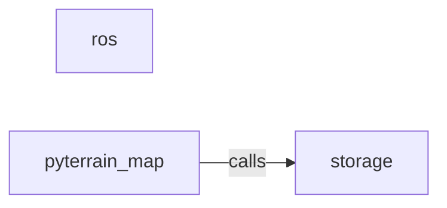

_Generated by CodeAtlas._

## Details

Owns 67 symbols across 6 file(s).

### ros

Owns 9 symbols across 2 file(s).

**Related Classes/Methods:** _None_

**Source Files:**

- `python/pyterrain_map/ros/bridge.py`
  - `python.pyterrain_map.ros.bridge.PyTerrainROSBridge`
  - `python.pyterrain_map.ros.bridge.PyTerrainROSBridge.__init__`
  - `python.pyterrain_map.ros.bridge.PyTerrainROSBridge._build_adapters`
  - `python.pyterrain_map.ros.bridge.PyTerrainROSBridge._extract_transforms`
  - `python.pyterrain_map.ros.bridge.PyTerrainROSBridge.attach_to_node`
  - `python.pyterrain_map.ros.bridge.PyTerrainROSBridge.get_stats`
  - `python.pyterrain_map.ros.bridge.PyTerrainROSBridge.on_message`
  - `python.pyterrain_map.ros.bridge.PyTerrainROSBridge.on_tf_message`
  - `python.pyterrain_map.ros.bridge.PyTerrainROSBridge.set_origin`

### storage

Owns 55 symbols across 6 file(s).

**Related Classes/Methods:** _None_

**Source Files:**

- `python/pyterrain_map/storage/adls.py`
  - `python.pyterrain_map.storage.adls.ADLSStorageBackend`
  - `python.pyterrain_map.storage.adls.ADLSStorageBackend.__init__`
  - `python.pyterrain_map.storage.adls.ADLSStorageBackend._get_file_path`
  - `python.pyterrain_map.storage.adls.ADLSStorageBackend.connect`
  - `python.pyterrain_map.storage.adls.ADLSStorageBackend.delete_old`
  - `python.pyterrain_map.storage.adls.ADLSStorageBackend.get_stats`
  - `python.pyterrain_map.storage.adls.ADLSStorageBackend.query`
  - `python.pyterrain_map.storage.adls.ADLSStorageBackend.write_batch`
  - `python.pyterrain_map.storage.adls.ADLSStorageBackend.write_observation`
- `python/pyterrain_map/storage/base.py`
  - `python.pyterrain_map.storage.base.StorageBackend`
  - `python.pyterrain_map.storage.base.StorageBackend.__init__`
  - `python.pyterrain_map.storage.base.StorageBackend._matches_filters`
  - `python.pyterrain_map.storage.base.StorageBackend._partition_key`
  - `python.pyterrain_map.storage.base.StorageBackend.connect`
  - `python.pyterrain_map.storage.base.StorageBackend.delete_old`
  - `python.pyterrain_map.storage.base.StorageBackend.get_stats`
  - `python.pyterrain_map.storage.base.StorageBackend.health_check`
  - `python.pyterrain_map.storage.base.StorageBackend.query`
  - `python.pyterrain_map.storage.base.StorageBackend.write_batch`
  - `python.pyterrain_map.storage.base.StorageBackend.write_observation`
  - `python.pyterrain_map.storage.base.StorageFactory`
  - `python.pyterrain_map.storage.base.StorageFactory.create`
  - `python.pyterrain_map.storage.base.StorageFactory.list_backends`
  - `python.pyterrain_map.storage.base.StorageFactory.register`
  - `python.pyterrain_map.storage.base.StorageObservation`
  - `python.pyterrain_map.storage.base.StorageObservation.from_json`
  - `python.pyterrain_map.storage.base.StorageObservation.to_dict`
  - `python.pyterrain_map.storage.base.StorageObservation.to_json`
- `python/pyterrain_map/storage/gcs.py`
  - `python.pyterrain_map.storage.gcs.GCSStorageBackend`
  - `python.pyterrain_map.storage.gcs.GCSStorageBackend.__init__`
  - `python.pyterrain_map.storage.gcs.GCSStorageBackend._get_blob_name`
  - `python.pyterrain_map.storage.gcs.GCSStorageBackend.connect`
  - `python.pyterrain_map.storage.gcs.GCSStorageBackend.delete_old`
  - `python.pyterrain_map.storage.gcs.GCSStorageBackend.get_stats`
  - `python.pyterrain_map.storage.gcs.GCSStorageBackend.query`
  - `python.pyterrain_map.storage.gcs.GCSStorageBackend.write_batch`
  - `python.pyterrain_map.storage.gcs.GCSStorageBackend.write_observation`
- `python/pyterrain_map/storage/local.py`
  - `python.pyterrain_map.storage.local.LocalStorageBackend`
  - `python.pyterrain_map.storage.local.LocalStorageBackend.__init__`
  - `python.pyterrain_map.storage.local.LocalStorageBackend._get_file_path`
  - `python.pyterrain_map.storage.local.LocalStorageBackend.connect`
  - `python.pyterrain_map.storage.local.LocalStorageBackend.delete_old`
  - `python.pyterrain_map.storage.local.LocalStorageBackend.get_stats`
  - `python.pyterrain_map.storage.local.LocalStorageBackend.query`
  - `python.pyterrain_map.storage.local.LocalStorageBackend.write_batch`
  - `python.pyterrain_map.storage.local.LocalStorageBackend.write_observation`
- `python/pyterrain_map/storage/s3.py`
  - `python.pyterrain_map.storage.s3.S3StorageBackend`
  - `python.pyterrain_map.storage.s3.S3StorageBackend.__init__`
  - `python.pyterrain_map.storage.s3.S3StorageBackend._get_object_key`
  - `python.pyterrain_map.storage.s3.S3StorageBackend.connect`
  - `python.pyterrain_map.storage.s3.S3StorageBackend.delete_old`
  - `python.pyterrain_map.storage.s3.S3StorageBackend.get_stats`
  - `python.pyterrain_map.storage.s3.S3StorageBackend.query`
  - `python.pyterrain_map.storage.s3.S3StorageBackend.write_batch`
  - `python.pyterrain_map.storage.s3.S3StorageBackend.write_observation`
