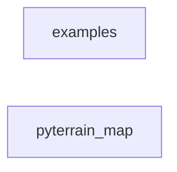

_Generated by CodeAtlas._

## Details

Owns 0 symbols across 0 file(s).

### examples

Owns 2 symbols across 2 file(s).

**Related Classes/Methods:** _None_

**Source Files:**

- `python/examples/01_quick_start.py`
  - `python.examples.01_quick_start.main`
- `python/examples/basic_analysis.py`
  - `python.examples.basic_analysis.main`

### pyterrain_map

Owns 67 symbols across 6 file(s).

**Related Classes/Methods:** _None_

**Source Files:**

- `python/pyterrain_map/__init__.py`
  - `python.pyterrain_map.__init__.Persona`
- `python/pyterrain_map/api.py`
  - `python.pyterrain_map.api.PyTerrainMapClient`
  - `python.pyterrain_map.api.PyTerrainMapClient.__init__`
  - `python.pyterrain_map.api.PyTerrainMapClient._load_config`
  - `python.pyterrain_map.api.PyTerrainMapClient.connect`
  - `python.pyterrain_map.api.PyTerrainMapClient.push_batch`
  - `python.pyterrain_map.api.PyTerrainMapClient.push_observation`
  - `python.pyterrain_map.api.PyTerrainMapClient.query`
  - `python.pyterrain_map.api.PyTerrainMapSetup`
  - `python.pyterrain_map.api.PyTerrainMapSetup.__init__`
  - `python.pyterrain_map.api.PyTerrainMapSetup.configure_multi_warehouse`
  - `python.pyterrain_map.api.PyTerrainMapSetup.configure_warehouse`
  - `python.pyterrain_map.api.PyTerrainMapSetup.from_env`
  - `python.pyterrain_map.api.PyTerrainMapSetup.get_config`
  - `python.pyterrain_map.api.PyTerrainMapSetup.get_config_file`
  - `python.pyterrain_map.api.PyTerrainMapSetup.get_credential_file`
  - `python.pyterrain_map.api.PyTerrainMapSetup.interactive_setup`
- `python/pyterrain_map/cli.py`
  - `python.pyterrain_map.cli._bounding_box`
  - `python.pyterrain_map.cli._parse_timestamp`
  - `python.pyterrain_map.cli._resolve_observations_dir`
  - `python.pyterrain_map.cli._run_query`
  - `python.pyterrain_map.cli.configure_command`
  - `python.pyterrain_map.cli.main`
  - `python.pyterrain_map.cli.query_command`
  - `python.pyterrain_map.cli.setup_command`
  - `python.pyterrain_map.cli.version_command`
- `python/pyterrain_map/setup_wizard.py`
  - `python.pyterrain_map.setup_wizard.DataWarehouse`
  - `python.pyterrain_map.setup_wizard.SetupWizard`
  - `python.pyterrain_map.setup_wizard.SetupWizard.__init__`
  - `python.pyterrain_map.setup_wizard.SetupWizard._collect_credentials`
  - `python.pyterrain_map.setup_wizard.SetupWizard._configure_bigquery`
  - `python.pyterrain_map.setup_wizard.SetupWizard._configure_duckdb`
  - `python.pyterrain_map.setup_wizard.SetupWizard._configure_optional_features`
  - `python.pyterrain_map.setup_wizard.SetupWizard._configure_postgresql`
  - `python.pyterrain_map.setup_wizard.SetupWizard._configure_s3`
  - `python.pyterrain_map.setup_wizard.SetupWizard._configure_snowflake`
  - `python.pyterrain_map.setup_wizard.SetupWizard._load_config`
  - `python.pyterrain_map.setup_wizard.SetupWizard._print_header`
  - `python.pyterrain_map.setup_wizard.SetupWizard._print_option`
  - `python.pyterrain_map.setup_wizard.SetupWizard._prompt_yes_no`
  - `python.pyterrain_map.setup_wizard.SetupWizard._save_config`
  - `python.pyterrain_map.setup_wizard.SetupWizard._save_credentials`
  - `python.pyterrain_map.setup_wizard.SetupWizard._select_multiple_warehouses`
  - `python.pyterrain_map.setup_wizard.SetupWizard._select_warehouse`
  - `python.pyterrain_map.setup_wizard.SetupWizard._test_connection`
  - `python.pyterrain_map.setup_wizard.SetupWizard.run`
  - `python.pyterrain_map.setup_wizard.main`
- `python/pyterrain_map/statguardian_integration.py`
  - `python.pyterrain_map.statguardian_integration.MultiSensorConsistencyContract`
  - `python.pyterrain_map.statguardian_integration.MultiSensorConsistencyContract.__init__`
  - `python.pyterrain_map.statguardian_integration.MultiSensorConsistencyContract.validate_consistency`
  - `python.pyterrain_map.statguardian_integration.SensorCalibrationContract`
  - `python.pyterrain_map.statguardian_integration.SensorCalibrationContract.__init__`
  - `python.pyterrain_map.statguardian_integration.SensorCalibrationContract.validate_sensor`
  - `python.pyterrain_map.statguardian_integration.SensorValidation`
  - `python.pyterrain_map.statguardian_integration.StatGuardianTerrainMapper`
  - `python.pyterrain_map.statguardian_integration.StatGuardianTerrainMapper.__init__`
  - `python.pyterrain_map.statguardian_integration.StatGuardianTerrainMapper._calculate_compliance_score`
  - `python.pyterrain_map.statguardian_integration.StatGuardianTerrainMapper._generate_quality_regions`
  - `python.pyterrain_map.statguardian_integration.StatGuardianTerrainMapper._log_validation`
  - `python.pyterrain_map.statguardian_integration.StatGuardianTerrainMapper.add_sensor_with_validation`
  - `python.pyterrain_map.statguardian_integration.StatGuardianTerrainMapper.finalize_terrain_with_validation`
  - `python.pyterrain_map.statguardian_integration.TemporalCoordinateContract`
  - `python.pyterrain_map.statguardian_integration.TemporalCoordinateContract.__init__`
  - `python.pyterrain_map.statguardian_integration.TemporalCoordinateContract.validate_coordinates`
  - `python.pyterrain_map.statguardian_integration.TerrainMappingAnomalyContract`
  - `python.pyterrain_map.statguardian_integration.TerrainMappingAnomalyContract.__init__`
  - `python.pyterrain_map.statguardian_integration.TerrainMappingAnomalyContract.validate_terrain`
