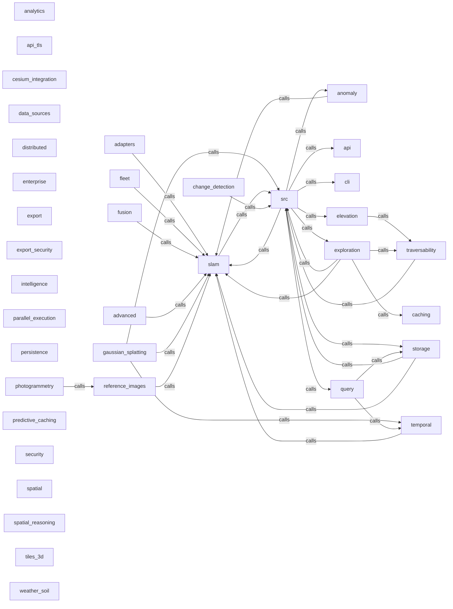

_Generated by CodeAtlas._

## Details

Owns 377 symbols across 10 file(s).

### adapters

Owns 55 symbols across 4 file(s).

**Related Classes/Methods:** _None_

**Source Files:**

- `src/adapters/data_contracts.rs`
  - `src.adapters.data_contracts.LineageEntry`
  - `src.adapters.data_contracts.LineageTracker`
  - `src.adapters.data_contracts.LineageTracker.default`
  - `src.adapters.data_contracts.LineageTracker.get_history`
  - `src.adapters.data_contracts.LineageTracker.get_lineage`
  - `src.adapters.data_contracts.LineageTracker.new`
  - `src.adapters.data_contracts.LineageTracker.record_entry`
  - `src.adapters.data_contracts.UnifiedObservationSchema`
  - `src.adapters.data_contracts.UnifiedObservationSchema.v1_0`
  - `src.adapters.data_contracts.UnifiedObservationSchema.validate`
  - `src.adapters.data_contracts.tests.create_valid_observation`
  - `src.adapters.data_contracts.tests.test_lineage_history`
  - `src.adapters.data_contracts.tests.test_lineage_missing_observation`
  - `src.adapters.data_contracts.tests.test_lineage_recording`
  - `src.adapters.data_contracts.tests.test_lineage_tracker_creation`
  - `src.adapters.data_contracts.tests.test_schema_creation`
  - `src.adapters.data_contracts.tests.test_schema_validation_missing_episode_id`
  - `src.adapters.data_contracts.tests.test_schema_validation_temporal_consistency`
  - `src.adapters.data_contracts.tests.test_schema_validation_valid`
- `src/adapters/pyroboframes_adapter.rs`
  - `src.adapters.pyroboframes_adapter.AlignedDataFrame`
  - `src.adapters.pyroboframes_adapter.RoboticsDataFrameAdapter`
  - `src.adapters.pyroboframes_adapter.RoboticsDataFrameAdapter.ingest_batch`
  - `src.adapters.pyroboframes_adapter.RoboticsDataFrameAdapter.ingest_dataframe`
  - `src.adapters.pyroboframes_adapter.RoboticsDataFrameAdapter.new`
  - `src.adapters.pyroboframes_adapter.RoboticsDataFrameAdapter.set_ingestion_time`
  - `src.adapters.pyroboframes_adapter.SensorReading`
  - `src.adapters.pyroboframes_adapter.tests.create_test_dataframe`
  - `src.adapters.pyroboframes_adapter.tests.test_adapter_creation`
  - `src.adapters.pyroboframes_adapter.tests.test_empty_dataframe_error`
  - `src.adapters.pyroboframes_adapter.tests.test_ingest_batch`
  - `src.adapters.pyroboframes_adapter.tests.test_ingest_multi_sensor_dataframe`
  - `src.adapters.pyroboframes_adapter.tests.test_ingest_single_sensor_dataframe`
  - `src.adapters.pyroboframes_adapter.tests.test_provenance_tracking`
  - `src.adapters.pyroboframes_adapter.tests.test_temporal_metadata_preservation`
- `src/adapters/pyrobovision_adapter.rs`
  - `src.adapters.pyrobovision_adapter.ModelMetrics`
  - `src.adapters.pyrobovision_adapter.VisionModelAwareAdapter`
  - `src.adapters.pyrobovision_adapter.VisionModelAwareAdapter.compute_fusion_weight`
  - `src.adapters.pyrobovision_adapter.VisionModelAwareAdapter.new`
  - `src.adapters.pyrobovision_adapter.VisionModelAwareAdapter.select_best_model`
  - `src.adapters.pyrobovision_adapter.VisionModelAwareAdapter.set_terrain`
  - `src.adapters.pyrobovision_adapter.VisionModelAwareAdapter.validate_consensus`
  - `src.adapters.pyrobovision_adapter.VisionModelRegistry`
  - `src.adapters.pyrobovision_adapter.VisionModelRegistry.default`
  - `src.adapters.pyrobovision_adapter.VisionModelRegistry.get_model`
  - `src.adapters.pyrobovision_adapter.VisionModelRegistry.get_models_for_terrain`
  - `src.adapters.pyrobovision_adapter.VisionModelRegistry.new`
  - `src.adapters.pyrobovision_adapter.VisionModelRegistry.register`
  - `src.adapters.pyrobovision_adapter.tests.create_test_registry`
  - `src.adapters.pyrobovision_adapter.tests.test_adapter_creation`
  - `src.adapters.pyrobovision_adapter.tests.test_compute_fusion_weight`
  - `src.adapters.pyrobovision_adapter.tests.test_disabled_model_error`
  - `src.adapters.pyrobovision_adapter.tests.test_multi_model_consensus_disagreement`
  - `src.adapters.pyrobovision_adapter.tests.test_multi_model_consensus_perfect_agreement`
  - `src.adapters.pyrobovision_adapter.tests.test_select_best_model_rocky_day`
  - `src.adapters.pyrobovision_adapter.tests.test_select_best_model_rocky_night`

### advanced

Owns 153 symbols across 6 file(s).

**Related Classes/Methods:** _None_

**Source Files:**

- `src/advanced/caching.rs`
  - `src.advanced.caching.CacheEntry`
  - `src.advanced.caching.CacheEntry.access`
  - `src.advanced.caching.CacheEntry.age_us`
  - `src.advanced.caching.CacheEntry.new`
  - `src.advanced.caching.CacheEntry.time_since_access_us`
  - `src.advanced.caching.CacheStatistics`
  - `src.advanced.caching.CacheStatistics.combined_hit_rate`
  - `src.advanced.caching.CacheTier`
  - `src.advanced.caching.L1Cache`
  - `src.advanced.caching.L1Cache.clear`
  - `src.advanced.caching.L1Cache.default`
  - `src.advanced.caching.L1Cache.evict_lru`
  - `src.advanced.caching.L1Cache.get`
  - `src.advanced.caching.L1Cache.hit_rate`
  - `src.advanced.caching.L1Cache.new`
  - `src.advanced.caching.L1Cache.put`
  - `src.advanced.caching.L2Cache`
  - `src.advanced.caching.L2Cache.default`
  - `src.advanced.caching.L2Cache.get`
  - `src.advanced.caching.L2Cache.hit_rate`
  - `src.advanced.caching.L2Cache.new`
  - `src.advanced.caching.L2Cache.put`
  - `src.advanced.caching.MultiTierCache`
  - `src.advanced.caching.MultiTierCache.clear`
  - `src.advanced.caching.MultiTierCache.default`
  - `src.advanced.caching.MultiTierCache.get`
  - `src.advanced.caching.MultiTierCache.new`
  - `src.advanced.caching.MultiTierCache.put`
  - `src.advanced.caching.MultiTierCache.statistics`
  - `src.advanced.caching.tests.test_cache_entry`
  - `src.advanced.caching.tests.test_cache_statistics`
  - `src.advanced.caching.tests.test_l1_cache_hit_rate`
  - `src.advanced.caching.tests.test_l1_cache_miss`
  - `src.advanced.caching.tests.test_l1_cache_put_get`
  - `src.advanced.caching.tests.test_multi_tier_cache`
- `src/advanced/mod.rs`
  - `src.advanced.mod.AdvancedCapabilities`
  - `src.advanced.mod.AdvancedCapabilities.default`
  - `src.advanced.mod.AdvancedCapabilities.new`
- `src/advanced/profiling.rs`
  - `src.advanced.profiling.OperationTimer`
  - `src.advanced.profiling.OperationTimer.elapsed_us`
  - `src.advanced.profiling.OperationTimer.finish`
  - `src.advanced.profiling.OperationTimer.start`
  - `src.advanced.profiling.PerformanceMetrics`
  - `src.advanced.profiling.PerformanceMetrics.new`
  - `src.advanced.profiling.PerformanceProfiler`
  - `src.advanced.profiling.PerformanceProfiler.clear`
  - `src.advanced.profiling.PerformanceProfiler.default`
  - `src.advanced.profiling.PerformanceProfiler.get_all_stats`
  - `src.advanced.profiling.PerformanceProfiler.get_stats`
  - `src.advanced.profiling.PerformanceProfiler.new`
  - `src.advanced.profiling.PerformanceProfiler.record`
  - `src.advanced.profiling.PerformanceProfiler.start_timer`
  - `src.advanced.profiling.PerformanceProfiler.summary`
  - `src.advanced.profiling.PerformanceStats`
  - `src.advanced.profiling.PerformanceStats.from_metrics`
  - `src.advanced.profiling.ProfilerSummary`
  - `src.advanced.profiling.tests.test_operation_timer`
  - `src.advanced.profiling.tests.test_performance_metrics`
  - `src.advanced.profiling.tests.test_performance_stats`
  - `src.advanced.profiling.tests.test_profiler`
  - `src.advanced.profiling.tests.test_profiler_summary`
- `src/advanced/query_opt.rs`
  - `src.advanced.query_opt.CostModel`
  - `src.advanced.query_opt.CostModel.apply_cache_benefit`
  - `src.advanced.query_opt.CostModel.default`
  - `src.advanced.query_opt.CostModel.filter_cost`
  - `src.advanced.query_opt.CostModel.index_scan_cost`
  - `src.advanced.query_opt.CostModel.new`
  - `src.advanced.query_opt.CostModel.seq_scan_cost`
  - `src.advanced.query_opt.ExecutionPlan`
  - `src.advanced.query_opt.ExecutionPlan.add_step`
  - `src.advanced.query_opt.ExecutionPlan.complexity`
  - `src.advanced.query_opt.ExecutionPlan.new`
  - `src.advanced.query_opt.PlanStatistics`
  - `src.advanced.query_opt.QueryOptimizer`
  - `src.advanced.query_opt.QueryOptimizer.default`
  - `src.advanced.query_opt.QueryOptimizer.new`
  - `src.advanced.query_opt.QueryOptimizer.plan_aggregation_query`
  - `src.advanced.query_opt.QueryOptimizer.plan_nearest_neighbor_query`
  - `src.advanced.query_opt.QueryOptimizer.plan_spatio_temporal_query`
  - `src.advanced.query_opt.QueryOptimizer.plan_statistics`
  - `src.advanced.query_opt.QueryStatistics`
  - `src.advanced.query_opt.QueryStatistics.default`
  - `src.advanced.query_opt.QueryStatistics.new`
  - `src.advanced.query_opt.QueryStep`
  - `src.advanced.query_opt.QueryStep.new`
  - `src.advanced.query_opt.StepType`
  - `src.advanced.query_opt.tests.test_cost_model`
  - `src.advanced.query_opt.tests.test_cost_model_with_cache_benefit`
  - `src.advanced.query_opt.tests.test_execution_plan`
  - `src.advanced.query_opt.tests.test_optimizer_statistics`
  - `src.advanced.query_opt.tests.test_query_optimizer_aggregation`
  - `src.advanced.query_opt.tests.test_query_optimizer_nearest_neighbor`
  - `src.advanced.query_opt.tests.test_query_optimizer_spatio_temporal`
- `src/advanced/sensor_fusion.rs`
  - `src.advanced.sensor_fusion.FusedObservation`
  - `src.advanced.sensor_fusion.FusedObservation.new`
  - `src.advanced.sensor_fusion.FusionMethod`
  - `src.advanced.sensor_fusion.FusionStatistics`
  - `src.advanced.sensor_fusion.SensorFusionEngine`
  - `src.advanced.sensor_fusion.SensorFusionEngine.add_observation`
  - `src.advanced.sensor_fusion.SensorFusionEngine.default`
  - `src.advanced.sensor_fusion.SensorFusionEngine.fuse_average`
  - `src.advanced.sensor_fusion.SensorFusionEngine.fuse_weighted`
  - `src.advanced.sensor_fusion.SensorFusionEngine.get_sensor`
  - `src.advanced.sensor_fusion.SensorFusionEngine.new`
  - `src.advanced.sensor_fusion.SensorFusionEngine.register_sensor`
  - `src.advanced.sensor_fusion.SensorFusionEngine.statistics`
  - `src.advanced.sensor_fusion.SensorId`
  - `src.advanced.sensor_fusion.SensorId.new`
  - `src.advanced.sensor_fusion.SensorObservation`
  - `src.advanced.sensor_fusion.SensorObservation.effective_quality`
  - `src.advanced.sensor_fusion.SensorObservation.new`
  - `src.advanced.sensor_fusion.SensorSpec`
  - `src.advanced.sensor_fusion.SensorSpec.new`
  - `src.advanced.sensor_fusion.SensorSpec.quality_score`
  - `src.advanced.sensor_fusion.SensorType`
  - `src.advanced.sensor_fusion.SensorType.default_accuracy`
  - `src.advanced.sensor_fusion.SensorType.default_frequency`
  - `src.advanced.sensor_fusion.SensorType.default_range`
  - `src.advanced.sensor_fusion.tests.test_fuse_average`
  - `src.advanced.sensor_fusion.tests.test_fusion_engine`
  - `src.advanced.sensor_fusion.tests.test_fusion_statistics`
  - `src.advanced.sensor_fusion.tests.test_sensor_observation`
  - `src.advanced.sensor_fusion.tests.test_sensor_spec`
  - `src.advanced.sensor_fusion.tests.test_sensor_type_defaults`
- `src/advanced/streaming.rs`
  - `src.advanced.streaming.StreamBatch`
  - `src.advanced.streaming.StreamBatch.add_point`
  - `src.advanced.streaming.StreamBatch.complete`
  - `src.advanced.streaming.StreamBatch.latency_us`
  - `src.advanced.streaming.StreamBatch.new`
  - `src.advanced.streaming.StreamBatch.size`
  - `src.advanced.streaming.StreamResult`
  - `src.advanced.streaming.StreamWindow`
  - `src.advanced.streaming.StreamWindow.new`
  - `src.advanced.streaming.StreamWindow.overlap_ratio`
  - `src.advanced.streaming.StreamingPipeline`
  - `src.advanced.streaming.StreamingPipeline.add_point`
  - `src.advanced.streaming.StreamingPipeline.calculate_throughput`
  - `src.advanced.streaming.StreamingPipeline.close_window`
  - `src.advanced.streaming.StreamingPipeline.default`
  - `src.advanced.streaming.StreamingPipeline.flush_batch`
  - `src.advanced.streaming.StreamingPipeline.new`
  - `src.advanced.streaming.StreamingPipeline.statistics`
  - `src.advanced.streaming.StreamingPipeline.update_windows`
  - `src.advanced.streaming.StreamingStatistics`
  - `src.advanced.streaming.WindowState`
  - `src.advanced.streaming.WindowState.is_point_after_window`
  - `src.advanced.streaming.WindowState.new`
  - `src.advanced.streaming.WindowState.try_add_point`
  - `src.advanced.streaming.tests.test_stream_batch`
  - `src.advanced.streaming.tests.test_stream_window`
  - `src.advanced.streaming.tests.test_streaming_pipeline`
  - `src.advanced.streaming.tests.test_streaming_statistics`
  - `src.advanced.streaming.tests.test_window_state`

### analytics

Owns 88 symbols across 6 file(s).

**Related Classes/Methods:** _None_

**Source Files:**

- `src/analytics/anomaly.rs`
  - `src.analytics.anomaly.AnomalyDetector`
  - `src.analytics.anomaly.AnomalyDetector.default`
  - `src.analytics.anomaly.AnomalyDetector.detect_level_shift`
  - `src.analytics.anomaly.AnomalyDetector.detect_z_score_anomaly`
  - `src.analytics.anomaly.AnomalyDetector.new`
  - `src.analytics.anomaly.AnomalyDetector.process_point`
  - `src.analytics.anomaly.AnomalyDetector.statistics`
  - `src.analytics.anomaly.AnomalyStatistics`
  - `src.analytics.anomaly.AnomalyType`
  - `src.analytics.anomaly.DetectedAnomaly`
  - `src.analytics.anomaly.DetectedAnomaly.new`
  - `src.analytics.anomaly.tests.test_anomaly_detector_creation`
  - `src.analytics.anomaly.tests.test_anomaly_detector_processing`
  - `src.analytics.anomaly.tests.test_anomaly_statistics`
  - `src.analytics.anomaly.tests.test_detected_anomaly`
- `src/analytics/changepoint.rs`
  - `src.analytics.changepoint.ChangePoint`
  - `src.analytics.changepoint.ChangePoint.new`
  - `src.analytics.changepoint.ChangePointDetector`
  - `src.analytics.changepoint.ChangePointDetector.analyze_window`
  - `src.analytics.changepoint.ChangePointDetector.compute_slope`
  - `src.analytics.changepoint.ChangePointDetector.default`
  - `src.analytics.changepoint.ChangePointDetector.detect`
  - `src.analytics.changepoint.ChangePointDetector.detect_trend_change`
  - `src.analytics.changepoint.ChangePointDetector.new`
  - `src.analytics.changepoint.ChangePointDetector.statistics`
  - `src.analytics.changepoint.ChangePointStatistics`
  - `src.analytics.changepoint.ChangeType`
  - `src.analytics.changepoint.tests.test_change_point`
  - `src.analytics.changepoint.tests.test_detector`
  - `src.analytics.changepoint.tests.test_detector_detect`
- `src/analytics/mod.rs`
  - `src.analytics.mod.AnalyticsCapabilities`
  - `src.analytics.mod.AnalyticsCapabilities.default`
  - `src.analytics.mod.AnalyticsCapabilities.new`
- `src/analytics/prediction.rs`
  - `src.analytics.prediction.ElevationPrediction`
  - `src.analytics.prediction.ElevationPrediction.new`
  - `src.analytics.prediction.PredictionModel`
  - `src.analytics.prediction.PredictionStatistics`
  - `src.analytics.prediction.RegressionCoefficients`
  - `src.analytics.prediction.RegressionCoefficients.default`
  - `src.analytics.prediction.RegressionCoefficients.new`
  - `src.analytics.prediction.RegressionCoefficients.predict`
  - `src.analytics.prediction.TerrainPredictor`
  - `src.analytics.prediction.TerrainPredictor.add_sample`
  - `src.analytics.prediction.TerrainPredictor.default`
  - `src.analytics.prediction.TerrainPredictor.new`
  - `src.analytics.prediction.TerrainPredictor.predict_idw`
  - `src.analytics.prediction.TerrainPredictor.predict_regression`
  - `src.analytics.prediction.TerrainPredictor.statistics`
  - `src.analytics.prediction.TerrainPredictor.train_linear`
  - `src.analytics.prediction.TrainingSample`
  - `src.analytics.prediction.tests.test_elevation_prediction`
  - `src.analytics.prediction.tests.test_predictor_idw`
  - `src.analytics.prediction.tests.test_predictor_statistics`
  - `src.analytics.prediction.tests.test_regression_coefficients`
  - `src.analytics.prediction.tests.test_terrain_predictor`
  - `src.analytics.prediction.tests.test_training_sample`
- `src/analytics/risk.rs`
  - `src.analytics.risk.RiskAlert`
  - `src.analytics.risk.RiskAlert.new`
  - `src.analytics.risk.RiskFactor`
  - `src.analytics.risk.RiskFactor.new`
  - `src.analytics.risk.RiskFactor.weighted_severity`
  - `src.analytics.risk.RiskLevel`
  - `src.analytics.risk.RiskLevel.threshold`
  - `src.analytics.risk.RiskScorer`
  - `src.analytics.risk.RiskScorer.add_factor`
  - `src.analytics.risk.RiskScorer.default`
  - `src.analytics.risk.RiskScorer.new`
  - `src.analytics.risk.RiskScorer.score_point`
  - `src.analytics.risk.RiskScorer.statistics`
  - `src.analytics.risk.RiskStatistics`
  - `src.analytics.risk.tests.test_risk_alert`
  - `src.analytics.risk.tests.test_risk_factor`
  - `src.analytics.risk.tests.test_risk_scorer`
  - `src.analytics.risk.tests.test_risk_statistics`
  - `src.analytics.risk.tests.test_score_point`
- `src/analytics/trends.rs`
  - `src.analytics.trends.TrendAnalyzer`
  - `src.analytics.trends.TrendAnalyzer.analyze`
  - `src.analytics.trends.TrendAnalyzer.default`
  - `src.analytics.trends.TrendAnalyzer.moving_average`
  - `src.analytics.trends.TrendAnalyzer.new`
  - `src.analytics.trends.TrendAnalyzer.statistics`
  - `src.analytics.trends.TrendDirection`
  - `src.analytics.trends.TrendForecast`
  - `src.analytics.trends.TrendForecast.new`
  - `src.analytics.trends.TrendStatistics`
  - `src.analytics.trends.tests.test_trend_analyze`
  - `src.analytics.trends.tests.test_trend_analyzer`
  - `src.analytics.trends.tests.test_trend_forecast`

### anomaly

Owns 29 symbols across 1 file(s).

**Related Classes/Methods:** _None_

**Source Files:**

- `src/anomaly/mod.rs`
  - `src.anomaly.mod.AnomalyDetector`
  - `src.anomaly.mod.AnomalyDetector.aggressive`
  - `src.anomaly.mod.AnomalyDetector.default`
  - `src.anomaly.mod.AnomalyDetector.detect`
  - `src.anomaly.mod.AnomalyDetector.detect_drift`
  - `src.anomaly.mod.AnomalyDetector.detect_iqr`
  - `src.anomaly.mod.AnomalyDetector.detect_rogue_bot`
  - `src.anomaly.mod.AnomalyDetector.detect_spike`
  - `src.anomaly.mod.AnomalyDetector.detect_zscore`
  - `src.anomaly.mod.AnomalyDetector.new`
  - `src.anomaly.mod.AnomalyStats`
  - `src.anomaly.mod.AnomalyStats.anomaly_rate`
  - `src.anomaly.mod.AnomalyStats.default`
  - `src.anomaly.mod.AnomalyStats.new`
  - `src.anomaly.mod.AnomalyStats.update`
  - `src.anomaly.mod.AnomalyType`
  - `src.anomaly.mod.tests.create_obs`
  - `src.anomaly.mod.tests.test_anomaly_stats`
  - `src.anomaly.mod.tests.test_combined_detection`
  - `src.anomaly.mod.tests.test_detector_creation`
  - `src.anomaly.mod.tests.test_drift_detection`
  - `src.anomaly.mod.tests.test_iqr_detection`
  - `src.anomaly.mod.tests.test_non_temperature_observations`
  - `src.anomaly.mod.tests.test_rogue_bot_detection`
  - `src.anomaly.mod.tests.test_rogue_bot_normal`
  - `src.anomaly.mod.tests.test_spike_detection`
  - `src.anomaly.mod.tests.test_zero_variance_baseline`
  - `src.anomaly.mod.tests.test_zscore_normal`
  - `src.anomaly.mod.tests.test_zscore_outlier`

### api

Owns 46 symbols across 1 file(s).

**Related Classes/Methods:** _None_

**Source Files:**

- `src/api/mod.rs`
  - `src.api.mod.ApiConfig`
  - `src.api.mod.ApiConfig.default`
  - `src.api.mod.ApiConfig.public`
  - `src.api.mod.ApiConfig.secure`
  - `src.api.mod.ApiError`
  - `src.api.mod.ApiError.forbidden`
  - `src.api.mod.ApiError.internal_error`
  - `src.api.mod.ApiError.invalid_request`
  - `src.api.mod.ApiError.new`
  - `src.api.mod.ApiError.not_found`
  - `src.api.mod.ApiError.unauthorized`
  - `src.api.mod.ApiError.with_details`
  - `src.api.mod.ApiRoute`
  - `src.api.mod.ApiRoute.method`
  - `src.api.mod.ApiRoute.path`
  - `src.api.mod.ExportRequest`
  - `src.api.mod.ExportResponse`
  - `src.api.mod.FleetStatus`
  - `src.api.mod.HealthResponse`
  - `src.api.mod.QueryObservationResponse`
  - `src.api.mod.RobotStatusReport`
  - `src.api.mod.SpatialQueryRequest`
  - `src.api.mod.SpatialTemporalQueryRequest`
  - `src.api.mod.SubmitObservationRequest`
  - `src.api.mod.SubmitObservationRequest.parse_sensor_value`
  - `src.api.mod.SubmitObservationRequest.to_observation`
  - `src.api.mod.SubmitObservationResponse`
  - `src.api.mod.TemporalQueryRequest`
  - `src.api.mod.tests.test_api_config_default`
  - `src.api.mod.tests.test_api_config_public`
  - `src.api.mod.tests.test_api_config_secure`
  - `src.api.mod.tests.test_api_error_creation`
  - `src.api.mod.tests.test_api_error_helpers`
  - `src.api.mod.tests.test_api_error_with_details`
  - `src.api.mod.tests.test_api_route_methods`
  - `src.api.mod.tests.test_api_route_paths`
  - `src.api.mod.tests.test_fleet_status`
  - `src.api.mod.tests.test_health_response`
  - `src.api.mod.tests.test_lidar_sensor_parsing`
  - `src.api.mod.tests.test_movement_sensor_parsing`
  - `src.api.mod.tests.test_query_request_serialization`
  - `src.api.mod.tests.test_submission_request_invalid_confidence`
  - `src.api.mod.tests.test_submission_request_invalid_coordinates`
  - `src.api.mod.tests.test_submission_request_invalid_sensor_type`
  - `src.api.mod.tests.test_submission_request_valid`
  - `src.api.mod.tests.test_thermal_sensor_parsing`

### api_tls

Owns 38 symbols across 1 file(s).

**Related Classes/Methods:** _None_

**Source Files:**

- `src/api_tls/mod.rs`
  - `src.api_tls.mod.CertificateInfo`
  - `src.api_tls.mod.CertificateInfo.expiring_soon`
  - `src.api_tls.mod.CertificateInfo.is_expired`
  - `src.api_tls.mod.CertificateValidator`
  - `src.api_tls.mod.CertificateValidator.default`
  - `src.api_tls.mod.CertificateValidator.permissive`
  - `src.api_tls.mod.CertificateValidator.strict`
  - `src.api_tls.mod.HttpsMode`
  - `src.api_tls.mod.HttpsMode.development`
  - `src.api_tls.mod.HttpsMode.from_files`
  - `src.api_tls.mod.HttpsMode.is_secure`
  - `src.api_tls.mod.HttpsMode.mtls`
  - `src.api_tls.mod.HttpsMode.production`
  - `src.api_tls.mod.SecurityHeaders`
  - `src.api_tls.mod.SecurityHeaders.default_secure`
  - `src.api_tls.mod.SecurityHeaders.minimal`
  - `src.api_tls.mod.SecurityHeaders.to_headers`
  - `src.api_tls.mod.TlsConfig`
  - `src.api_tls.mod.TlsVersion`
  - `src.api_tls.mod.TlsVersion.as_str`
  - `src.api_tls.mod.TlsVersion.fmt`
  - `src.api_tls.mod.cipher_suites.balanced`
  - `src.api_tls.mod.cipher_suites.compatible`
  - `src.api_tls.mod.cipher_suites.modern`
  - `src.api_tls.mod.tests.test_certificate_expired`
  - `src.api_tls.mod.tests.test_certificate_info`
  - `src.api_tls.mod.tests.test_certificate_validator_permissive`
  - `src.api_tls.mod.tests.test_certificate_validator_strict`
  - `src.api_tls.mod.tests.test_cipher_suites_balanced`
  - `src.api_tls.mod.tests.test_cipher_suites_modern`
  - `src.api_tls.mod.tests.test_https_mode_is_secure`
  - `src.api_tls.mod.tests.test_https_mode_production`
  - `src.api_tls.mod.tests.test_mtls_configuration`
  - `src.api_tls.mod.tests.test_security_headers_default`
  - `src.api_tls.mod.tests.test_security_headers_minimal`
  - `src.api_tls.mod.tests.test_security_headers_to_headers`
  - `src.api_tls.mod.tests.test_tls_config_from_files`
  - `src.api_tls.mod.tests.test_tls_version_display`

### caching

Owns 44 symbols across 1 file(s).

**Related Classes/Methods:** _None_

**Source Files:**

- `src/caching/mod.rs`
  - `src.caching.mod.BehavioralPattern`
  - `src.caching.mod.CacheEntry`
  - `src.caching.mod.CacheLayer`
  - `src.caching.mod.CacheManager`
  - `src.caching.mod.CacheManager.default`
  - `src.caching.mod.CacheManager.get_for_need`
  - `src.caching.mod.CacheManager.invalidate`
  - `src.caching.mod.CacheManager.new`
  - `src.caching.mod.CacheManager.policy`
  - `src.caching.mod.CacheManager.put_context`
  - `src.caching.mod.CacheManager.put_facts`
  - `src.caching.mod.CacheManager.put_summary`
  - `src.caching.mod.CacheManager.stats`
  - `src.caching.mod.CacheManager.with_policy`
  - `src.caching.mod.CacheQuality`
  - `src.caching.mod.CacheQuality.has_layer`
  - `src.caching.mod.CacheQuality.is_confident`
  - `src.caching.mod.CacheQuality.is_fresh`
  - `src.caching.mod.CacheQuality.set_layer`
  - `src.caching.mod.CacheStats`
  - `src.caching.mod.CacheStats.hit_rate`
  - `src.caching.mod.CacheUpdatePolicy`
  - `src.caching.mod.CacheUpdatePolicy.default`
  - `src.caching.mod.CachedLayer`
  - `src.caching.mod.CachedResult`
  - `src.caching.mod.CachedResult.has_layer`
  - `src.caching.mod.CachedResult.is_empty`
  - `src.caching.mod.Event`
  - `src.caching.mod.InformationNeed`
  - `src.caching.mod.InformationNeed.layers_needed`
  - `src.caching.mod.InformationNeed.target_latency_ms`
  - `src.caching.mod.InvalidationReason`
  - `src.caching.mod.LocationFacts`
  - `src.caching.mod.LocationSummary`
  - `src.caching.mod.ObservationStats`
  - `src.caching.mod.ObstacleSummary`
  - `src.caching.mod.RegionContext`
  - `src.caching.mod.TerrainZone`
  - `src.caching.mod.tests.test_cache_hit_rate`
  - `src.caching.mod.tests.test_cache_invalidation`
  - `src.caching.mod.tests.test_cache_manager_put_get`
  - `src.caching.mod.tests.test_cache_miss`
  - `src.caching.mod.tests.test_cache_quality_tracking`
  - `src.caching.mod.tests.test_information_need_layers`

### cesium_integration

Owns 78 symbols across 1 file(s).

**Related Classes/Methods:** _None_

**Source Files:**

- `src/cesium_integration/mod.rs`
  - `src.cesium_integration.mod.BaseLayer`
  - `src.cesium_integration.mod.BaseLayer.provider_name`
  - `src.cesium_integration.mod.BoundingBox`
  - `src.cesium_integration.mod.BoundingBox.center`
  - `src.cesium_integration.mod.BoundingBox.new`
  - `src.cesium_integration.mod.BoundingBox.size`
  - `src.cesium_integration.mod.CameraPosition`
  - `src.cesium_integration.mod.CameraPosition.default`
  - `src.cesium_integration.mod.CameraPosition.fit_bounds`
  - `src.cesium_integration.mod.CameraPosition.new`
  - `src.cesium_integration.mod.CameraPosition.with_heading`
  - `src.cesium_integration.mod.CameraPosition.with_pitch`
  - `src.cesium_integration.mod.CesiumConfig`
  - `src.cesium_integration.mod.CesiumConfig.add_feature_layer`
  - `src.cesium_integration.mod.CesiumConfig.add_tileset`
  - `src.cesium_integration.mod.CesiumConfig.default`
  - `src.cesium_integration.mod.CesiumConfig.generate_viewer_script`
  - `src.cesium_integration.mod.CesiumConfig.new`
  - `src.cesium_integration.mod.CesiumConfig.set_base_layer`
  - `src.cesium_integration.mod.CesiumConfig.set_terrain`
  - `src.cesium_integration.mod.CesiumIonAsset`
  - `src.cesium_integration.mod.CesiumIonAsset.full_url`
  - `src.cesium_integration.mod.CesiumIonAsset.new`
  - `src.cesium_integration.mod.DataSource`
  - `src.cesium_integration.mod.FeatureLayer`
  - `src.cesium_integration.mod.FeatureLayer.new`
  - `src.cesium_integration.mod.FeatureLayer.with_style`
  - `src.cesium_integration.mod.FeatureLayer.with_visibility`
  - `src.cesium_integration.mod.FeatureStyle`
  - `src.cesium_integration.mod.FeatureStyle.default`
  - `src.cesium_integration.mod.FeatureStyle.new`
  - `src.cesium_integration.mod.FeatureStyle.with_fill_color`
  - `src.cesium_integration.mod.FeatureStyle.with_line_color`
  - `src.cesium_integration.mod.FeatureStyle.with_point_color`
  - `src.cesium_integration.mod.MeasurementTool`
  - `src.cesium_integration.mod.MeasurementTool.area`
  - `src.cesium_integration.mod.MeasurementTool.distance`
  - `src.cesium_integration.mod.TerrainProvider`
  - `src.cesium_integration.mod.TerrainProvider.url_or_default`
  - `src.cesium_integration.mod.TilesetLayer`
  - `src.cesium_integration.mod.TilesetLayer.add_property`
  - `src.cesium_integration.mod.TilesetLayer.new`
  - `src.cesium_integration.mod.TilesetLayer.with_opacity`
  - `src.cesium_integration.mod.TilesetLayer.with_screen_space_error`
  - `src.cesium_integration.mod.TilesetLayer.with_visibility`
  - `src.cesium_integration.mod.TilesetMetadata`
  - `src.cesium_integration.mod.ViewerOptions`
  - `src.cesium_integration.mod.ViewerOptions.default`
  - `src.cesium_integration.mod.ViewerOptions.minimal`
  - `src.cesium_integration.mod.ViewerOptions.new`
  - `src.cesium_integration.mod.tests.test_base_layer_provider_name`
  - `src.cesium_integration.mod.tests.test_bounding_box_center`
  - `src.cesium_integration.mod.tests.test_bounding_box_creation`
  - `src.cesium_integration.mod.tests.test_bounding_box_size`
  - `src.cesium_integration.mod.tests.test_camera_position_creation`
  - `src.cesium_integration.mod.tests.test_camera_position_fit_bounds`
  - `src.cesium_integration.mod.tests.test_camera_position_pitch_clamping`
  - `src.cesium_integration.mod.tests.test_camera_position_with_heading`
  - `src.cesium_integration.mod.tests.test_cesium_config_add_tileset`
  - `src.cesium_integration.mod.tests.test_cesium_config_base_layer`
  - `src.cesium_integration.mod.tests.test_cesium_config_creation`
  - `src.cesium_integration.mod.tests.test_cesium_config_serialization`
  - `src.cesium_integration.mod.tests.test_cesium_ion_asset`
  - `src.cesium_integration.mod.tests.test_data_source_geojson`
  - `src.cesium_integration.mod.tests.test_data_source_wms`
  - `src.cesium_integration.mod.tests.test_feature_layer_creation`
  - `src.cesium_integration.mod.tests.test_feature_style_creation`
  - `src.cesium_integration.mod.tests.test_feature_style_with_colors`
  - `src.cesium_integration.mod.tests.test_measurement_tool_area`
  - `src.cesium_integration.mod.tests.test_measurement_tool_distance`
  - `src.cesium_integration.mod.tests.test_terrain_provider_cesium_ion`
  - `src.cesium_integration.mod.tests.test_terrain_provider_usgs`
  - `src.cesium_integration.mod.tests.test_tileset_layer_add_property`
  - `src.cesium_integration.mod.tests.test_tileset_layer_creation`
  - `src.cesium_integration.mod.tests.test_tileset_layer_opacity_clamping`
  - `src.cesium_integration.mod.tests.test_tileset_layer_with_opacity`
  - `src.cesium_integration.mod.tests.test_viewer_options_default`
  - `src.cesium_integration.mod.tests.test_viewer_options_minimal`

### change_detection

Owns 44 symbols across 1 file(s).

**Related Classes/Methods:** _None_

**Source Files:**

- `src/change_detection/mod.rs`
  - `src.change_detection.mod.ChangeDetectionResult`
  - `src.change_detection.mod.ChangeDetectionResult.change_percentage`
  - `src.change_detection.mod.ChangeDetectionResult.change_rate_per_second`
  - `src.change_detection.mod.ChangeDetectionResult.new`
  - `src.change_detection.mod.ChangeDetector`
  - `src.change_detection.mod.ChangeDetector.default`
  - `src.change_detection.mod.ChangeDetector.detect_changes`
  - `src.change_detection.mod.ChangeDetector.find_bounds`
  - `src.change_detection.mod.ChangeDetector.new`
  - `src.change_detection.mod.ChangeHeatmap`
  - `src.change_detection.mod.ChangeHeatmap.add_change`
  - `src.change_detection.mod.ChangeHeatmap.new`
  - `src.change_detection.mod.ChangeHeatmap.normalize`
  - `src.change_detection.mod.ChangeMask`
  - `src.change_detection.mod.ChangeMask.changed_cell_count`
  - `src.change_detection.mod.ChangeMask.get_change_intensity`
  - `src.change_detection.mod.ChangeMask.mark_changed`
  - `src.change_detection.mod.ChangeMask.new`
  - `src.change_detection.mod.ChangeMask.total_change_energy`
  - `src.change_detection.mod.ChangeStatistics`
  - `src.change_detection.mod.ChangeTrend`
  - `src.change_detection.mod.TemporalChangesSeries`
  - `src.change_detection.mod.TemporalChangesSeries.add_change`
  - `src.change_detection.mod.TemporalChangesSeries.average_change_rate`
  - `src.change_detection.mod.TemporalChangesSeries.change_trend`
  - `src.change_detection.mod.TemporalChangesSeries.new`
  - `src.change_detection.mod.tests.test_change_detection_result_creation`
  - `src.change_detection.mod.tests.test_change_detector_creation`
  - `src.change_detection.mod.tests.test_change_detector_no_changes`
  - `src.change_detection.mod.tests.test_change_detector_with_movement`
  - `src.change_detection.mod.tests.test_change_heatmap_add_change`
  - `src.change_detection.mod.tests.test_change_heatmap_creation`
  - `src.change_detection.mod.tests.test_change_heatmap_normalize`
  - `src.change_detection.mod.tests.test_change_mask_changed_cell_count`
  - `src.change_detection.mod.tests.test_change_mask_creation`
  - `src.change_detection.mod.tests.test_change_mask_mark_changed`
  - `src.change_detection.mod.tests.test_change_percentage`
  - `src.change_detection.mod.tests.test_change_rate_per_second`
  - `src.change_detection.mod.tests.test_change_statistics_default`
  - `src.change_detection.mod.tests.test_change_trend_decreasing`
  - `src.change_detection.mod.tests.test_temporal_changes_average_rate`
  - `src.change_detection.mod.tests.test_temporal_changes_series_add_change`
  - `src.change_detection.mod.tests.test_temporal_changes_series_creation`
  - `src.change_detection.mod.tests.test_temporal_changes_trend`

### cli

Owns 34 symbols across 1 file(s).

**Related Classes/Methods:** _None_

**Source Files:**

- `src/cli/mod.rs`
  - `src.cli.mod.CLICommand`
  - `src.cli.mod.CLICommand.extract_coordinates`
  - `src.cli.mod.CLICommand.parse`
  - `src.cli.mod.CLIResponse`
  - `src.cli.mod.CLIResponse.add_detail`
  - `src.cli.mod.CLIResponse.add_warning`
  - `src.cli.mod.CLIResponse.error`
  - `src.cli.mod.CLIResponse.format_json`
  - `src.cli.mod.CLIResponse.format_terminal`
  - `src.cli.mod.CLIResponse.success`
  - `src.cli.mod.CLIResponse.with_data`
  - `src.cli.mod.ResponseStatus`
  - `src.cli.mod.help_text`
  - `src.cli.mod.tests.test_case_insensitive`
  - `src.cli.mod.tests.test_cli_response_add_detail`
  - `src.cli.mod.tests.test_cli_response_add_warning`
  - `src.cli.mod.tests.test_cli_response_success`
  - `src.cli.mod.tests.test_extract_coordinates`
  - `src.cli.mod.tests.test_extract_coordinates_with_text`
  - `src.cli.mod.tests.test_help_text`
  - `src.cli.mod.tests.test_invalid_coordinates`
  - `src.cli.mod.tests.test_parse_analyze`
  - `src.cli.mod.tests.test_parse_can_traverse`
  - `src.cli.mod.tests.test_parse_can_traverse_drone`
  - `src.cli.mod.tests.test_parse_error`
  - `src.cli.mod.tests.test_parse_explain`
  - `src.cli.mod.tests.test_parse_help`
  - `src.cli.mod.tests.test_parse_mission`
  - `src.cli.mod.tests.test_parse_risks`
  - `src.cli.mod.tests.test_parse_soil`
  - `src.cli.mod.tests.test_parse_version`
  - `src.cli.mod.tests.test_parse_weather`
  - `src.cli.mod.tests.test_version_text`
  - `src.cli.mod.version_text`

### data_sources

Owns 43 symbols across 1 file(s).

**Related Classes/Methods:** _None_

**Source Files:**

- `src/data_sources/mod.rs`
  - `src.data_sources.mod.ContextEnrichment`
  - `src.data_sources.mod.DataSourceConfig`
  - `src.data_sources.mod.DataSourceConfig.disabled`
  - `src.data_sources.mod.DataSourceConfig.geonames`
  - `src.data_sources.mod.DataSourceConfig.mapillary`
  - `src.data_sources.mod.DataSourceConfig.openstreetmap`
  - `src.data_sources.mod.DataSourceConfig.sentinel2`
  - `src.data_sources.mod.DataSourceConfig.srtm`
  - `src.data_sources.mod.DataSourceRegistry`
  - `src.data_sources.mod.DataSourceRegistry.add_source`
  - `src.data_sources.mod.DataSourceRegistry.default`
  - `src.data_sources.mod.DataSourceRegistry.enabled_sources`
  - `src.data_sources.mod.DataSourceRegistry.get_config`
  - `src.data_sources.mod.DataSourceRegistry.get_features_at`
  - `src.data_sources.mod.DataSourceRegistry.get_features_by_type`
  - `src.data_sources.mod.DataSourceRegistry.new`
  - `src.data_sources.mod.DataSourceType`
  - `src.data_sources.mod.DataSourceType.fmt`
  - `src.data_sources.mod.ExternalFeature`
  - `src.data_sources.mod.ExternalFeature.intersects`
  - `src.data_sources.mod.ExternalFeature.linestring`
  - `src.data_sources.mod.ExternalFeature.point`
  - `src.data_sources.mod.ExternalFeature.polygon`
  - `src.data_sources.mod.ExternalFeature.raster`
  - `src.data_sources.mod.ExternalFeature.with_confidence`
  - `src.data_sources.mod.ExternalFeature.with_property`
  - `src.data_sources.mod.ExternalFeature.with_timestamp`
  - `src.data_sources.mod.GeometryType`
  - `src.data_sources.mod.tests.test_context_enrichment`
  - `src.data_sources.mod.tests.test_datasource_config_mapillary`
  - `src.data_sources.mod.tests.test_datasource_config_openstreetmap`
  - `src.data_sources.mod.tests.test_datasource_config_sentinel2`
  - `src.data_sources.mod.tests.test_datasource_config_srtm`
  - `src.data_sources.mod.tests.test_datasource_registry_add`
  - `src.data_sources.mod.tests.test_datasource_registry_disabled_source`
  - `src.data_sources.mod.tests.test_datasource_type_display`
  - `src.data_sources.mod.tests.test_external_feature_linestring`
  - `src.data_sources.mod.tests.test_external_feature_point`
  - `src.data_sources.mod.tests.test_external_feature_polygon`
  - `src.data_sources.mod.tests.test_external_feature_raster`
  - `src.data_sources.mod.tests.test_feature_intersects`
  - `src.data_sources.mod.tests.test_feature_with_properties`
  - `src.data_sources.mod.tests.test_raster_intersects`

### distributed

Owns 30 symbols across 6 file(s).

**Related Classes/Methods:** _None_

**Source Files:**

- `src/distributed/balancing.rs`
  - `src.distributed.balancing.BalancingStrategy`
  - `src.distributed.balancing.LoadBalancer`
  - `src.distributed.balancing.LoadBalancer.default`
  - `src.distributed.balancing.LoadBalancer.new`
  - `src.distributed.balancing.LoadBalancer.select_node`
- `src/distributed/cluster.rs`
  - `src.distributed.cluster.ClusterManager`
  - `src.distributed.cluster.ClusterManager.add_node`
  - `src.distributed.cluster.ClusterManager.default`
  - `src.distributed.cluster.ClusterManager.get_healthy_nodes`
  - `src.distributed.cluster.ClusterManager.new`
  - `src.distributed.cluster.ClusterNode`
  - `src.distributed.cluster.NodeStatus`
- `src/distributed/mod.rs`
  - `src.distributed.mod.DeploymentMode`
  - `src.distributed.mod.NodeId`
  - `src.distributed.mod.NodeId.new`
- `src/distributed/recovery.rs`
  - `src.distributed.recovery.DisasterRecovery`
  - `src.distributed.recovery.DisasterRecovery.create_snapshot`
  - `src.distributed.recovery.DisasterRecovery.default`
  - `src.distributed.recovery.DisasterRecovery.new`
  - `src.distributed.recovery.RecoveryPoint`
- `src/distributed/replication.rs`
  - `src.distributed.replication.ConsistencyLevel`
  - `src.distributed.replication.ReplicationConfig`
  - `src.distributed.replication.ReplicationManager`
  - `src.distributed.replication.ReplicationManager.default`
  - `src.distributed.replication.ReplicationManager.new`
- `src/distributed/sharding.rs`
  - `src.distributed.sharding.ShardKey`
  - `src.distributed.sharding.Sharding`
  - `src.distributed.sharding.Sharding.default`
  - `src.distributed.sharding.Sharding.get_shard`
  - `src.distributed.sharding.Sharding.new`

### elevation

Owns 28 symbols across 1 file(s).

**Related Classes/Methods:** _None_

**Source Files:**

- `src/elevation/mod.rs`
  - `src.elevation.mod.ElevationError`
  - `src.elevation.mod.ElevationError.fmt`
  - `src.elevation.mod.ElevationProvider`
  - `src.elevation.mod.OpenMeteoElevationProvider`
  - `src.elevation.mod.OpenMeteoElevationProvider.default`
  - `src.elevation.mod.OpenMeteoElevationProvider.elevations`
  - `src.elevation.mod.OpenMeteoElevationProvider.new`
  - `src.elevation.mod.OpenMeteoElevationProvider.with_base_url`
  - `src.elevation.mod.OpenMeteoElevationResponse`
  - `src.elevation.mod.TerrainSample`
  - `src.elevation.mod.haversine_km`
  - `src.elevation.mod.offset_point`
  - `src.elevation.mod.sample_terrain`
  - `src.elevation.mod.slope_degrees`
  - `src.elevation.mod.slope_to_risk_severity`
  - `src.elevation.mod.tests.FakeElevationProvider`
  - `src.elevation.mod.tests.FakeElevationProvider.elevations`
  - `src.elevation.mod.tests.FakeElevationProvider.key`
  - `src.elevation.mod.tests.FakeElevationProvider.new`
  - `src.elevation.mod.tests.offset_point_east_moves_only_longitude_and_widens_near_equator`
  - `src.elevation.mod.tests.offset_point_east_narrows_at_high_latitude`
  - `src.elevation.mod.tests.offset_point_north_moves_only_latitude`
  - `src.elevation.mod.tests.open_meteo_provider_returns_real_elevation_data`
  - `src.elevation.mod.tests.sample_terrain_computes_real_slope_from_elevation_samples`
  - `src.elevation.mod.tests.sample_terrain_propagates_real_provider_errors`
  - `src.elevation.mod.tests.slope_degrees_matches_known_closed_form_values`
  - `src.elevation.mod.tests.slope_degrees_zero_run_does_not_divide_by_zero`
  - `src.elevation.mod.tests.slope_to_risk_severity_matches_expected_boundaries`

### enterprise

Owns 24 symbols across 6 file(s).

**Related Classes/Methods:** _None_

**Source Files:**

- `src/enterprise/auth.rs`
  - `src.enterprise.auth.AuthMethod`
  - `src.enterprise.auth.EnterpriseAuth`
  - `src.enterprise.auth.EnterpriseAuth.default`
  - `src.enterprise.auth.EnterpriseAuth.new`
- `src/enterprise/compliance.rs`
  - `src.enterprise.compliance.AuditLog`
  - `src.enterprise.compliance.ComplianceAuditor`
  - `src.enterprise.compliance.ComplianceAuditor.default`
  - `src.enterprise.compliance.ComplianceAuditor.log_action`
  - `src.enterprise.compliance.ComplianceAuditor.new`
- `src/enterprise/mod.rs`
  - `src.enterprise.mod.ComplianceStandard`
  - `src.enterprise.mod.TenantId`
- `src/enterprise/multitenancy.rs`
  - `src.enterprise.multitenancy.MultiTenancyManager`
  - `src.enterprise.multitenancy.MultiTenancyManager.default`
  - `src.enterprise.multitenancy.MultiTenancyManager.new`
  - `src.enterprise.multitenancy.MultiTenancyManager.register_tenant`
  - `src.enterprise.multitenancy.TenantContext`
- `src/enterprise/privacy.rs`
  - `src.enterprise.privacy.EncryptionAlgorithm`
  - `src.enterprise.privacy.PrivacyManager`
  - `src.enterprise.privacy.PrivacyManager.default`
  - `src.enterprise.privacy.PrivacyManager.new`
- `src/enterprise/sla.rs`
  - `src.enterprise.sla.SLAConfig`
  - `src.enterprise.sla.SLAManager`
  - `src.enterprise.sla.SLAManager.default`
  - `src.enterprise.sla.SLAManager.new`

### exploration

Owns 246 symbols across 13 file(s).

**Related Classes/Methods:** _None_

**Source Files:**

- `src/exploration/frontier.rs`
  - `src.exploration.frontier.CuriosityScorer`
  - `src.exploration.frontier.CuriosityScorer.default`
  - `src.exploration.frontier.CuriosityScorer.new`
  - `src.exploration.frontier.CuriosityScorer.score_curiosity`
  - `src.exploration.frontier.Frontier`
  - `src.exploration.frontier.Frontier.evaluate`
  - `src.exploration.frontier.Frontier.new`
  - `src.exploration.frontier.Frontier.update_priority`
  - `src.exploration.frontier.FrontierDetector`
  - `src.exploration.frontier.FrontierDetector.default`
  - `src.exploration.frontier.FrontierDetector.detect_frontiers`
  - `src.exploration.frontier.FrontierDetector.distance_between`
  - `src.exploration.frontier.FrontierDetector.new`
  - `src.exploration.frontier.FrontierPrioritizer`
  - `src.exploration.frontier.FrontierPrioritizer.default`
  - `src.exploration.frontier.FrontierPrioritizer.frontier_for_robot`
  - `src.exploration.frontier.FrontierPrioritizer.new`
  - `src.exploration.frontier.FrontierPrioritizer.rank_frontiers`
  - `src.exploration.frontier.RiskEvaluator`
  - `src.exploration.frontier.RiskEvaluator.default`
  - `src.exploration.frontier.RiskEvaluator.estimate_risk`
  - `src.exploration.frontier.RiskEvaluator.new`
  - `src.exploration.frontier.tests.test_curiosity_scorer_creation`
  - `src.exploration.frontier.tests.test_estimate_risk`
  - `src.exploration.frontier.tests.test_frontier_creation`
  - `src.exploration.frontier.tests.test_frontier_detector_creation`
  - `src.exploration.frontier.tests.test_frontier_evaluation`
  - `src.exploration.frontier.tests.test_frontier_for_aerial_robot`
  - `src.exploration.frontier.tests.test_frontier_for_tracked_robot`
  - `src.exploration.frontier.tests.test_frontier_for_wheeled_robot`
  - `src.exploration.frontier.tests.test_frontier_prioritizer_creation`
  - `src.exploration.frontier.tests.test_frontier_priority_calculation`
  - `src.exploration.frontier.tests.test_rank_frontiers`
  - `src.exploration.frontier.tests.test_risk_evaluator_creation`
  - `src.exploration.frontier.tests.test_score_curiosity`
- `src/exploration/gaussian_cache_integration.rs`
  - `src.exploration.gaussian_cache_integration.GaussianCacheEntry`
  - `src.exploration.gaussian_cache_integration.GaussianCacheManager`
  - `src.exploration.gaussian_cache_integration.GaussianCacheManager.default`
  - `src.exploration.gaussian_cache_integration.GaussianCacheManager.generate_context`
  - `src.exploration.gaussian_cache_integration.GaussianCacheManager.generate_facts`
  - `src.exploration.gaussian_cache_integration.GaussianCacheManager.generate_summary`
  - `src.exploration.gaussian_cache_integration.GaussianCacheManager.get_context`
  - `src.exploration.gaussian_cache_integration.GaussianCacheManager.get_facts`
  - `src.exploration.gaussian_cache_integration.GaussianCacheManager.get_summary`
  - `src.exploration.gaussian_cache_integration.GaussianCacheManager.invalidate_region`
  - `src.exploration.gaussian_cache_integration.GaussianCacheManager.new`
  - `src.exploration.gaussian_cache_integration.GaussianCacheManager.stats`
  - `src.exploration.gaussian_cache_integration.GaussianCacheStats`
  - `src.exploration.gaussian_cache_integration.GaussianObservationFacts`
  - `src.exploration.gaussian_cache_integration.GaussianRegionContext`
  - `src.exploration.gaussian_cache_integration.GaussianTerrainSummary`
  - `src.exploration.gaussian_cache_integration.tests.test_cache_hit_after_first_access`
  - `src.exploration.gaussian_cache_integration.tests.test_cache_manager_creation`
  - `src.exploration.gaussian_cache_integration.tests.test_cache_miss_increments_counter`
  - `src.exploration.gaussian_cache_integration.tests.test_invalidate_clears_cache`
- `src/exploration/gaussian_frontier_integration.rs`
  - `src.exploration.gaussian_frontier_integration.GaussianFrontierScorer`
  - `src.exploration.gaussian_frontier_integration.GaussianFrontierScorer.default`
  - `src.exploration.gaussian_frontier_integration.GaussianFrontierScorer.filter_by_uncertainty_threshold`
  - `src.exploration.gaussian_frontier_integration.GaussianFrontierScorer.new`
  - `src.exploration.gaussian_frontier_integration.GaussianFrontierScorer.rank_by_priority`
  - `src.exploration.gaussian_frontier_integration.GaussianFrontierScorer.score_frontier_with_gaussian`
  - `src.exploration.gaussian_frontier_integration.GaussianFrontierScorer.score_frontiers_batch`
  - `src.exploration.gaussian_frontier_integration.tests.test_filter_by_uncertainty_threshold`
  - `src.exploration.gaussian_frontier_integration.tests.test_rank_by_priority`
  - `src.exploration.gaussian_frontier_integration.tests.test_score_frontier_with_high_uncertainty`
  - `src.exploration.gaussian_frontier_integration.tests.test_score_frontier_with_observations`
  - `src.exploration.gaussian_frontier_integration.tests.test_scorer_creation`
- `src/exploration/hypotheses.rs`
  - `src.exploration.hypotheses.Hypothesis`
  - `src.exploration.hypotheses.Hypothesis.add_contradiction`
  - `src.exploration.hypotheses.Hypothesis.add_evidence`
  - `src.exploration.hypotheses.Hypothesis.is_viable`
  - `src.exploration.hypotheses.Hypothesis.new`
  - `src.exploration.hypotheses.Hypothesis.update_confidence`
  - `src.exploration.hypotheses.HypothesisManager`
  - `src.exploration.hypotheses.HypothesisManager.average_accuracy`
  - `src.exploration.hypotheses.HypothesisManager.default`
  - `src.exploration.hypotheses.HypothesisManager.generate_hypotheses`
  - `src.exploration.hypotheses.HypothesisManager.get_hypotheses`
  - `src.exploration.hypotheses.HypothesisManager.get_top_hypothesis`
  - `src.exploration.hypotheses.HypothesisManager.new`
  - `src.exploration.hypotheses.HypothesisManager.record_outcome`
  - `src.exploration.hypotheses.HypothesisManager.remove_hypothesis`
  - `src.exploration.hypotheses.HypothesisManager.update_hypothesis`
  - `src.exploration.hypotheses.HypothesisType`
  - `src.exploration.hypotheses.PredictionOutcome`
  - `src.exploration.hypotheses.PredictionValue`
  - `src.exploration.hypotheses.tests.test_average_accuracy`
  - `src.exploration.hypotheses.tests.test_generate_hypotheses`
  - `src.exploration.hypotheses.tests.test_get_top_hypothesis`
  - `src.exploration.hypotheses.tests.test_hypothesis_contradiction`
  - `src.exploration.hypotheses.tests.test_hypothesis_creation`
  - `src.exploration.hypotheses.tests.test_hypothesis_evidence`
  - `src.exploration.hypotheses.tests.test_hypothesis_manager_creation`
  - `src.exploration.hypotheses.tests.test_hypothesis_viability`
  - `src.exploration.hypotheses.tests.test_remove_hypothesis`
- `src/exploration/learning.rs`
  - `src.exploration.learning.AccuracyMetrics`
  - `src.exploration.learning.AccuracyMetrics.default`
  - `src.exploration.learning.ActiveLearner`
  - `src.exploration.learning.ActiveLearner.default`
  - `src.exploration.learning.ActiveLearner.learn_from_outcome`
  - `src.exploration.learning.ActiveLearner.learning_progress`
  - `src.exploration.learning.ActiveLearner.new`
  - `src.exploration.learning.ConfidenceCalibration`
  - `src.exploration.learning.ErrorPattern`
  - `src.exploration.learning.LearningUpdate`
  - `src.exploration.learning.PredictionOutcome`
  - `src.exploration.learning.PredictionOutcome.new`
  - `src.exploration.learning.PredictionOutcome.with_confidence`
  - `src.exploration.learning.PredictionOutcome.with_magnitude`
  - `src.exploration.learning.PredictionValidator`
  - `src.exploration.learning.PredictionValidator.accuracy_metrics`
  - `src.exploration.learning.PredictionValidator.confidence_calibration`
  - `src.exploration.learning.PredictionValidator.default`
  - `src.exploration.learning.PredictionValidator.new`
  - `src.exploration.learning.PredictionValidator.recent_outcomes`
  - `src.exploration.learning.PredictionValidator.record_outcome`
  - `src.exploration.learning.PredictionValidator.systematic_errors`
  - `src.exploration.learning.tests.test_accuracy_metrics`
  - `src.exploration.learning.tests.test_active_learner_creation`
  - `src.exploration.learning.tests.test_calibration_score`
  - `src.exploration.learning.tests.test_confidence_calibration`
  - `src.exploration.learning.tests.test_learn_from_correct_outcome`
  - `src.exploration.learning.tests.test_learn_from_incorrect_outcome`
  - `src.exploration.learning.tests.test_learning_improvement_over_time`
  - `src.exploration.learning.tests.test_learning_progress`
  - `src.exploration.learning.tests.test_outcome_with_magnitude`
  - `src.exploration.learning.tests.test_prediction_outcome_creation`
  - `src.exploration.learning.tests.test_prediction_outcome_incorrect`
  - `src.exploration.learning.tests.test_recent_outcomes`
  - `src.exploration.learning.tests.test_record_outcomes`
  - `src.exploration.learning.tests.test_systematic_errors`
  - `src.exploration.learning.tests.test_validator_creation`
- `src/exploration/multi_bot_sync.rs`
  - `src.exploration.multi_bot_sync.BotObservationMessage`
  - `src.exploration.multi_bot_sync.BotStatus`
  - `src.exploration.multi_bot_sync.ConflictResolution`
  - `src.exploration.multi_bot_sync.FleetCoordinator`
  - `src.exploration.multi_bot_sync.FleetCoordinator.all_bot_statuses`
  - `src.exploration.multi_bot_sync.FleetCoordinator.broadcast_observation`
  - `src.exploration.multi_bot_sync.FleetCoordinator.fleet_health`
  - `src.exploration.multi_bot_sync.FleetCoordinator.fleet_state`
  - `src.exploration.multi_bot_sync.FleetCoordinator.get_bot_status`
  - `src.exploration.multi_bot_sync.FleetCoordinator.ingest_bot_observation`
  - `src.exploration.multi_bot_sync.FleetCoordinator.message_history`
  - `src.exploration.multi_bot_sync.FleetCoordinator.new`
  - `src.exploration.multi_bot_sync.FleetCoordinator.register_bot`
  - `src.exploration.multi_bot_sync.FleetCoordinator.resolve_conflict`
  - `src.exploration.multi_bot_sync.FleetSyncState`
  - `src.exploration.multi_bot_sync.tests.test_bot_status`
  - `src.exploration.multi_bot_sync.tests.test_broadcast_observation`
  - `src.exploration.multi_bot_sync.tests.test_coordinator_creation`
  - `src.exploration.multi_bot_sync.tests.test_fleet_health`
  - `src.exploration.multi_bot_sync.tests.test_ingest_observation`
  - `src.exploration.multi_bot_sync.tests.test_message_history`
  - `src.exploration.multi_bot_sync.tests.test_register_bot`
- `src/exploration/path_planning.rs`
  - `src.exploration.path_planning.UnifiedPathCost`
  - `src.exploration.path_planning.UnifiedPathPlanner`
  - `src.exploration.path_planning.UnifiedPathPlanner.default`
  - `src.exploration.path_planning.UnifiedPathPlanner.find_best_route`
  - `src.exploration.path_planning.UnifiedPathPlanner.new`
  - `src.exploration.path_planning.UnifiedPathPlanner.path_cost`
  - `src.exploration.path_planning.UnifiedPathPlanner.path_cost_with_graph_edges`
  - `src.exploration.path_planning.tests.test_path_cost_with_observations`
  - `src.exploration.path_planning.tests.test_path_cost_with_uncertainty`
  - `src.exploration.path_planning.tests.test_planner_creation`
- `src/exploration/patterns.rs`
  - `src.exploration.patterns.EnvironmentPattern`
  - `src.exploration.patterns.EnvironmentPattern.new`
  - `src.exploration.patterns.EnvironmentPattern.update_from_observations`
  - `src.exploration.patterns.EnvironmentType`
  - `src.exploration.patterns.EnvironmentType.as_str`
  - `src.exploration.patterns.PatternLibrary`
  - `src.exploration.patterns.PatternLibrary.classify_region`
  - `src.exploration.patterns.PatternLibrary.default`
  - `src.exploration.patterns.PatternLibrary.get_pattern`
  - `src.exploration.patterns.PatternLibrary.learn_from_observations`
  - `src.exploration.patterns.PatternLibrary.new`
  - `src.exploration.patterns.PatternLibrary.predict_next_connector`
  - `src.exploration.patterns.tests.test_classify_empty_region`
  - `src.exploration.patterns.tests.test_environment_type_as_str`
  - `src.exploration.patterns.tests.test_pattern_creation`
  - `src.exploration.patterns.tests.test_pattern_library_creation`
  - `src.exploration.patterns.tests.test_predict_next_connector_unknown_env`
- `src/exploration/predictions.rs`
  - `src.exploration.predictions.PredictiveModel`
  - `src.exploration.predictions.PredictiveModel.add_evidence`
  - `src.exploration.predictions.PredictiveModel.new`
  - `src.exploration.predictions.PredictiveModel.validate`
  - `src.exploration.predictions.TraversabilityPredictor`
  - `src.exploration.predictions.TraversabilityPredictor.new`
  - `src.exploration.predictions.TraversabilityPredictor.predict_connector_type`
  - `src.exploration.predictions.TraversabilityPredictor.predict_edge`
  - `src.exploration.predictions.tests.test_add_evidence`
  - `src.exploration.predictions.tests.test_predict_connector_type`
  - `src.exploration.predictions.tests.test_predict_edge_default`
  - `src.exploration.predictions.tests.test_predictive_model_creation`
  - `src.exploration.predictions.tests.test_predictor_creation`
  - `src.exploration.predictions.tests.test_validate_prediction`
- `src/exploration/semantics.rs`
  - `src.exploration.semantics.SemanticClassifier`
  - `src.exploration.semantics.SemanticClassifier.classify_region`
  - `src.exploration.semantics.SemanticClassifier.default`
  - `src.exploration.semantics.SemanticClassifier.new`
  - `src.exploration.semantics.SemanticClassifier.obstacle_likelihood_in`
  - `src.exploration.semantics.SemanticClassifier.predict_structure_from_context`
  - `src.exploration.semantics.SemanticContext`
  - `src.exploration.semantics.SemanticContext.as_str`
  - `src.exploration.semantics.StructureTemplate`
  - `src.exploration.semantics.StructureTemplate.default`
  - `src.exploration.semantics.StructureTemplate.new`
  - `src.exploration.semantics.tests.test_classifier_creation`
  - `src.exploration.semantics.tests.test_classify_empty_region`
  - `src.exploration.semantics.tests.test_classify_indoor_region`
  - `src.exploration.semantics.tests.test_obstacle_likelihood`
  - `src.exploration.semantics.tests.test_predict_structure_natural`
  - `src.exploration.semantics.tests.test_predict_structure_structured`
  - `src.exploration.semantics.tests.test_semantic_context_as_str`
  - `src.exploration.semantics.tests.test_structure_template_creation`
- `src/exploration/statistics.rs`
  - `src.exploration.statistics.FleetStatistics`
  - `src.exploration.statistics.FleetStatistics.best_robot_type`
  - `src.exploration.statistics.FleetStatistics.default`
  - `src.exploration.statistics.FleetStatistics.expected_cost_for`
  - `src.exploration.statistics.FleetStatistics.most_common_failure`
  - `src.exploration.statistics.FleetStatistics.new`
  - `src.exploration.statistics.FleetStatistics.success_probability_for`
  - `src.exploration.statistics.FleetStatistics.update_from_observation`
  - `src.exploration.statistics.RobotProfile`
  - `src.exploration.statistics.RobotProfile.new`
  - `src.exploration.statistics.RobotProfile.update_from_observation`
  - `src.exploration.statistics.tests.test_best_robot_type_empty`
  - `src.exploration.statistics.tests.test_expected_cost`
  - `src.exploration.statistics.tests.test_fleet_statistics_creation`
  - `src.exploration.statistics.tests.test_most_common_failure_empty`
  - `src.exploration.statistics.tests.test_robot_profile_creation`
  - `src.exploration.statistics.tests.test_success_probability`
- `src/exploration/tests.rs`
  - `src.exploration.tests.test_accuracy_improvement_trajectory`
  - `src.exploration.tests.test_complete_exploration_workflow`
  - `src.exploration.tests.test_complete_learning_loop`
  - `src.exploration.tests.test_confidence_calibration_detection`
  - `src.exploration.tests.test_curiosity_vs_cost_tradeoff`
  - `src.exploration.tests.test_fleet_learning_coordination`
  - `src.exploration.tests.test_frontier_exploration_decision`
  - `src.exploration.tests.test_frontier_prioritization_workflow`
  - `src.exploration.tests.test_multi_hypothesis_competition`
  - `src.exploration.tests.test_pattern_learning_from_office`
  - `src.exploration.tests.test_prediction_validation_and_learning`
  - `src.exploration.tests.test_robot_heterogeneity`
  - `src.exploration.tests.test_robot_specific_frontier_selection`
  - `src.exploration.tests.test_semantic_classification_outdoor`
  - `src.exploration.tests.test_systematic_error_identification`

### export

Owns 38 symbols across 1 file(s).

**Related Classes/Methods:** _None_

**Source Files:**

- `src/export/mod.rs`
  - `src.export.mod.ExportFormat`
  - `src.export.mod.ExportFormat.fmt`
  - `src.export.mod.GeoJSONExporter`
  - `src.export.mod.GeoJSONExporter.export_fused_data`
  - `src.export.mod.GeoJSONExporter.export_observations`
  - `src.export.mod.GeoJSONExporter.observation_to_feature`
  - `src.export.mod.KMLExporter`
  - `src.export.mod.KMLExporter.export_observations`
  - `src.export.mod.KMLExporter.observation_to_placemark`
  - `src.export.mod.OBJExporter`
  - `src.export.mod.OBJExporter.export_observations`
  - `src.export.mod.ShapefileExporter`
  - `src.export.mod.ShapefileExporter.export_observations`
  - `src.export.mod.SpatialExporter`
  - `src.export.mod.SpatialExporter.export`
  - `src.export.mod.ThreeDTilesExporter`
  - `src.export.mod.ThreeDTilesExporter.export_tileset`
  - `src.export.mod.WKTExporter`
  - `src.export.mod.WKTExporter.export_observations`
  - `src.export.mod.WKTExporter.observation_to_wkt`
  - `src.export.mod.format_timestamp_iso`
  - `src.export.mod.tests.create_test_observation`
  - `src.export.mod.tests.test_3dtiles_export`
  - `src.export.mod.tests.test_export_format_display`
  - `src.export.mod.tests.test_geojson_export_multiple`
  - `src.export.mod.tests.test_geojson_export_single`
  - `src.export.mod.tests.test_geojson_fused_data`
  - `src.export.mod.tests.test_geojson_with_camera_detections`
  - `src.export.mod.tests.test_geotiff_not_implemented`
  - `src.export.mod.tests.test_kml_export`
  - `src.export.mod.tests.test_kml_multiple_sensors`
  - `src.export.mod.tests.test_obj_export`
  - `src.export.mod.tests.test_shapefile_not_implemented`
  - `src.export.mod.tests.test_spatial_exporter_geojson`
  - `src.export.mod.tests.test_spatial_exporter_kml`
  - `src.export.mod.tests.test_spatial_exporter_wkt`
  - `src.export.mod.tests.test_wkt_export_multipoint`
  - `src.export.mod.tests.test_wkt_export_single`

### export_security

Owns 36 symbols across 1 file(s).

**Related Classes/Methods:** _None_

**Source Files:**

- `src/export_security/mod.rs`
  - `src.export_security.mod.AuditLogEntry`
  - `src.export_security.mod.AuditLogger`
  - `src.export_security.mod.AuditLogger.clear`
  - `src.export_security.mod.AuditLogger.default`
  - `src.export_security.mod.AuditLogger.entries`
  - `src.export_security.mod.AuditLogger.entries_for_user`
  - `src.export_security.mod.AuditLogger.log_export`
  - `src.export_security.mod.AuditLogger.new`
  - `src.export_security.mod.DataClassification`
  - `src.export_security.mod.ExportPolicy`
  - `src.export_security.mod.ExportPolicy.can_export`
  - `src.export_security.mod.ExportPolicy.for_role`
  - `src.export_security.mod.ExportPrivacy`
  - `src.export_security.mod.ExportPrivacy.balanced`
  - `src.export_security.mod.ExportPrivacy.filter_observation`
  - `src.export_security.mod.ExportPrivacy.hash_string`
  - `src.export_security.mod.ExportPrivacy.maximum`
  - `src.export_security.mod.ExportPrivacy.none`
  - `src.export_security.mod.UserRole`
  - `src.export_security.mod.UserRole.can_access`
  - `src.export_security.mod.UserRole.max_classification`
  - `src.export_security.mod.sanitize.json_escape`
  - `src.export_security.mod.sanitize.validate_coordinate`
  - `src.export_security.mod.sanitize.xml_escape`
  - `src.export_security.mod.tests.create_test_obs`
  - `src.export_security.mod.tests.test_audit_logging`
  - `src.export_security.mod.tests.test_coordinate_degradation`
  - `src.export_security.mod.tests.test_coordinate_validation`
  - `src.export_security.mod.tests.test_export_policy_admin`
  - `src.export_security.mod.tests.test_export_policy_anonymous`
  - `src.export_security.mod.tests.test_privacy_balanced`
  - `src.export_security.mod.tests.test_privacy_maximum`
  - `src.export_security.mod.tests.test_privacy_none`
  - `src.export_security.mod.tests.test_sensor_redaction`
  - `src.export_security.mod.tests.test_user_role_access`
  - `src.export_security.mod.tests.test_xml_sanitization`

### fleet

Owns 143 symbols across 6 file(s).

**Related Classes/Methods:** _None_

**Source Files:**

- `src/fleet/conflict.rs`
  - `src.fleet.conflict.ConflictResolution`
  - `src.fleet.conflict.ConflictResolver`
  - `src.fleet.conflict.ConflictResolver.clone`
  - `src.fleet.conflict.ConflictResolver.default`
  - `src.fleet.conflict.ConflictResolver.get_reliability`
  - `src.fleet.conflict.ConflictResolver.history`
  - `src.fleet.conflict.ConflictResolver.new`
  - `src.fleet.conflict.ConflictResolver.resolve`
  - `src.fleet.conflict.ConflictResolver.resolve_average`
  - `src.fleet.conflict.ConflictResolver.resolve_highest_quality`
  - `src.fleet.conflict.ConflictResolver.resolve_newest`
  - `src.fleet.conflict.ConflictResolver.resolve_weighted`
  - `src.fleet.conflict.ConflictResolver.set_reliability`
  - `src.fleet.conflict.ConflictResolver.statistics`
  - `src.fleet.conflict.ConflictStatistics`
  - `src.fleet.conflict.ConflictType`
  - `src.fleet.conflict.ObservationConflict`
  - `src.fleet.conflict.ObservationConflict.calculate_magnitude`
  - `src.fleet.conflict.ObservationConflict.detect_conflict_type`
  - `src.fleet.conflict.ObservationConflict.new`
  - `src.fleet.conflict.ResolutionStrategy`
  - `src.fleet.conflict.tests.test_conflict_resolver_average`
  - `src.fleet.conflict.tests.test_conflict_resolver_newest`
  - `src.fleet.conflict.tests.test_conflict_resolver_quality`
  - `src.fleet.conflict.tests.test_conflict_resolver_statistics`
  - `src.fleet.conflict.tests.test_observation_conflict`
- `src/fleet/consensus.rs`
  - `src.fleet.consensus.ConsensusDecision`
  - `src.fleet.consensus.ConsensusDecision.new`
  - `src.fleet.consensus.ConsensusDecision.strength`
  - `src.fleet.consensus.ConsensusEngine`
  - `src.fleet.consensus.ConsensusEngine.add_vote`
  - `src.fleet.consensus.ConsensusEngine.bayesian_consensus`
  - `src.fleet.consensus.ConsensusEngine.consensus_at_location`
  - `src.fleet.consensus.ConsensusEngine.decisions`
  - `src.fleet.consensus.ConsensusEngine.default`
  - `src.fleet.consensus.ConsensusEngine.get_reliability`
  - `src.fleet.consensus.ConsensusEngine.majority_consensus`
  - `src.fleet.consensus.ConsensusEngine.new`
  - `src.fleet.consensus.ConsensusEngine.set_reliability`
  - `src.fleet.consensus.ConsensusEngine.statistics`
  - `src.fleet.consensus.ConsensusEngine.supermajority_consensus`
  - `src.fleet.consensus.ConsensusEngine.weighted_consensus`
  - `src.fleet.consensus.ConsensusMethod`
  - `src.fleet.consensus.ConsensusStatistics`
  - `src.fleet.consensus.ObservationVote`
  - `src.fleet.consensus.ObservationVote.new`
  - `src.fleet.consensus.ObservationVote.weighted_quality`
  - `src.fleet.consensus.calculate_agreement_confidence`
  - `src.fleet.consensus.tests.test_confidence_calculation`
  - `src.fleet.consensus.tests.test_consensus_decision`
  - `src.fleet.consensus.tests.test_consensus_engine_majority`
  - `src.fleet.consensus.tests.test_consensus_engine_weighted`
  - `src.fleet.consensus.tests.test_consensus_statistics`
  - `src.fleet.consensus.tests.test_observation_vote`
- `src/fleet/learning.rs`
  - `src.fleet.learning.FleetLearningEngine`
  - `src.fleet.learning.FleetLearningEngine.default`
  - `src.fleet.learning.FleetLearningEngine.get_model`
  - `src.fleet.learning.FleetLearningEngine.get_model_mut`
  - `src.fleet.learning.FleetLearningEngine.learn_from_consensus`
  - `src.fleet.learning.FleetLearningEngine.new`
  - `src.fleet.learning.FleetLearningEngine.predict_elevation`
  - `src.fleet.learning.FleetLearningEngine.register_robot`
  - `src.fleet.learning.FleetLearningEngine.statistics`
  - `src.fleet.learning.FleetLearningEngine.update_global_accuracy`
  - `src.fleet.learning.FleetLearningModel`
  - `src.fleet.learning.FleetLearningModel.new`
  - `src.fleet.learning.FleetLearningModel.update`
  - `src.fleet.learning.LearnedPattern`
  - `src.fleet.learning.LearnedPattern.new`
  - `src.fleet.learning.LearnedPattern.std_dev`
  - `src.fleet.learning.LearnedPattern.update`
  - `src.fleet.learning.LearningStatistics`
  - `src.fleet.learning.tests.test_learned_pattern`
  - `src.fleet.learning.tests.test_learning_engine`
  - `src.fleet.learning.tests.test_learning_from_consensus`
  - `src.fleet.learning.tests.test_learning_model_creation`
  - `src.fleet.learning.tests.test_learning_model_update`
  - `src.fleet.learning.tests.test_learning_statistics`
- `src/fleet/mod.rs`
  - `src.fleet.mod.FleetStatistics`
  - `src.fleet.mod.FleetStatistics.default`
  - `src.fleet.mod.FleetStatistics.new`
  - `src.fleet.mod.RobotId`
  - `src.fleet.mod.RobotId.new`
- `src/fleet/protocol.rs`
  - `src.fleet.protocol.ObservationAck`
  - `src.fleet.protocol.ObservationAck.acceptance_rate`
  - `src.fleet.protocol.ObservationAck.new`
  - `src.fleet.protocol.ObservationMessage`
  - `src.fleet.protocol.ObservationMessage.average_quality`
  - `src.fleet.protocol.ObservationMessage.new`
  - `src.fleet.protocol.ObservationMessage.observation_count`
  - `src.fleet.protocol.ObservationMessage.unicast`
  - `src.fleet.protocol.ProtocolState`
  - `src.fleet.protocol.ProtocolState.cleanup_old_messages`
  - `src.fleet.protocol.ProtocolState.messages_from`
  - `src.fleet.protocol.ProtocolState.new`
  - `src.fleet.protocol.ProtocolState.receive_ack`
  - `src.fleet.protocol.ProtocolState.receive_message`
  - `src.fleet.protocol.ProtocolState.send_message`
  - `src.fleet.protocol.ProtocolState.statistics`
  - `src.fleet.protocol.ProtocolState.unacknowledged_messages`
  - `src.fleet.protocol.ProtocolStatistics`
  - `src.fleet.protocol.RobotObservation`
  - `src.fleet.protocol.RobotObservation.effective_quality`
  - `src.fleet.protocol.RobotObservation.new`
  - `src.fleet.protocol.tests.test_observation_ack`
  - `src.fleet.protocol.tests.test_observation_message`
  - `src.fleet.protocol.tests.test_protocol_state`
  - `src.fleet.protocol.tests.test_protocol_state_messages_from`
  - `src.fleet.protocol.tests.test_protocol_state_unacknowledged`
  - `src.fleet.protocol.tests.test_robot_observation`
  - `src.fleet.protocol.tests.test_unicast_message`
- `src/fleet/sync.rs`
  - `src.fleet.sync.GlobalMapState`
  - `src.fleet.sync.GlobalMapState.default`
  - `src.fleet.sync.GlobalMapState.new`
  - `src.fleet.sync.MapSynchronizer`
  - `src.fleet.sync.MapSynchronizer.complete_checkpoint`
  - `src.fleet.sync.MapSynchronizer.completed_checkpoints`
  - `src.fleet.sync.MapSynchronizer.create_checkpoint`
  - `src.fleet.sync.MapSynchronizer.default`
  - `src.fleet.sync.MapSynchronizer.merge_pending_updates`
  - `src.fleet.sync.MapSynchronizer.needs_sync`
  - `src.fleet.sync.MapSynchronizer.new`
  - `src.fleet.sync.MapSynchronizer.pending_updates`
  - `src.fleet.sync.MapSynchronizer.queue_update`
  - `src.fleet.sync.MapSynchronizer.set_sync_interval`
  - `src.fleet.sync.MapSynchronizer.statistics`
  - `src.fleet.sync.MapSynchronizer.sync_progress`
  - `src.fleet.sync.MapUpdate`
  - `src.fleet.sync.MapUpdate.average_quality`
  - `src.fleet.sync.MapUpdate.new`
  - `src.fleet.sync.MapUpdate.point_count`
  - `src.fleet.sync.SyncCheckpoint`
  - `src.fleet.sync.SyncCheckpoint.add_robot`
  - `src.fleet.sync.SyncCheckpoint.completion_percent`
  - `src.fleet.sync.SyncCheckpoint.is_complete`
  - `src.fleet.sync.SyncCheckpoint.new`
  - `src.fleet.sync.SyncMergeResult`
  - `src.fleet.sync.SyncStatistics`
  - `src.fleet.sync.tests.test_checkpoint_completion`
  - `src.fleet.sync.tests.test_map_synchronizer`
  - `src.fleet.sync.tests.test_map_update`
  - `src.fleet.sync.tests.test_sync_checkpoint`
  - `src.fleet.sync.tests.test_sync_statistics`

### fusion

Owns 38 symbols across 1 file(s).

**Related Classes/Methods:** _None_

**Source Files:**

- `src/fusion/mod.rs`
  - `src.fusion.mod.SensorFusion`
  - `src.fusion.mod.SensorFusion.baseline_statistics`
  - `src.fusion.mod.SensorFusion.calculate_weight`
  - `src.fusion.mod.SensorFusion.compute_activity_level`
  - `src.fusion.mod.SensorFusion.default`
  - `src.fusion.mod.SensorFusion.extract_temporal_quality`
  - `src.fusion.mod.SensorFusion.fuse`
  - `src.fusion.mod.SensorFusion.fuse_detections`
  - `src.fusion.mod.SensorFusion.fuse_occupancy_grid`
  - `src.fusion.mod.SensorFusion.fuse_temperature`
  - `src.fusion.mod.SensorFusion.is_anomalous`
  - `src.fusion.mod.SensorFusion.new`
  - `src.fusion.mod.SensorFusion.set_grid_cell_size_m`
  - `src.fusion.mod.SensorFusion.set_temporal_quality_enabled`
  - `src.fusion.mod.SensorFusion.to_cell`
  - `src.fusion.mod.SensorFusion.trace_ray`
  - `src.fusion.mod.SensorWeights`
  - `src.fusion.mod.SensorWeights.default_equal`
  - `src.fusion.mod.SensorWeights.for_sensor`
  - `src.fusion.mod.tests.create_obs`
  - `src.fusion.mod.tests.test_activity_level`
  - `src.fusion.mod.tests.test_anomaly_detection`
  - `src.fusion.mod.tests.test_baseline_empty_observations`
  - `src.fusion.mod.tests.test_baseline_non_temperature_observations`
  - `src.fusion.mod.tests.test_baseline_statistics`
  - `src.fusion.mod.tests.test_fuse_detection_consensus`
  - `src.fusion.mod.tests.test_fuse_detections`
  - `src.fusion.mod.tests.test_fuse_multiple_temperatures`
  - `src.fusion.mod.tests.test_fuse_single_temperature`
  - `src.fusion.mod.tests.test_fuse_weighted_temperatures`
  - `src.fusion.mod.tests.test_fusion_empty`
  - `src.fusion.mod.tests.test_mixed_sensor_fusion`
  - `src.fusion.mod.tests.test_occupancy_grid_absent_without_range_sensors`
  - `src.fusion.mod.tests.test_occupancy_grid_ignores_zero_and_out_of_range_lidar_beams`
  - `src.fusion.mod.tests.test_occupancy_grid_marks_hit_cell_as_occupied`
  - `src.fusion.mod.tests.test_occupancy_grid_reinforces_from_repeated_observations`
  - `src.fusion.mod.tests.test_occupancy_grid_ultrasonic_is_forward_facing_single_beam`
  - `src.fusion.mod.tests.test_sensor_weights`

### gaussian_splatting

Owns 319 symbols across 18 file(s).

**Related Classes/Methods:** _None_

**Source Files:**

- `src/gaussian_splatting/change_events.rs`
  - `src.gaussian_splatting.change_events.ChangeEvent`
  - `src.gaussian_splatting.change_events.ChangeEvent.add_observer`
  - `src.gaussian_splatting.change_events.ChangeEvent.increase_confidence`
  - `src.gaussian_splatting.change_events.ChangeEvent.new`
  - `src.gaussian_splatting.change_events.ChangeEventLog`
  - `src.gaussian_splatting.change_events.ChangeEventLog.change_rate_per_hour`
  - `src.gaussian_splatting.change_events.ChangeEventLog.default`
  - `src.gaussian_splatting.change_events.ChangeEventLog.distance_between`
  - `src.gaussian_splatting.change_events.ChangeEventLog.events_in_region`
  - `src.gaussian_splatting.change_events.ChangeEventLog.is_empty`
  - `src.gaussian_splatting.change_events.ChangeEventLog.len`
  - `src.gaussian_splatting.change_events.ChangeEventLog.new`
  - `src.gaussian_splatting.change_events.ChangeEventLog.recent`
  - `src.gaussian_splatting.change_events.ChangeEventLog.record`
  - `src.gaussian_splatting.change_events.ChangeEventType`
  - `src.gaussian_splatting.change_events.tests.test_change_event_add_observer`
  - `src.gaussian_splatting.change_events.tests.test_change_event_creation`
  - `src.gaussian_splatting.change_events.tests.test_change_event_log_max_capacity`
  - `src.gaussian_splatting.change_events.tests.test_change_event_log_recent`
  - `src.gaussian_splatting.change_events.tests.test_change_event_log_record`
- `src/gaussian_splatting/core.rs`
  - `src.gaussian_splatting.core.GaussianCovariance`
  - `src.gaussian_splatting.core.GaussianCovariance.default`
  - `src.gaussian_splatting.core.GaussianCovariance.determinant`
  - `src.gaussian_splatting.core.GaussianCovariance.diagonal`
  - `src.gaussian_splatting.core.GaussianCovariance.fuse`
  - `src.gaussian_splatting.core.GaussianCovariance.inverse`
  - `src.gaussian_splatting.core.GaussianCovariance.isotropic`
  - `src.gaussian_splatting.core.GaussianCovariance.mahalanobis_sq`
  - `src.gaussian_splatting.core.GaussianCovariance.uncertainty_volume`
  - `src.gaussian_splatting.core.SplatKind`
  - `src.gaussian_splatting.core.TerrainGaussian`
  - `src.gaussian_splatting.core.TerrainGaussian.add_source_bot`
  - `src.gaussian_splatting.core.TerrainGaussian.decrease_confidence`
  - `src.gaussian_splatting.core.TerrainGaussian.from_point_observation`
  - `src.gaussian_splatting.core.TerrainGaussian.increase_confidence`
  - `src.gaussian_splatting.core.TerrainGaussian.overlap_mahalanobis`
  - `src.gaussian_splatting.core.TerrainGaussian.overlaps`
  - `src.gaussian_splatting.core.TerrainGaussian.set_confidence`
  - `src.gaussian_splatting.core.TerrainType`
  - `src.gaussian_splatting.core.TerrainType.as_str`
  - `src.gaussian_splatting.core.TerrainType.from_str`
  - `src.gaussian_splatting.core.tests.test_gaussian_covariance_determinant`
  - `src.gaussian_splatting.core.tests.test_gaussian_covariance_diagonal`
  - `src.gaussian_splatting.core.tests.test_gaussian_covariance_inverse`
  - `src.gaussian_splatting.core.tests.test_gaussian_covariance_isotropic`
  - `src.gaussian_splatting.core.tests.test_gaussian_covariance_mahalanobis`
  - `src.gaussian_splatting.core.tests.test_gaussian_covariance_uncertainty_volume`
  - `src.gaussian_splatting.core.tests.test_terrain_gaussian_confidence_clamping`
  - `src.gaussian_splatting.core.tests.test_terrain_gaussian_from_point`
  - `src.gaussian_splatting.core.tests.test_terrain_gaussian_overlaps`
  - `src.gaussian_splatting.core.tests.test_terrain_type_from_str`
  - `src.gaussian_splatting.core.tests.test_terrain_type_str`
- `src/gaussian_splatting/distance.rs`
  - `src.gaussian_splatting.distance.PathCost`
  - `src.gaussian_splatting.distance.TerrainCostMap`
  - `src.gaussian_splatting.distance.TerrainCostMap.cost_for`
  - `src.gaussian_splatting.distance.TerrainCostMap.default`
  - `src.gaussian_splatting.distance.TerrainCostMap.new`
  - `src.gaussian_splatting.distance.TraversabilityDistanceEngine`
  - `src.gaussian_splatting.distance.TraversabilityDistanceEngine.default`
  - `src.gaussian_splatting.distance.TraversabilityDistanceEngine.haversine_m`
  - `src.gaussian_splatting.distance.TraversabilityDistanceEngine.new`
  - `src.gaussian_splatting.distance.TraversabilityDistanceEngine.path_cost`
  - `src.gaussian_splatting.distance.tests.test_distance_engine_creation`
  - `src.gaussian_splatting.distance.tests.test_haversine_distance`
  - `src.gaussian_splatting.distance.tests.test_terrain_cost_map_default`
- `src/gaussian_splatting/exploration.rs`
  - `src.gaussian_splatting.exploration.ExplorationTarget`
  - `src.gaussian_splatting.exploration.GaussianExplorationStrategy`
  - `src.gaussian_splatting.exploration.GaussianExplorationStrategy.default`
  - `src.gaussian_splatting.exploration.GaussianExplorationStrategy.new`
  - `src.gaussian_splatting.exploration.GaussianExplorationStrategy.score_position`
  - `src.gaussian_splatting.exploration.GaussianExplorationStrategy.top_targets`
  - `src.gaussian_splatting.exploration.MultiSplatSynchronizer`
  - `src.gaussian_splatting.exploration.MultiSplatSynchronizer.apply_patch`
  - `src.gaussian_splatting.exploration.MultiSplatSynchronizer.merge_patches`
  - `src.gaussian_splatting.exploration.StorePatch`
  - `src.gaussian_splatting.exploration.SyncResult`
  - `src.gaussian_splatting.exploration.tests.test_exploration_target_scoring`
  - `src.gaussian_splatting.exploration.tests.test_gaussian_exploration_strategy_creation`
  - `src.gaussian_splatting.exploration.tests.test_multi_splat_synchronizer`
  - `src.gaussian_splatting.exploration.tests.test_store_patch_creation`
  - `src.gaussian_splatting.exploration.tests.test_top_targets`
- `src/gaussian_splatting/fleet_learning.rs`
  - `src.gaussian_splatting.fleet_learning.AreaDynamicsProfile`
  - `src.gaussian_splatting.fleet_learning.FleetLearningEngine`
  - `src.gaussian_splatting.fleet_learning.FleetLearningEngine.default`
  - `src.gaussian_splatting.fleet_learning.FleetLearningEngine.distance_between`
  - `src.gaussian_splatting.fleet_learning.FleetLearningEngine.ingest_observation`
  - `src.gaussian_splatting.fleet_learning.FleetLearningEngine.new`
  - `src.gaussian_splatting.fleet_learning.FleetLearningEngine.objects_near`
  - `src.gaussian_splatting.fleet_learning.FleetLearningEngine.path_blocked`
  - `src.gaussian_splatting.fleet_learning.FleetLearningEngine.predict_object_positions`
  - `src.gaussian_splatting.fleet_learning.FleetLearningEngine.update_area_profile`
  - `src.gaussian_splatting.fleet_learning.ObjectObservation`
  - `src.gaussian_splatting.fleet_learning.ObjectPrediction`
  - `src.gaussian_splatting.fleet_learning.ObjectState`
  - `src.gaussian_splatting.fleet_learning.tests.test_fleet_learning_change_event_log`
  - `src.gaussian_splatting.fleet_learning.tests.test_fleet_learning_new_observation`
  - `src.gaussian_splatting.fleet_learning.tests.test_fleet_learning_object_update`
  - `src.gaussian_splatting.fleet_learning.tests.test_fleet_learning_objects_near`
  - `src.gaussian_splatting.fleet_learning.tests.test_fleet_learning_predict_positions`
- `src/gaussian_splatting/fusion.rs`
  - `src.gaussian_splatting.fusion.FusionAction`
  - `src.gaussian_splatting.fusion.FusionResult`
  - `src.gaussian_splatting.fusion.ObservationFuser`
  - `src.gaussian_splatting.fusion.ObservationFuser.fuse`
  - `src.gaussian_splatting.fusion.ObservationFuser.fuse_positions`
  - `src.gaussian_splatting.fusion.tests.test_fusion_agreement`
  - `src.gaussian_splatting.fusion.tests.test_fusion_conflict`
  - `src.gaussian_splatting.fusion.tests.test_fusion_position_update`
  - `src.gaussian_splatting.fusion.tests.test_fusion_source_bot_deduplication`
  - `src.gaussian_splatting.fusion.tests.test_fusion_traversability_average`
- `src/gaussian_splatting/h3_optimization.rs`
  - `src.gaussian_splatting.h3_optimization.H3IndexStats`
  - `src.gaussian_splatting.h3_optimization.H3Resolution`
  - `src.gaussian_splatting.h3_optimization.H3Resolution.estimated_area_km2`
  - `src.gaussian_splatting.h3_optimization.H3SpatialIndex`
  - `src.gaussian_splatting.h3_optimization.H3SpatialIndex.clear`
  - `src.gaussian_splatting.h3_optimization.H3SpatialIndex.default`
  - `src.gaussian_splatting.h3_optimization.H3SpatialIndex.estimate_memory_kb`
  - `src.gaussian_splatting.h3_optimization.H3SpatialIndex.index_splat`
  - `src.gaussian_splatting.h3_optimization.H3SpatialIndex.lat_lon_to_h3`
  - `src.gaussian_splatting.h3_optimization.H3SpatialIndex.new`
  - `src.gaussian_splatting.h3_optimization.H3SpatialIndex.query_radius_candidates`
  - `src.gaussian_splatting.h3_optimization.H3SpatialIndex.stats`
  - `src.gaussian_splatting.h3_optimization.tests.test_h3_resolution_areas`
  - `src.gaussian_splatting.h3_optimization.tests.test_index_clear`
  - `src.gaussian_splatting.h3_optimization.tests.test_index_creation`
  - `src.gaussian_splatting.h3_optimization.tests.test_index_stats`
  - `src.gaussian_splatting.h3_optimization.tests.test_query_candidates`
  - `src.gaussian_splatting.h3_optimization.tests.test_splat_indexing`
- `src/gaussian_splatting/lod.rs`
  - `src.gaussian_splatting.lod.HierarchicalLOD`
  - `src.gaussian_splatting.lod.HierarchicalLOD.default`
  - `src.gaussian_splatting.lod.HierarchicalLOD.level_for_interest`
  - `src.gaussian_splatting.lod.HierarchicalLOD.merge`
  - `src.gaussian_splatting.lod.HierarchicalLOD.new`
  - `src.gaussian_splatting.lod.HierarchicalLOD.should_merge`
  - `src.gaussian_splatting.lod.HierarchicalLOD.should_split`
  - `src.gaussian_splatting.lod.HierarchicalLOD.split`
  - `src.gaussian_splatting.lod.LODLevel`
  - `src.gaussian_splatting.lod.LODLevel.new`
  - `src.gaussian_splatting.lod.tests.test_hierarchical_lod_creation`
  - `src.gaussian_splatting.lod.tests.test_level_for_interest`
  - `src.gaussian_splatting.lod.tests.test_lod_level_creation`
  - `src.gaussian_splatting.lod.tests.test_merge_splats`
  - `src.gaussian_splatting.lod.tests.test_should_split`
  - `src.gaussian_splatting.lod.tests.test_split_splat`
- `src/gaussian_splatting/memory_pool.rs`
  - `src.gaussian_splatting.memory_pool.MemoryPoolManager`
  - `src.gaussian_splatting.memory_pool.MemoryPoolManager.clear`
  - `src.gaussian_splatting.memory_pool.MemoryPoolManager.default`
  - `src.gaussian_splatting.memory_pool.MemoryPoolManager.new`
  - `src.gaussian_splatting.memory_pool.MemoryPoolManager.observation_pool`
  - `src.gaussian_splatting.memory_pool.MemoryPoolManager.splat_pool`
  - `src.gaussian_splatting.memory_pool.MemoryPoolManager.stats`
  - `src.gaussian_splatting.memory_pool.MemoryPoolStats`
  - `src.gaussian_splatting.memory_pool.MemoryPoolStats.combined_hit_rate`
  - `src.gaussian_splatting.memory_pool.MemoryPoolStats.total_memory_saved_kb`
  - `src.gaussian_splatting.memory_pool.ObservationPool`
  - `src.gaussian_splatting.memory_pool.ObservationPool.allocate`
  - `src.gaussian_splatting.memory_pool.ObservationPool.clear`
  - `src.gaussian_splatting.memory_pool.ObservationPool.deallocate`
  - `src.gaussian_splatting.memory_pool.ObservationPool.default`
  - `src.gaussian_splatting.memory_pool.ObservationPool.new`
  - `src.gaussian_splatting.memory_pool.ObservationPool.stats`
  - `src.gaussian_splatting.memory_pool.PoolConfig`
  - `src.gaussian_splatting.memory_pool.PoolConfig.default`
  - `src.gaussian_splatting.memory_pool.PoolStats`
  - `src.gaussian_splatting.memory_pool.PoolStats.estimated_memory_saved_kb`
  - `src.gaussian_splatting.memory_pool.PoolStats.hit_rate`
  - `src.gaussian_splatting.memory_pool.PooledObservation`
  - `src.gaussian_splatting.memory_pool.PooledObservation.reset`
  - `src.gaussian_splatting.memory_pool.PooledSplat`
  - `src.gaussian_splatting.memory_pool.PooledSplat.default`
  - `src.gaussian_splatting.memory_pool.PooledSplat.reset`
  - `src.gaussian_splatting.memory_pool.SplatPool`
  - `src.gaussian_splatting.memory_pool.SplatPool.allocate`
  - `src.gaussian_splatting.memory_pool.SplatPool.clear`
  - `src.gaussian_splatting.memory_pool.SplatPool.deallocate`
  - `src.gaussian_splatting.memory_pool.SplatPool.default`
  - `src.gaussian_splatting.memory_pool.SplatPool.new`
  - `src.gaussian_splatting.memory_pool.SplatPool.stats`
  - `src.gaussian_splatting.memory_pool.tests.test_manager_stats`
  - `src.gaussian_splatting.memory_pool.tests.test_observation_pool`
  - `src.gaussian_splatting.memory_pool.tests.test_pool_hit_rate`
  - `src.gaussian_splatting.memory_pool.tests.test_pool_max_size_enforcement`
  - `src.gaussian_splatting.memory_pool.tests.test_splat_pool_allocation`
  - `src.gaussian_splatting.memory_pool.tests.test_splat_pool_reuse`
- `src/gaussian_splatting/objects.rs`
  - `src.gaussian_splatting.objects.DynamicObjectSplat`
  - `src.gaussian_splatting.objects.DynamicObjectSplat.add_position_snapshot`
  - `src.gaussian_splatting.objects.DynamicObjectSplat.decayed_confidence`
  - `src.gaussian_splatting.objects.DynamicObjectSplat.estimated_velocity_m_per_s`
  - `src.gaussian_splatting.objects.DynamicObjectSplat.has_moved_since_first_seen`
  - `src.gaussian_splatting.objects.DynamicObjectSplat.new`
  - `src.gaussian_splatting.objects.DynamicObjectSplat.predict_position_at`
  - `src.gaussian_splatting.objects.ObjectClass`
  - `src.gaussian_splatting.objects.ObjectClass.as_str`
  - `src.gaussian_splatting.objects.ObjectClass.from_str`
  - `src.gaussian_splatting.objects.ObjectMobility`
  - `src.gaussian_splatting.objects.ObjectMobility.decay_half_life_ms`
  - `src.gaussian_splatting.objects.ObjectMobility.for_class`
  - `src.gaussian_splatting.objects.PositionSnapshot`
  - `src.gaussian_splatting.objects.tests.test_dynamic_object_splat_add_snapshot`
  - `src.gaussian_splatting.objects.tests.test_dynamic_object_splat_creation`
  - `src.gaussian_splatting.objects.tests.test_dynamic_object_splat_decayed_confidence`
  - `src.gaussian_splatting.objects.tests.test_dynamic_object_splat_has_moved`
  - `src.gaussian_splatting.objects.tests.test_dynamic_object_splat_position_history_limit`
  - `src.gaussian_splatting.objects.tests.test_dynamic_object_splat_velocity`
  - `src.gaussian_splatting.objects.tests.test_object_class_from_str`
  - `src.gaussian_splatting.objects.tests.test_object_class_str`
  - `src.gaussian_splatting.objects.tests.test_object_mobility_decay_half_life`
- `src/gaussian_splatting/observability.rs`
  - `src.gaussian_splatting.observability.GaussianMetrics`
  - `src.gaussian_splatting.observability.GaussianMetrics.record_change_event`
  - `src.gaussian_splatting.observability.GaussianMetrics.record_decay`
  - `src.gaussian_splatting.observability.GaussianMetrics.record_fusion`
  - `src.gaussian_splatting.observability.GaussianMetrics.record_new_splat`
  - `src.gaussian_splatting.observability.GaussianMetrics.record_observation`
  - `src.gaussian_splatting.observability.GaussianMetrics.record_query`
  - `src.gaussian_splatting.observability.GaussianSplattingTracer`
  - `src.gaussian_splatting.observability.GaussianSplattingTracer.clear_events`
  - `src.gaussian_splatting.observability.GaussianSplattingTracer.default`
  - `src.gaussian_splatting.observability.GaussianSplattingTracer.events`
  - `src.gaussian_splatting.observability.GaussianSplattingTracer.export_metrics`
  - `src.gaussian_splatting.observability.GaussianSplattingTracer.metrics`
  - `src.gaussian_splatting.observability.GaussianSplattingTracer.new`
  - `src.gaussian_splatting.observability.GaussianSplattingTracer.record_change_event`
  - `src.gaussian_splatting.observability.GaussianSplattingTracer.record_decay`
  - `src.gaussian_splatting.observability.GaussianSplattingTracer.record_event`
  - `src.gaussian_splatting.observability.GaussianSplattingTracer.record_fusion`
  - `src.gaussian_splatting.observability.GaussianSplattingTracer.record_query`
  - `src.gaussian_splatting.observability.ObsContext`
  - `src.gaussian_splatting.observability.ObsContext.new`
  - `src.gaussian_splatting.observability.ObsEvent`
  - `src.gaussian_splatting.observability.ObsEvent.new`
  - `src.gaussian_splatting.observability.tests.test_event_ring_buffer`
  - `src.gaussian_splatting.observability.tests.test_metrics_export`
  - `src.gaussian_splatting.observability.tests.test_metrics_recording`
  - `src.gaussian_splatting.observability.tests.test_obs_context_creation`
  - `src.gaussian_splatting.observability.tests.test_tracer_recording`
- `src/gaussian_splatting/passage.rs`
  - `src.gaussian_splatting.passage.PassageSplat`
  - `src.gaussian_splatting.passage.PassageSplat.new`
  - `src.gaussian_splatting.passage.PassageSplat.open_probability`
  - `src.gaussian_splatting.passage.PassageSplat.passage_cost`
  - `src.gaussian_splatting.passage.PassageSplat.record_traversal`
  - `src.gaussian_splatting.passage.PassageSplat.traversal_success_rate`
  - `src.gaussian_splatting.passage.PassageTraversal`
  - `src.gaussian_splatting.passage.PassageType`
  - `src.gaussian_splatting.passage.tests.test_passage_cost`
  - `src.gaussian_splatting.passage.tests.test_passage_open_probability_empty`
  - `src.gaussian_splatting.passage.tests.test_passage_splat_creation`
  - `src.gaussian_splatting.passage.tests.test_passage_traversal_success_rate`
- `src/gaussian_splatting/prediction.rs`
  - `src.gaussian_splatting.prediction.PredictedSplat`
  - `src.gaussian_splatting.prediction.UnknownRegionPredictor`
  - `src.gaussian_splatting.prediction.UnknownRegionPredictor.default`
  - `src.gaussian_splatting.prediction.UnknownRegionPredictor.fill_frontier_predictions`
  - `src.gaussian_splatting.prediction.UnknownRegionPredictor.new`
  - `src.gaussian_splatting.prediction.UnknownRegionPredictor.predict_at`
  - `src.gaussian_splatting.prediction.UnknownRegionPredictor.verify_prediction`
  - `src.gaussian_splatting.prediction.VerificationResult`
  - `src.gaussian_splatting.prediction.tests.test_predict_at_insufficient_neighbors`
  - `src.gaussian_splatting.prediction.tests.test_unknown_region_predictor_creation`
- `src/gaussian_splatting/semantic.rs`
  - `src.gaussian_splatting.semantic.BotMissionProfile`
  - `src.gaussian_splatting.semantic.BotMissionProfile.new`
  - `src.gaussian_splatting.semantic.SemanticGaussianMapper`
  - `src.gaussian_splatting.semantic.SemanticGaussianMapper.classify_from_metadata`
  - `src.gaussian_splatting.semantic.SemanticGaussianMapper.default`
  - `src.gaussian_splatting.semantic.SemanticGaussianMapper.mission_terrain_cost`
  - `src.gaussian_splatting.semantic.SemanticGaussianMapper.new_with_defaults`
  - `src.gaussian_splatting.semantic.SemanticGaussianMapper.preferred_splats`
  - `src.gaussian_splatting.semantic.tests.test_mission_terrain_cost_avoid`
  - `src.gaussian_splatting.semantic.tests.test_mission_terrain_cost_delivery`
  - `src.gaussian_splatting.semantic.tests.test_preferred_splats`
  - `src.gaussian_splatting.semantic.tests.test_semantic_mapper_defaults`
- `src/gaussian_splatting/store.rs`
  - `src.gaussian_splatting.store.GaussianSplatStore`
  - `src.gaussian_splatting.store.GaussianSplatStore.apply_temporal_decay`
  - `src.gaussian_splatting.store.GaussianSplatStore.default`
  - `src.gaussian_splatting.store.GaussianSplatStore.find_nearby_splats`
  - `src.gaussian_splatting.store.GaussianSplatStore.haversine_m`
  - `src.gaussian_splatting.store.GaussianSplatStore.ingest_bot_observation`
  - `src.gaussian_splatting.store.GaussianSplatStore.insert`
  - `src.gaussian_splatting.store.GaussianSplatStore.insert_or_fuse`
  - `src.gaussian_splatting.store.GaussianSplatStore.new`
  - `src.gaussian_splatting.store.GaussianSplatStore.objects_near`
  - `src.gaussian_splatting.store.GaussianSplatStore.query_radius`
  - `src.gaussian_splatting.store.GaussianSplatStore.remove_stale`
  - `src.gaussian_splatting.store.GaussianSplatStore.stats`
  - `src.gaussian_splatting.store.GaussianSplatStore.uncertainty_at`
  - `src.gaussian_splatting.store.GaussianSplatStore.update_stats_for_insert`
  - `src.gaussian_splatting.store.H3SplatKey`
  - `src.gaussian_splatting.store.H3SplatKey.from_position`
  - `src.gaussian_splatting.store.StoreStats`
  - `src.gaussian_splatting.store.tests.test_store_creation`
  - `src.gaussian_splatting.store.tests.test_store_insert`
  - `src.gaussian_splatting.store.tests.test_store_insert_or_fuse_creates_new`
  - `src.gaussian_splatting.store.tests.test_store_query_radius`
  - `src.gaussian_splatting.store.tests.test_store_uncertainty_at_empty`
  - `src.gaussian_splatting.store.tests.test_store_uncertainty_at_with_splat`
- `src/gaussian_splatting/temporal.rs`
  - `src.gaussian_splatting.temporal.TemporalGaussianManager`
  - `src.gaussian_splatting.temporal.TemporalGaussianManager.apply_decay_to_store`
  - `src.gaussian_splatting.temporal.TemporalGaussianManager.decayed_confidence`
  - `src.gaussian_splatting.temporal.TemporalGaussianManager.default`
  - `src.gaussian_splatting.temporal.TemporalGaussianManager.freshness_score`
  - `src.gaussian_splatting.temporal.TemporalGaussianManager.needs_revalidation`
  - `src.gaussian_splatting.temporal.TemporalGaussianManager.new`
  - `src.gaussian_splatting.temporal.TemporalGaussianManager.prune_expired`
  - `src.gaussian_splatting.temporal.tests.test_freshness_score_immediate`
  - `src.gaussian_splatting.temporal.tests.test_needs_revalidation_false_when_fresh`
  - `src.gaussian_splatting.temporal.tests.test_temporal_manager_creation`
- `src/gaussian_splatting/tests.rs`
  - `src.gaussian_splatting.tests.gaussian_splatting_integration_tests.test_bot_mission_preferences`
  - `src.gaussian_splatting.tests.gaussian_splatting_integration_tests.test_conflict_handling`
  - `src.gaussian_splatting.tests.gaussian_splatting_integration_tests.test_dynamic_decay_by_mobility`
  - `src.gaussian_splatting.tests.gaussian_splatting_integration_tests.test_exploration_prioritization`
  - `src.gaussian_splatting.tests.gaussian_splatting_integration_tests.test_fleet_convergence`
  - `src.gaussian_splatting.tests.gaussian_splatting_integration_tests.test_lod_split`
  - `src.gaussian_splatting.tests.gaussian_splatting_integration_tests.test_multi_bot_fusion_agreement`
  - `src.gaussian_splatting.tests.gaussian_splatting_integration_tests.test_object_movement_detection`
  - `src.gaussian_splatting.tests.gaussian_splatting_integration_tests.test_one_bot_learns_all_bots_know`
  - `src.gaussian_splatting.tests.gaussian_splatting_integration_tests.test_out_of_sight_inference`
  - `src.gaussian_splatting.tests.gaussian_splatting_integration_tests.test_passage_open_probability`
  - `src.gaussian_splatting.tests.gaussian_splatting_integration_tests.test_path_blocked_detection`
  - `src.gaussian_splatting.tests.gaussian_splatting_integration_tests.test_store_insert_and_query`
  - `src.gaussian_splatting.tests.gaussian_splatting_integration_tests.test_store_uncertainty`
  - `src.gaussian_splatting.tests.gaussian_splatting_integration_tests.test_temporal_decay_exponential`
  - `src.gaussian_splatting.tests.gaussian_splatting_integration_tests.test_unknown_region_prediction`

### intelligence

Owns 72 symbols across 1 file(s).

**Related Classes/Methods:** _None_

**Source Files:**

- `src/intelligence/mod.rs`
  - `src.intelligence.mod.Action`
  - `src.intelligence.mod.AgriculturalSuitability`
  - `src.intelligence.mod.AgriculturalSuitability.add_amendment`
  - `src.intelligence.mod.AgriculturalSuitability.add_limiting_factor`
  - `src.intelligence.mod.AgriculturalSuitability.new`
  - `src.intelligence.mod.AnalysisReport`
  - `src.intelligence.mod.DataExplanation`
  - `src.intelligence.mod.DataExplanation.slope`
  - `src.intelligence.mod.DataExplanation.soil_moisture`
  - `src.intelligence.mod.DataExplanation.temperature`
  - `src.intelligence.mod.DataExplanation.visibility`
  - `src.intelligence.mod.DisasterAssessment`
  - `src.intelligence.mod.DisasterAssessment.new`
  - `src.intelligence.mod.DisasterAssessment.severity_label`
  - `src.intelligence.mod.MCPSchema`
  - `src.intelligence.mod.MCPTool`
  - `src.intelligence.mod.MCPTool.explain_field`
  - `src.intelligence.mod.MCPTool.mobility_assessment`
  - `src.intelligence.mod.MCPTool.terrain_assessment`
  - `src.intelligence.mod.MobilityAssessment`
  - `src.intelligence.mod.MobilityAssessment.default`
  - `src.intelligence.mod.MobilityAssessment.difficulty_label`
  - `src.intelligence.mod.MobilityAssessment.new`
  - `src.intelligence.mod.Persona`
  - `src.intelligence.mod.Persona.all`
  - `src.intelligence.mod.Persona.name`
  - `src.intelligence.mod.Projection`
  - `src.intelligence.mod.Risk`
  - `src.intelligence.mod.Risk.affects`
  - `src.intelligence.mod.Risk.new`
  - `src.intelligence.mod.Risk.severity_label`
  - `src.intelligence.mod.Risk.with_mitigation`
  - `src.intelligence.mod.RiskType`
  - `src.intelligence.mod.RiskType.description`
  - `src.intelligence.mod.TemporalReasoning`
  - `src.intelligence.mod.TemporalReasoning.add_action`
  - `src.intelligence.mod.TemporalReasoning.add_projection`
  - `src.intelligence.mod.TemporalReasoning.add_trend`
  - `src.intelligence.mod.TemporalReasoning.new`
  - `src.intelligence.mod.TerrainAnalysis`
  - `src.intelligence.mod.TerrainAnalysis.add_observation`
  - `src.intelligence.mod.TerrainAnalysis.add_recommendation`
  - `src.intelligence.mod.TerrainAnalysis.add_risk`
  - `src.intelligence.mod.TerrainAnalysis.advice_for`
  - `src.intelligence.mod.TerrainAnalysis.new`
  - `src.intelligence.mod.TerrainAnalysis.summary`
  - `src.intelligence.mod.TerrainAnalysis.to_report`
  - `src.intelligence.mod.Trend`
  - `src.intelligence.mod.TrendDirection`
  - `src.intelligence.mod.tests.test_agricultural_suitability_add_factor`
  - `src.intelligence.mod.tests.test_agricultural_suitability_creation`
  - `src.intelligence.mod.tests.test_data_explanation_soil_moisture`
  - `src.intelligence.mod.tests.test_data_explanation_temperature`
  - `src.intelligence.mod.tests.test_disaster_assessment_creation`
  - `src.intelligence.mod.tests.test_disaster_severity_label`
  - `src.intelligence.mod.tests.test_mcp_tool_explain_field`
  - `src.intelligence.mod.tests.test_mcp_tool_mobility_assessment`
  - `src.intelligence.mod.tests.test_mcp_tool_terrain_assessment`
  - `src.intelligence.mod.tests.test_mobility_assessment_creation`
  - `src.intelligence.mod.tests.test_mobility_difficulty_label`
  - `src.intelligence.mod.tests.test_persona_all`
  - `src.intelligence.mod.tests.test_persona_name`
  - `src.intelligence.mod.tests.test_risk_affects`
  - `src.intelligence.mod.tests.test_risk_creation`
  - `src.intelligence.mod.tests.test_risk_type_description`
  - `src.intelligence.mod.tests.test_temporal_reasoning_creation`
  - `src.intelligence.mod.tests.test_terrain_analysis_add_observation`
  - `src.intelligence.mod.tests.test_terrain_analysis_add_recommendation`
  - `src.intelligence.mod.tests.test_terrain_analysis_add_risk`
  - `src.intelligence.mod.tests.test_terrain_analysis_creation`
  - `src.intelligence.mod.tests.test_terrain_analysis_to_report`
  - `src.intelligence.mod.tests.test_trend_enum`

### parallel_execution

Owns 36 symbols across 1 file(s).

**Related Classes/Methods:** _None_

**Source Files:**

- `src/parallel_execution/mod.rs`
  - `src.parallel_execution.mod.AgentId`
  - `src.parallel_execution.mod.ExecutionMetadata`
  - `src.parallel_execution.mod.GPUDeviceId`
  - `src.parallel_execution.mod.GPUResources`
  - `src.parallel_execution.mod.LateArrivalTask`
  - `src.parallel_execution.mod.RegionId`
  - `src.parallel_execution.mod.SchedulerMetrics`
  - `src.parallel_execution.mod.SpaceTimeScheduler`
  - `src.parallel_execution.mod.SpaceTimeScheduler.advance_watermark`
  - `src.parallel_execution.mod.SpaceTimeScheduler.available_gpus`
  - `src.parallel_execution.mod.SpaceTimeScheduler.default`
  - `src.parallel_execution.mod.SpaceTimeScheduler.drain_corrections`
  - `src.parallel_execution.mod.SpaceTimeScheduler.handle_late_arrival`
  - `src.parallel_execution.mod.SpaceTimeScheduler.mark_completed`
  - `src.parallel_execution.mod.SpaceTimeScheduler.mark_failed`
  - `src.parallel_execution.mod.SpaceTimeScheduler.metrics`
  - `src.parallel_execution.mod.SpaceTimeScheduler.new`
  - `src.parallel_execution.mod.SpaceTimeScheduler.record_correction`
  - `src.parallel_execution.mod.SpaceTimeScheduler.register_gpu`
  - `src.parallel_execution.mod.SpaceTimeScheduler.schedule_next_batch`
  - `src.parallel_execution.mod.SpaceTimeScheduler.submit_work`
  - `src.parallel_execution.mod.TemporalCorrection`
  - `src.parallel_execution.mod.TimeWindow`
  - `src.parallel_execution.mod.TimeWindow.contains`
  - `src.parallel_execution.mod.TimeWindow.duration_us`
  - `src.parallel_execution.mod.TimeWindow.new`
  - `src.parallel_execution.mod.Watermark`
  - `src.parallel_execution.mod.WorkPacket`
  - `src.parallel_execution.mod.WorkPriority`
  - `src.parallel_execution.mod.WorkType`
  - `src.parallel_execution.mod.tests.test_gpu_memory_filter`
  - `src.parallel_execution.mod.tests.test_late_arrival_queue`
  - `src.parallel_execution.mod.tests.test_scheduler_creation`
  - `src.parallel_execution.mod.tests.test_time_window_contains`
  - `src.parallel_execution.mod.tests.test_watermark_tracking`
  - `src.parallel_execution.mod.tests.test_work_submission`

### persistence

Owns 59 symbols across 1 file(s).

**Related Classes/Methods:** _None_

**Source Files:**

- `src/persistence/mod.rs`
  - `src.persistence.mod.ArchivalPolicy`
  - `src.persistence.mod.ArchivalPolicy.default`
  - `src.persistence.mod.ArchivalPolicy.new`
  - `src.persistence.mod.BackupConfig`
  - `src.persistence.mod.BackupConfig.disabled`
  - `src.persistence.mod.BackupConfig.new`
  - `src.persistence.mod.DatabaseBackend`
  - `src.persistence.mod.DatabaseConfig`
  - `src.persistence.mod.DatabaseConfig.default`
  - `src.persistence.mod.DatabaseConfig.postgresql`
  - `src.persistence.mod.DatabaseConfig.sqlite`
  - `src.persistence.mod.DatabaseConfig.with_auto_archive`
  - `src.persistence.mod.DatabaseConfig.with_logging`
  - `src.persistence.mod.DatabaseStats`
  - `src.persistence.mod.GeographicBounds`
  - `src.persistence.mod.GeographicBounds.new`
  - `src.persistence.mod.IndexConfig`
  - `src.persistence.mod.IndexConfig.all`
  - `src.persistence.mod.IndexConfig.default`
  - `src.persistence.mod.IndexConfig.minimal`
  - `src.persistence.mod.PerformanceMetrics`
  - `src.persistence.mod.PerformanceMetrics.default`
  - `src.persistence.mod.PersistenceManager`
  - `src.persistence.mod.PersistenceManager.default`
  - `src.persistence.mod.PersistenceManager.get_postgresql_schema`
  - `src.persistence.mod.PersistenceManager.get_sqlite_schema`
  - `src.persistence.mod.PersistenceManager.postgresql`
  - `src.persistence.mod.PersistenceManager.sqlite`
  - `src.persistence.mod.PersistenceManager.with_archival`
  - `src.persistence.mod.PersistenceManager.with_backups`
  - `src.persistence.mod.PersistenceManager.with_indexes`
  - `src.persistence.mod.StorageQuery`
  - `src.persistence.mod.StorageQuery.new`
  - `src.persistence.mod.StorageQuery.with_bounds`
  - `src.persistence.mod.StorageQuery.with_limit`
  - `src.persistence.mod.StorageQuery.with_min_confidence`
  - `src.persistence.mod.StorageQuery.with_robots`
  - `src.persistence.mod.StorageQuery.with_sensors`
  - `src.persistence.mod.StorageRecord`
  - `src.persistence.mod.tests.test_archival_policy_creation`
  - `src.persistence.mod.tests.test_backup_config_creation`
  - `src.persistence.mod.tests.test_backup_config_disabled`
  - `src.persistence.mod.tests.test_database_config_postgresql`
  - `src.persistence.mod.tests.test_database_config_sqlite`
  - `src.persistence.mod.tests.test_database_config_with_archive`
  - `src.persistence.mod.tests.test_database_config_with_logging`
  - `src.persistence.mod.tests.test_database_stats_default`
  - `src.persistence.mod.tests.test_geographic_bounds_creation`
  - `src.persistence.mod.tests.test_index_config_all`
  - `src.persistence.mod.tests.test_index_config_minimal`
  - `src.persistence.mod.tests.test_performance_metrics_default`
  - `src.persistence.mod.tests.test_persistence_manager_postgresql`
  - `src.persistence.mod.tests.test_persistence_manager_sqlite`
  - `src.persistence.mod.tests.test_persistence_manager_with_indexes`
  - `src.persistence.mod.tests.test_postgresql_schema`
  - `src.persistence.mod.tests.test_sqlite_schema`
  - `src.persistence.mod.tests.test_storage_query_creation`
  - `src.persistence.mod.tests.test_storage_query_with_robots`
  - `src.persistence.mod.tests.test_storage_record_creation`

### photogrammetry

Owns 93 symbols across 2 file(s).

**Related Classes/Methods:** _None_

**Source Files:**

- `src/photogrammetry/geometry.rs`
  - `src.photogrammetry.geometry.GeometryError`
  - `src.photogrammetry.geometry.GeometryError.fmt`
  - `src.photogrammetry.geometry.Intrinsics`
  - `src.photogrammetry.geometry.Intrinsics.k_matrix`
  - `src.photogrammetry.geometry.Intrinsics.normalize`
  - `src.photogrammetry.geometry.Observation`
  - `src.photogrammetry.geometry.PixelObservation`
  - `src.photogrammetry.geometry.Pose`
  - `src.photogrammetry.geometry.Pose.extrinsics`
  - `src.photogrammetry.geometry.Pose.identity`
  - `src.photogrammetry.geometry.decompose_essential`
  - `src.photogrammetry.geometry.essential_from_fundamental`
  - `src.photogrammetry.geometry.estimate_fundamental_matrix`
  - `src.photogrammetry.geometry.hartley_normalize`
  - `src.photogrammetry.geometry.project`
  - `src.photogrammetry.geometry.quaternion_to_rotation`
  - `src.photogrammetry.geometry.recover_pose`
  - `src.photogrammetry.geometry.refine_point`
  - `src.photogrammetry.geometry.rms_reprojection_error`
  - `src.photogrammetry.geometry.rotation_to_quaternion`
  - `src.photogrammetry.geometry.tests.essential_matrix_pose_recovery_matches_ground_truth`
  - `src.photogrammetry.geometry.tests.estimate_fundamental_matrix_rejects_too_few_points`
  - `src.photogrammetry.geometry.tests.hartley_normalize_centers_and_scales_points`
  - `src.photogrammetry.geometry.tests.identity_rotation_roundtrip`
  - `src.photogrammetry.geometry.tests.refine_point_converges_toward_ground_truth_from_a_perturbed_start`
  - `src.photogrammetry.geometry.tests.refine_point_reduces_error_even_under_noisy_observations`
  - `src.photogrammetry.geometry.tests.rotation_quaternion_roundtrip_preserves_rotation`
  - `src.photogrammetry.geometry.tests.synthetic_scene`
  - `src.photogrammetry.geometry.tests.triangulate_dlt_recovers_known_3d_point`
  - `src.photogrammetry.geometry.triangulate_dlt`
  - `src.photogrammetry.geometry.unit_translation`
- `src/photogrammetry/mod.rs`
  - `src.photogrammetry.mod.CameraPoseEstimate`
  - `src.photogrammetry.mod.CameraPoseEstimate.new`
  - `src.photogrammetry.mod.CameraPoseEstimate.with_principal_point`
  - `src.photogrammetry.mod.DensePointCloud`
  - `src.photogrammetry.mod.DensePointCloud.add_point`
  - `src.photogrammetry.mod.DensePointCloud.compute_statistics`
  - `src.photogrammetry.mod.DensePointCloud.default`
  - `src.photogrammetry.mod.DensePointCloud.filter_by_error`
  - `src.photogrammetry.mod.DensePointCloud.filter_by_visibility`
  - `src.photogrammetry.mod.DensePointCloud.new`
  - `src.photogrammetry.mod.FeatureKeypoint`
  - `src.photogrammetry.mod.GaussianSplat`
  - `src.photogrammetry.mod.GaussianSplat.from_point`
  - `src.photogrammetry.mod.ImagePair`
  - `src.photogrammetry.mod.Neural3DRepresentation`
  - `src.photogrammetry.mod.PhotogrammetryProcessor`
  - `src.photogrammetry.mod.PhotogrammetryProcessor.default`
  - `src.photogrammetry.mod.PhotogrammetryProcessor.generate_gaussian_splats`
  - `src.photogrammetry.mod.PhotogrammetryProcessor.generate_nerf`
  - `src.photogrammetry.mod.PhotogrammetryProcessor.new`
  - `src.photogrammetry.mod.PhotogrammetryProcessor.process_images`
  - `src.photogrammetry.mod.PhotogrammetryProcessor.statistics`
  - `src.photogrammetry.mod.PhotogrammetryStats`
  - `src.photogrammetry.mod.PointCloudStatistics`
  - `src.photogrammetry.mod.StructureFromMotion`
  - `src.photogrammetry.mod.StructureFromMotion.add_image`
  - `src.photogrammetry.mod.StructureFromMotion.bundle_adjustment`
  - `src.photogrammetry.mod.StructureFromMotion.default`
  - `src.photogrammetry.mod.StructureFromMotion.geometry_pose`
  - `src.photogrammetry.mod.StructureFromMotion.image_count`
  - `src.photogrammetry.mod.StructureFromMotion.intrinsics_for`
  - `src.photogrammetry.mod.StructureFromMotion.match_image_pair`
  - `src.photogrammetry.mod.StructureFromMotion.new`
  - `src.photogrammetry.mod.StructureFromMotion.point_count`
  - `src.photogrammetry.mod.StructureFromMotion.set_image_keypoints`
  - `src.photogrammetry.mod.StructureFromMotion.to_dense_point_cloud`
  - `src.photogrammetry.mod.StructureFromMotion.triangulate`
  - `src.photogrammetry.mod.TriangulatedPoint`
  - `src.photogrammetry.mod.TriangulatedPoint.add_observation`
  - `src.photogrammetry.mod.TriangulatedPoint.new`
  - `src.photogrammetry.mod.descriptor_distance`
  - `src.photogrammetry.mod.tests.synthetic_sfm_inputs`
  - `src.photogrammetry.mod.tests.test_camera_pose_estimate`
  - `src.photogrammetry.mod.tests.test_camera_pose_principal_point`
  - `src.photogrammetry.mod.tests.test_dense_point_cloud_add_point`
  - `src.photogrammetry.mod.tests.test_dense_point_cloud_creation`
  - `src.photogrammetry.mod.tests.test_dense_point_cloud_filter_error`
  - `src.photogrammetry.mod.tests.test_dense_point_cloud_filter_visibility`
  - `src.photogrammetry.mod.tests.test_dense_point_cloud_statistics`
  - `src.photogrammetry.mod.tests.test_gaussian_splat_from_point`
  - `src.photogrammetry.mod.tests.test_image_pair_creation`
  - `src.photogrammetry.mod.tests.test_match_image_pair_requires_registered_keypoints`
  - `src.photogrammetry.mod.tests.test_neural_3d_nerf_variant`
  - `src.photogrammetry.mod.tests.test_photogrammetry_processor_creation`
  - `src.photogrammetry.mod.tests.test_photogrammetry_processor_insufficient_images`
  - `src.photogrammetry.mod.tests.test_photogrammetry_stats`
  - `src.photogrammetry.mod.tests.test_sfm_pipeline_recovers_real_pose_and_triangulates_real_points`
  - `src.photogrammetry.mod.tests.test_structure_from_motion_add_image`
  - `src.photogrammetry.mod.tests.test_structure_from_motion_creation`
  - `src.photogrammetry.mod.tests.test_triangulate_requires_known_poses`
  - `src.photogrammetry.mod.tests.test_triangulated_point_creation`
  - `src.photogrammetry.mod.tests.test_triangulated_point_observation`

### predictive_caching

Owns 60 symbols across 1 file(s).

**Related Classes/Methods:** _None_

**Source Files:**

- `src/predictive_caching/mod.rs`
  - `src.predictive_caching.mod.AccuracyStatistics`
  - `src.predictive_caching.mod.AccuracyStatistics.default`
  - `src.predictive_caching.mod.BehaviorHistory`
  - `src.predictive_caching.mod.BehaviorHistory.find_similar_states`
  - `src.predictive_caching.mod.BehavioralMode`
  - `src.predictive_caching.mod.CachePriority`
  - `src.predictive_caching.mod.CacheWarmingBudget`
  - `src.predictive_caching.mod.CacheWarmingBudget.default`
  - `src.predictive_caching.mod.DecisionGraph`
  - `src.predictive_caching.mod.DecisionState`
  - `src.predictive_caching.mod.DefaultIntentInferrer`
  - `src.predictive_caching.mod.DefaultIntentInferrer.infer_intent`
  - `src.predictive_caching.mod.EnvironmentalContext`
  - `src.predictive_caching.mod.InferredIntent`
  - `src.predictive_caching.mod.IntentInferrer`
  - `src.predictive_caching.mod.KnowledgeRequirement`
  - `src.predictive_caching.mod.Mission`
  - `src.predictive_caching.mod.Mission.remaining_waypoints`
  - `src.predictive_caching.mod.PredictedState`
  - `src.predictive_caching.mod.PredictedTrajectory`
  - `src.predictive_caching.mod.PredictionLearner`
  - `src.predictive_caching.mod.PredictionLearner.accuracy_rate`
  - `src.predictive_caching.mod.PredictionLearner.calculate_error_distance`
  - `src.predictive_caching.mod.PredictionLearner.default`
  - `src.predictive_caching.mod.PredictionLearner.learning_rate`
  - `src.predictive_caching.mod.PredictionLearner.new`
  - `src.predictive_caching.mod.PredictionLearner.record_outcome`
  - `src.predictive_caching.mod.PredictionLearner.should_expand_cache`
  - `src.predictive_caching.mod.PredictionLearner.should_limit_cache`
  - `src.predictive_caching.mod.PredictionLearner.statistics`
  - `src.predictive_caching.mod.PredictionLearner.update_accuracy_stats`
  - `src.predictive_caching.mod.PredictionRecord`
  - `src.predictive_caching.mod.PrioritizedPrefetch`
  - `src.predictive_caching.mod.Region`
  - `src.predictive_caching.mod.Region.center`
  - `src.predictive_caching.mod.Region.contains`
  - `src.predictive_caching.mod.TrajectoryModel`
  - `src.predictive_caching.mod.TrajectoryPredictor`
  - `src.predictive_caching.mod.TrajectoryPredictor.calculate_confidence`
  - `src.predictive_caching.mod.TrajectoryPredictor.identify_decision_points`
  - `src.predictive_caching.mod.TrajectoryPredictor.learning_rate`
  - `src.predictive_caching.mod.TrajectoryPredictor.new`
  - `src.predictive_caching.mod.TrajectoryPredictor.predict_ensemble`
  - `src.predictive_caching.mod.TrajectoryPredictor.predict_from_behavior`
  - `src.predictive_caching.mod.TrajectoryPredictor.predict_from_mission`
  - `src.predictive_caching.mod.TrajectoryPredictor.predict_linear`
  - `src.predictive_caching.mod.TrajectoryPredictor.predict_trajectory`
  - `src.predictive_caching.mod.TrajectoryPredictor.weight_ensemble`
  - `src.predictive_caching.mod.Waypoint`
  - `src.predictive_caching.mod.WaypointPrediction`
  - `src.predictive_caching.mod.tests.test_behavioral_mode_equality`
  - `src.predictive_caching.mod.tests.test_cache_warming_budget_default`
  - `src.predictive_caching.mod.tests.test_decision_graph_with_predictions`
  - `src.predictive_caching.mod.tests.test_decision_state_serialization`
  - `src.predictive_caching.mod.tests.test_geopoint_distance`
  - `src.predictive_caching.mod.tests.test_inferred_intent`
  - `src.predictive_caching.mod.tests.test_mission_remaining_waypoints`
  - `src.predictive_caching.mod.tests.test_prediction_learner_tracking`
  - `src.predictive_caching.mod.tests.test_region_contains`
  - `src.predictive_caching.mod.tests.test_trajectory_predictor_linear`

### query

Owns 24 symbols across 1 file(s).

**Related Classes/Methods:** _None_

**Source Files:**

- `src/query/mod.rs`
  - `src.query.mod.Query`
  - `src.query.mod.Query.apply_decay`
  - `src.query.mod.Query.new`
  - `src.query.mod.Query.newest_in_radius`
  - `src.query.mod.Query.oldest_in_radius`
  - `src.query.mod.Query.radius`
  - `src.query.mod.Query.radius_with_elevation`
  - `src.query.mod.Query.since`
  - `src.query.mod.Query.spatial_temporal`
  - `src.query.mod.Query.time_range`
  - `src.query.mod.Query.with_time`
  - `src.query.mod.QueryResult`
  - `src.query.mod.tests.create_store_with_observations`
  - `src.query.mod.tests.setup_query`
  - `src.query.mod.tests.test_query_creation`
  - `src.query.mod.tests.test_query_empty_results`
  - `src.query.mod.tests.test_query_invalid_coordinates`
  - `src.query.mod.tests.test_query_newest_in_radius`
  - `src.query.mod.tests.test_query_radius`
  - `src.query.mod.tests.test_query_set_time`
  - `src.query.mod.tests.test_query_since`
  - `src.query.mod.tests.test_query_spatial_temporal`
  - `src.query.mod.tests.test_query_time_range`
  - `src.query.mod.tests.test_query_with_decay`

### reference_images

Owns 44 symbols across 1 file(s).

**Related Classes/Methods:** _None_

**Source Files:**

- `src/reference_images/mod.rs`
  - `src.reference_images.mod.GeoreferenceStatus`
  - `src.reference_images.mod.ImageMatch`
  - `src.reference_images.mod.ImageOrientation`
  - `src.reference_images.mod.ImageOrientation.is_fully_known`
  - `src.reference_images.mod.ImageOrientation.unknown`
  - `src.reference_images.mod.ImageOrientation.with_heading`
  - `src.reference_images.mod.ReferenceImage`
  - `src.reference_images.mod.ReferenceImage.link_related`
  - `src.reference_images.mod.ReferenceImage.record_match`
  - `src.reference_images.mod.ReferenceImage.ungeoreferenced`
  - `src.reference_images.mod.ReferenceImage.update_location`
  - `src.reference_images.mod.ReferenceImage.update_orientation`
  - `src.reference_images.mod.ReferenceImage.with_metadata`
  - `src.reference_images.mod.ReferenceImageStore`
  - `src.reference_images.mod.ReferenceImageStore.add_image`
  - `src.reference_images.mod.ReferenceImageStore.all_images`
  - `src.reference_images.mod.ReferenceImageStore.default`
  - `src.reference_images.mod.ReferenceImageStore.find_similar`
  - `src.reference_images.mod.ReferenceImageStore.georeferenced_images`
  - `src.reference_images.mod.ReferenceImageStore.get_image`
  - `src.reference_images.mod.ReferenceImageStore.get_image_mut`
  - `src.reference_images.mod.ReferenceImageStore.get_related_images`
  - `src.reference_images.mod.ReferenceImageStore.images_near_location`
  - `src.reference_images.mod.ReferenceImageStore.is_empty`
  - `src.reference_images.mod.ReferenceImageStore.len`
  - `src.reference_images.mod.ReferenceImageStore.new`
  - `src.reference_images.mod.ReferenceImageStore.ungeoreferenced_images`
  - `src.reference_images.mod.VisualDescriptor`
  - `src.reference_images.mod.VisualDescriptor.hamming_distance`
  - `src.reference_images.mod.VisualDescriptor.new`
  - `src.reference_images.mod.VisualDescriptor.similarity_score`
  - `src.reference_images.mod.tests.create_descriptor`
  - `src.reference_images.mod.tests.test_image_georeference_update`
  - `src.reference_images.mod.tests.test_image_match_record`
  - `src.reference_images.mod.tests.test_images_near_location`
  - `src.reference_images.mod.tests.test_orientation_unknown`
  - `src.reference_images.mod.tests.test_orientation_with_heading`
  - `src.reference_images.mod.tests.test_reference_image_creation`
  - `src.reference_images.mod.tests.test_reference_image_metadata`
  - `src.reference_images.mod.tests.test_reference_image_store_add`
  - `src.reference_images.mod.tests.test_reference_image_store_find_similar`
  - `src.reference_images.mod.tests.test_related_images`
  - `src.reference_images.mod.tests.test_ungeoreferenced_filter`
  - `src.reference_images.mod.tests.test_visual_descriptor_similarity`

### security

Owns 48 symbols across 1 file(s).

**Related Classes/Methods:** _None_

**Source Files:**

- `src/security/mod.rs`
  - `src.security.mod.AuditEvent`
  - `src.security.mod.AuditEvent.new`
  - `src.security.mod.AuditEvent.with_actor`
  - `src.security.mod.AuditEvent.with_component`
  - `src.security.mod.AuditEvent.with_result`
  - `src.security.mod.AuditEventType`
  - `src.security.mod.AuditLog`
  - `src.security.mod.AuditLog.all_events`
  - `src.security.mod.AuditLog.append`
  - `src.security.mod.AuditLog.default`
  - `src.security.mod.AuditLog.event_count`
  - `src.security.mod.AuditLog.events_by_actor`
  - `src.security.mod.AuditLog.events_by_type`
  - `src.security.mod.AuditLog.new`
  - `src.security.mod.AuditResult`
  - `src.security.mod.ComplianceMetadata`
  - `src.security.mod.ComplianceMetadata.default`
  - `src.security.mod.DataClassification`
  - `src.security.mod.ProvenanceAction`
  - `src.security.mod.ProvenanceChain`
  - `src.security.mod.ProvenanceChain.add_step`
  - `src.security.mod.ProvenanceChain.new`
  - `src.security.mod.ProvenanceChain.total_steps`
  - `src.security.mod.ProvenanceStep`
  - `src.security.mod.RetentionPolicy`
  - `src.security.mod.RetentionPolicy.expires_at_us`
  - `src.security.mod.RetentionPolicy.is_expired`
  - `src.security.mod.SourceIdentity`
  - `src.security.mod.SourceIdentity.identifier`
  - `src.security.mod.TrustMetadata`
  - `src.security.mod.TrustMetadata.default`
  - `src.security.mod.TrustScore`
  - `src.security.mod.TrustScore.is_highly_trusted`
  - `src.security.mod.TrustScore.is_trusted`
  - `src.security.mod.TrustScore.new`
  - `src.security.mod.VerificationMetadata`
  - `src.security.mod.VerificationMetadata.default`
  - `src.security.mod.VerificationStatus`
  - `src.security.mod.tests.test_audit_log_append`
  - `src.security.mod.tests.test_audit_log_query_by_actor`
  - `src.security.mod.tests.test_audit_log_query_by_type`
  - `src.security.mod.tests.test_data_classification`
  - `src.security.mod.tests.test_provenance_chain`
  - `src.security.mod.tests.test_retention_policy_expiry`
  - `src.security.mod.tests.test_source_identity_identifier`
  - `src.security.mod.tests.test_trust_score_bounds`
  - `src.security.mod.tests.test_trust_score_thresholds`
  - `src.security.mod.tests.test_verification_metadata_default`

### slam

Owns 147 symbols across 5 file(s).

**Related Classes/Methods:** _None_

**Source Files:**

- `src/slam/imu_fusion.rs`
  - `src.slam.imu_fusion.IMUFusion`
  - `src.slam.imu_fusion.IMUFusion.default`
  - `src.slam.imu_fusion.IMUFusion.get_position`
  - `src.slam.imu_fusion.IMUFusion.get_position_uncertainty`
  - `src.slam.imu_fusion.IMUFusion.get_velocity`
  - `src.slam.imu_fusion.IMUFusion.new`
  - `src.slam.imu_fusion.IMUFusion.predict`
  - `src.slam.imu_fusion.IMUFusion.update_visual_odometry`
  - `src.slam.imu_fusion.IMUFusion.zupt_update`
  - `src.slam.imu_fusion.IMUPreintegration`
  - `src.slam.imu_fusion.IMUPreintegration.add_measurement`
  - `src.slam.imu_fusion.IMUPreintegration.default`
  - `src.slam.imu_fusion.IMUPreintegration.new`
  - `src.slam.imu_fusion.IMUPreintegration.reset`
  - `src.slam.imu_fusion.IMUState`
  - `src.slam.imu_fusion.IMUState.default`
  - `src.slam.imu_fusion.IMUState.new`
  - `src.slam.imu_fusion.IMUState.update_gyro_bias`
  - `src.slam.imu_fusion.quaternion_multiply`
  - `src.slam.imu_fusion.tests.test_imu_fusion_predict`
  - `src.slam.imu_fusion.tests.test_imu_fusion_update`
  - `src.slam.imu_fusion.tests.test_imu_state_creation`
  - `src.slam.imu_fusion.tests.test_preintegration_add_measurement`
  - `src.slam.imu_fusion.tests.test_quaternion_multiply`
- `src/slam/local_mapping.rs`
  - `src.slam.local_mapping.Keyframe`
  - `src.slam.local_mapping.Keyframe.new`
  - `src.slam.local_mapping.KeyframeSelector`
  - `src.slam.local_mapping.KeyframeSelector.default`
  - `src.slam.local_mapping.KeyframeSelector.get_local_keyframes`
  - `src.slam.local_mapping.KeyframeSelector.insert_keyframe`
  - `src.slam.local_mapping.KeyframeSelector.last_keyframe_id`
  - `src.slam.local_mapping.KeyframeSelector.new`
  - `src.slam.local_mapping.KeyframeSelector.queue_size`
  - `src.slam.local_mapping.KeyframeSelector.should_insert_keyframe`
  - `src.slam.local_mapping.LocalMapper`
  - `src.slam.local_mapping.LocalMapper.add_keyframe`
  - `src.slam.local_mapping.LocalMapper.add_map_point`
  - `src.slam.local_mapping.LocalMapper.default`
  - `src.slam.local_mapping.LocalMapper.get_map_point`
  - `src.slam.local_mapping.LocalMapper.map_point_count`
  - `src.slam.local_mapping.LocalMapper.new`
  - `src.slam.local_mapping.LocalMapper.optimize_local`
  - `src.slam.local_mapping.LocalMapper.prune_map_points`
  - `src.slam.local_mapping.OptimizationStats`
  - `src.slam.local_mapping.OptimizationStats.default`
  - `src.slam.local_mapping.quaternion_distance`
  - `src.slam.local_mapping.tests.test_keyframe_creation`
  - `src.slam.local_mapping.tests.test_keyframe_selector`
  - `src.slam.local_mapping.tests.test_local_mapper`
  - `src.slam.local_mapping.tests.test_quaternion_distance`
- `src/slam/loop_closure.rs`
  - `src.slam.loop_closure.BoWHistogram`
  - `src.slam.loop_closure.BoWHistogram.from_descriptors`
  - `src.slam.loop_closure.BoWHistogram.similarity`
  - `src.slam.loop_closure.FeatureVocabulary`
  - `src.slam.loop_closure.FeatureVocabulary.compute_idf_weights`
  - `src.slam.loop_closure.FeatureVocabulary.default`
  - `src.slam.loop_closure.FeatureVocabulary.find_nearest_word`
  - `src.slam.loop_closure.FeatureVocabulary.from_training_data`
  - `src.slam.loop_closure.FeatureVocabulary.new`
  - `src.slam.loop_closure.FeatureVocabulary.size`
  - `src.slam.loop_closure.LoopClosureCandidate`
  - `src.slam.loop_closure.LoopClosureCandidate.cmp`
  - `src.slam.loop_closure.LoopClosureCandidate.eq`
  - `src.slam.loop_closure.LoopClosureCandidate.partial_cmp`
  - `src.slam.loop_closure.LoopClosureDetector`
  - `src.slam.loop_closure.LoopClosureDetector.add_frame`
  - `src.slam.loop_closure.LoopClosureDetector.database_size`
  - `src.slam.loop_closure.LoopClosureDetector.default`
  - `src.slam.loop_closure.LoopClosureDetector.new`
  - `src.slam.loop_closure.LoopClosureDetector.search_loop_closures`
  - `src.slam.loop_closure.LoopClosureDetector.set_min_frame_distance`
  - `src.slam.loop_closure.LoopClosureDetector.set_similarity_threshold`
  - `src.slam.loop_closure.VocabularyWord`
  - `src.slam.loop_closure.VocabularyWord.hamming_distance`
  - `src.slam.loop_closure.VocabularyWord.new`
  - `src.slam.loop_closure.tests.test_bow_histogram_similarity`
  - `src.slam.loop_closure.tests.test_loop_closure_detector`
  - `src.slam.loop_closure.tests.test_vocabulary_creation`
- `src/slam/mod.rs`
  - `src.slam.mod.CameraFrame`
  - `src.slam.mod.CameraFrame.add_feature`
  - `src.slam.mod.CameraFrame.new`
  - `src.slam.mod.DepthMeasurement`
  - `src.slam.mod.DepthMeasurement.add_depth`
  - `src.slam.mod.DepthMeasurement.new`
  - `src.slam.mod.DepthSensorType`
  - `src.slam.mod.IMUReading`
  - `src.slam.mod.IMUReading.new`
  - `src.slam.mod.IMUReading.with_magnetometer`
  - `src.slam.mod.LoopClosure`
  - `src.slam.mod.PoseEdge`
  - `src.slam.mod.PoseGraph`
  - `src.slam.mod.PoseGraph.add_edge`
  - `src.slam.mod.PoseGraph.add_keyframe`
  - `src.slam.mod.PoseGraph.default`
  - `src.slam.mod.PoseGraph.descriptor_distance`
  - `src.slam.mod.PoseGraph.detect_loop_closure`
  - `src.slam.mod.PoseGraph.keyframe_count`
  - `src.slam.mod.PoseGraph.loop_closure_count`
  - `src.slam.mod.PoseGraph.match_features`
  - `src.slam.mod.PoseGraph.new`
  - `src.slam.mod.SLAMPose`
  - `src.slam.mod.SLAMPose.from_transform`
  - `src.slam.mod.SLAMPose.grow_uncertainty`
  - `src.slam.mod.SLAMPose.identity`
  - `src.slam.mod.SLAMStats`
  - `src.slam.mod.SLAMTracker`
  - `src.slam.mod.SLAMTracker.add_depth`
  - `src.slam.mod.SLAMTracker.add_imu_reading`
  - `src.slam.mod.SLAMTracker.default`
  - `src.slam.mod.SLAMTracker.new`
  - `src.slam.mod.SLAMTracker.process_frame`
  - `src.slam.mod.SLAMTracker.statistics`
  - `src.slam.mod.VisualFeature`
  - `src.slam.mod.tests.test_camera_frame`
  - `src.slam.mod.tests.test_depth_measurement`
  - `src.slam.mod.tests.test_imu_reading_creation`
  - `src.slam.mod.tests.test_loop_closure_detection`
  - `src.slam.mod.tests.test_pose_graph_add_keyframe`
  - `src.slam.mod.tests.test_pose_graph_creation`
  - `src.slam.mod.tests.test_pose_uncertainty_growth`
  - `src.slam.mod.tests.test_slam_pose_identity`
  - `src.slam.mod.tests.test_slam_statistics`
  - `src.slam.mod.tests.test_slam_tracker_add_depth`
  - `src.slam.mod.tests.test_slam_tracker_add_imu`
  - `src.slam.mod.tests.test_slam_tracker_creation`
  - `src.slam.mod.tests.test_slam_tracker_empty_frame_error`
  - `src.slam.mod.tests.test_slam_tracker_process_frame`
- `src/slam/pose_optimizer.rs`
  - `src.slam.pose_optimizer.GraphStatistics`
  - `src.slam.pose_optimizer.OptimizationResult`
  - `src.slam.pose_optimizer.OptimizationResult.default`
  - `src.slam.pose_optimizer.PoseEdgeConstraint`
  - `src.slam.pose_optimizer.PoseGraphOptimizer`
  - `src.slam.pose_optimizer.PoseGraphOptimizer.add_edge`
  - `src.slam.pose_optimizer.PoseGraphOptimizer.add_node`
  - `src.slam.pose_optimizer.PoseGraphOptimizer.default`
  - `src.slam.pose_optimizer.PoseGraphOptimizer.fix_node`
  - `src.slam.pose_optimizer.PoseGraphOptimizer.get_nodes`
  - `src.slam.pose_optimizer.PoseGraphOptimizer.get_pose`
  - `src.slam.pose_optimizer.PoseGraphOptimizer.new`
  - `src.slam.pose_optimizer.PoseGraphOptimizer.optimize`
  - `src.slam.pose_optimizer.PoseGraphOptimizer.statistics`
  - `src.slam.pose_optimizer.PoseNode`
  - `src.slam.pose_optimizer.tests.test_add_edge`
  - `src.slam.pose_optimizer.tests.test_add_node`
  - `src.slam.pose_optimizer.tests.test_optimize`
  - `src.slam.pose_optimizer.tests.test_optimizer_creation`
  - `src.slam.pose_optimizer.tests.test_statistics`

### spatial

Owns 25 symbols across 1 file(s).

**Related Classes/Methods:** _None_

**Source Files:**

- `src/spatial/mod.rs`
  - `src.spatial.mod.SpatialIndex`
  - `src.spatial.mod.SpatialIndex.clear`
  - `src.spatial.mod.SpatialIndex.default`
  - `src.spatial.mod.SpatialIndex.elevation_to_bucket`
  - `src.spatial.mod.SpatialIndex.get_disk`
  - `src.spatial.mod.SpatialIndex.get_observations_in_cell`
  - `src.spatial.mod.SpatialIndex.get_populated_cells`
  - `src.spatial.mod.SpatialIndex.insert`
  - `src.spatial.mod.SpatialIndex.location_to_h3`
  - `src.spatial.mod.SpatialIndex.new`
  - `src.spatial.mod.SpatialIndex.query_radius`
  - `src.spatial.mod.SpatialIndex.with_resolution`
  - `src.spatial.mod.SpatialKey`
  - `src.spatial.mod.SpatialKey.new`
  - `src.spatial.mod.tests.test_clear`
  - `src.spatial.mod.tests.test_custom_resolution`
  - `src.spatial.mod.tests.test_elevation_bucket_generation`
  - `src.spatial.mod.tests.test_h3_consistency`
  - `src.spatial.mod.tests.test_insert_and_query`
  - `src.spatial.mod.tests.test_invalid_location`
  - `src.spatial.mod.tests.test_location_to_h3`
  - `src.spatial.mod.tests.test_multiple_observations_in_cell`
  - `src.spatial.mod.tests.test_populated_cells`
  - `src.spatial.mod.tests.test_radius_query_multiple_cells`
  - `src.spatial.mod.tests.test_spatial_index_creation`

### spatial_reasoning

Owns 42 symbols across 1 file(s).

**Related Classes/Methods:** _None_

**Source Files:**

- `src/spatial_reasoning/mod.rs`
  - `src.spatial_reasoning.mod.DataProvenance`
  - `src.spatial_reasoning.mod.DataProvenance.new`
  - `src.spatial_reasoning.mod.DataProvenance.with_age_hours`
  - `src.spatial_reasoning.mod.DataProvenance.with_reasoning`
  - `src.spatial_reasoning.mod.DataProvenance.with_region`
  - `src.spatial_reasoning.mod.PositionAnswer`
  - `src.spatial_reasoning.mod.ReasomedSpatialAnswer`
  - `src.spatial_reasoning.mod.ReasomedSpatialAnswer.add_disagreement`
  - `src.spatial_reasoning.mod.ReasomedSpatialAnswer.add_source`
  - `src.spatial_reasoning.mod.ReasomedSpatialAnswer.explain_for_agent`
  - `src.spatial_reasoning.mod.ReasomedSpatialAnswer.explain_for_human`
  - `src.spatial_reasoning.mod.ReasomedSpatialAnswer.new`
  - `src.spatial_reasoning.mod.ReasomedSpatialAnswer.with_reasoning`
  - `src.spatial_reasoning.mod.ReasomedSpatialAnswer.with_region`
  - `src.spatial_reasoning.mod.ReasomedSpatialAnswer.with_uncertainty`
  - `src.spatial_reasoning.mod.RegionalPreference`
  - `src.spatial_reasoning.mod.RegionalPreference.new`
  - `src.spatial_reasoning.mod.RegionalPreference.with_justification`
  - `src.spatial_reasoning.mod.SourceDisagreement`
  - `src.spatial_reasoning.mod.SourceDisagreement.new`
  - `src.spatial_reasoning.mod.SourceDisagreement.with_explanation`
  - `src.spatial_reasoning.mod.SpatialReasoningEngine`
  - `src.spatial_reasoning.mod.SpatialReasoningEngine.default`
  - `src.spatial_reasoning.mod.SpatialReasoningEngine.new`
  - `src.spatial_reasoning.mod.SpatialReasoningEngine.reason_position`
  - `src.spatial_reasoning.mod.SpatialReasoningEngine.register_preference`
  - `src.spatial_reasoning.mod.Uncertainty`
  - `src.spatial_reasoning.mod.Uncertainty.acceptable_for`
  - `src.spatial_reasoning.mod.Uncertainty.add_factor`
  - `src.spatial_reasoning.mod.Uncertainty.new`
  - `src.spatial_reasoning.mod.Uncertainty.not_acceptable_for`
  - `src.spatial_reasoning.mod.tests.test_data_source_creation`
  - `src.spatial_reasoning.mod.tests.test_data_source_with_reasoning`
  - `src.spatial_reasoning.mod.tests.test_reason_position_india`
  - `src.spatial_reasoning.mod.tests.test_reason_position_without_regional_preference`
  - `src.spatial_reasoning.mod.tests.test_reasoned_answer_agent_explanation`
  - `src.spatial_reasoning.mod.tests.test_reasoned_answer_human_explanation`
  - `src.spatial_reasoning.mod.tests.test_regional_preference`
  - `src.spatial_reasoning.mod.tests.test_source_disagreement`
  - `src.spatial_reasoning.mod.tests.test_spatial_reasoning_engine_creation`
  - `src.spatial_reasoning.mod.tests.test_uncertainty_acceptable_for`
  - `src.spatial_reasoning.mod.tests.test_uncertainty_model`

### storage

Owns 135 symbols across 6 file(s).

**Related Classes/Methods:** _None_

**Source Files:**

- `src/storage/backends.rs`
  - `src.storage.backends.AggregationOp`
  - `src.storage.backends.AggregationQuery`
  - `src.storage.backends.AggregationResult`
  - `src.storage.backends.BackendCapabilities`
  - `src.storage.backends.BackendError`
  - `src.storage.backends.BackendError.fmt`
  - `src.storage.backends.BackendRegistry`
  - `src.storage.backends.BackendRegistry.all_backends`
  - `src.storage.backends.BackendRegistry.default`
  - `src.storage.backends.BackendRegistry.get`
  - `src.storage.backends.BackendRegistry.new`
  - `src.storage.backends.BackendRegistry.register`
  - `src.storage.backends.DataPlacementPolicy`
  - `src.storage.backends.DataPlacementPolicy.default`
  - `src.storage.backends.DataTier`
  - `src.storage.backends.FederatedQueryExecutor`
  - `src.storage.backends.FederatedQueryExecutor.new`
  - `src.storage.backends.FederatedQueryExecutor.optimizer`
  - `src.storage.backends.FederatedQueryExecutor.policy`
  - `src.storage.backends.FederatedQueryExecutor.registry`
  - `src.storage.backends.HealthStatus`
  - `src.storage.backends.InMemoryBackend`
  - `src.storage.backends.InMemoryBackend.aggregate`
  - `src.storage.backends.InMemoryBackend.backend_id`
  - `src.storage.backends.InMemoryBackend.capabilities`
  - `src.storage.backends.InMemoryBackend.default`
  - `src.storage.backends.InMemoryBackend.delete_expired`
  - `src.storage.backends.InMemoryBackend.get_by_id`
  - `src.storage.backends.InMemoryBackend.health_check`
  - `src.storage.backends.InMemoryBackend.insert_batch`
  - `src.storage.backends.InMemoryBackend.insert_observation`
  - `src.storage.backends.InMemoryBackend.maintenance`
  - `src.storage.backends.InMemoryBackend.new`
  - `src.storage.backends.InMemoryBackend.query_spatial_temporal`
  - `src.storage.backends.ObservationId`
  - `src.storage.backends.QueryOptimizer`
  - `src.storage.backends.QueryOptimizer.default`
  - `src.storage.backends.QueryOptimizer.new`
  - `src.storage.backends.Region`
  - `src.storage.backends.StorageBackend`
  - `src.storage.backends.StorageFormat`
  - `src.storage.backends.StorageObservation`
  - `src.storage.backends.TimeRange`
  - `src.storage.backends.tests.test_backend_registry`
  - `src.storage.backends.tests.test_data_tier_default_policy`
  - `src.storage.backends.tests.test_in_memory_backend_capabilities`
  - `src.storage.backends.tests.test_in_memory_backend_health_check`
- `src/storage/federation.rs`
  - `src.storage.federation.MultiBackendInserter`
  - `src.storage.federation.MultiBackendInserter.insert_with_replication`
  - `src.storage.federation.MultiBackendInserter.new`
  - `src.storage.federation.QueryRouter`
  - `src.storage.federation.QueryRouter._estimate_tier`
  - `src.storage.federation.QueryRouter._is_recent_query`
  - `src.storage.federation.QueryRouter._is_small_region`
  - `src.storage.federation.QueryRouter._select_backend_for_tier`
  - `src.storage.federation.QueryRouter.new`
  - `src.storage.federation.QueryRouter.optimizer`
  - `src.storage.federation.QueryRouter.policy`
  - `src.storage.federation.QueryRouter.route_aggregation`
  - `src.storage.federation.QueryRouter.route_insert`
  - `src.storage.federation.QueryRouter.route_query`
  - `src.storage.federation.tests.test_recent_query_detection`
  - `src.storage.federation.tests.test_region_size_detection`
  - `src.storage.federation.tests.test_tier_estimation`
- `src/storage/mod.rs`
  - `src.storage.mod.ObservationStore`
  - `src.storage.mod.ObservationStore.add`
  - `src.storage.mod.ObservationStore.count_by_sensor_type`
  - `src.storage.mod.ObservationStore.default`
  - `src.storage.mod.ObservationStore.get`
  - `src.storage.mod.ObservationStore.get_batch`
  - `src.storage.mod.ObservationStore.is_empty`
  - `src.storage.mod.ObservationStore.len`
  - `src.storage.mod.ObservationStore.new`
  - `src.storage.mod.ObservationStore.observations_by_robot`
  - `src.storage.mod.ObservationStore.since_index`
  - `src.storage.mod.ObservationStore.timestamp_range`
  - `src.storage.mod.tests.create_test_observation`
  - `src.storage.mod.tests.test_add_and_get`
  - `src.storage.mod.tests.test_concurrent_reads`
  - `src.storage.mod.tests.test_count_by_sensor_type`
  - `src.storage.mod.tests.test_get_batch`
  - `src.storage.mod.tests.test_invalid_index`
  - `src.storage.mod.tests.test_invalid_observation_rejected`
  - `src.storage.mod.tests.test_multiple_observations`
  - `src.storage.mod.tests.test_observation_store_creation`
  - `src.storage.mod.tests.test_observations_by_robot`
  - `src.storage.mod.tests.test_since_index`
  - `src.storage.mod.tests.test_timestamp_range`
- `src/storage/persistence_bridge.rs`
  - `src.storage.persistence_bridge.RestoreOutcome`
  - `src.storage.persistence_bridge.count_observations`
  - `src.storage.persistence_bridge.everything`
  - `src.storage.persistence_bridge.fetch_all_observations`
  - `src.storage.persistence_bridge.observation_to_storage`
  - `src.storage.persistence_bridge.sensor_type_from_str`
  - `src.storage.persistence_bridge.storage_to_observation`
  - `src.storage.persistence_bridge.tests.rejects_corrupt_value_json_instead_of_fabricating_a_value`
  - `src.storage.persistence_bridge.tests.rejects_invalid_id_instead_of_minting_a_new_one`
  - `src.storage.persistence_bridge.tests.rejects_unknown_sensor_type_instead_of_guessing`
  - `src.storage.persistence_bridge.tests.round_trips_every_sensor_type`
  - `src.storage.persistence_bridge.tests.round_trips_through_storage_observation`
  - `src.storage.persistence_bridge.tests.sample_observation`
- `src/storage/postgres.rs`
  - `src.storage.postgres.PostgresBackend`
  - `src.storage.postgres.PostgresBackend.aggregate`
  - `src.storage.postgres.PostgresBackend.backend_id`
  - `src.storage.postgres.PostgresBackend.capabilities`
  - `src.storage.postgres.PostgresBackend.delete_expired`
  - `src.storage.postgres.PostgresBackend.get_by_id`
  - `src.storage.postgres.PostgresBackend.health_check`
  - `src.storage.postgres.PostgresBackend.initialize_schema`
  - `src.storage.postgres.PostgresBackend.insert_batch`
  - `src.storage.postgres.PostgresBackend.insert_observation`
  - `src.storage.postgres.PostgresBackend.maintenance`
  - `src.storage.postgres.PostgresBackend.new`
  - `src.storage.postgres.PostgresBackend.pool`
  - `src.storage.postgres.PostgresBackend.query_spatial_temporal`
  - `src.storage.postgres.PostgresBackend.table_name`
  - `src.storage.postgres.tests.test_postgres_backend_connect`
  - `src.storage.postgres.tests.test_postgres_capabilities_specification`
- `src/storage/rollup.rs`
  - `src.storage.rollup.CellRollup`
  - `src.storage.rollup.CompactionPolicy`
  - `src.storage.rollup.CompactionPolicy.bucket_start`
  - `src.storage.rollup.CompactionPolicy.compact_range`
  - `src.storage.rollup.CompactionPolicy.compact_range.Accumulator`
  - `src.storage.rollup.CompactionPolicy.new`
  - `src.storage.rollup.CompactionPolicy.parent_cell_for`
  - `src.storage.rollup.tests.compact_range_deduplicates_contributing_robots`
  - `src.storage.rollup.tests.compact_range_does_not_mutate_the_store`
  - `src.storage.rollup.tests.compact_range_keeps_different_sensor_types_separate`
  - `src.storage.rollup.tests.compact_range_keeps_different_time_buckets_separate`
  - `src.storage.rollup.tests.compact_range_on_empty_store_returns_no_rollups`
  - `src.storage.rollup.tests.compact_range_reduces_many_observations_to_one_rollup_per_cell_bucket`
  - `src.storage.rollup.tests.compact_range_respects_the_requested_time_window`
  - `src.storage.rollup.tests.obs_at`
  - `src.storage.rollup.tests.policy_rejects_non_coarsening_resolutions`
  - `src.storage.rollup.tests.policy_rejects_non_positive_bucket_width`

### temporal

Owns 186 symbols across 6 file(s).

**Related Classes/Methods:** _None_

**Source Files:**

- `src/temporal/index.rs`
  - `src.temporal.index.BoundingBox5D`
  - `src.temporal.index.BoundingBox5D.contains_point`
  - `src.temporal.index.BoundingBox5D.expand`
  - `src.temporal.index.BoundingBox5D.from_point`
  - `src.temporal.index.BoundingBox5D.intersects`
  - `src.temporal.index.BoundingBox5D.volume`
  - `src.temporal.index.IndexLeaf`
  - `src.temporal.index.IndexLeaf.add_point`
  - `src.temporal.index.IndexLeaf.default`
  - `src.temporal.index.IndexLeaf.new`
  - `src.temporal.index.IndexLeaf.range_query`
  - `src.temporal.index.IndexLeaf.size`
  - `src.temporal.index.IndexStatistics`
  - `src.temporal.index.TemporalPoint`
  - `src.temporal.index.TemporalPoint.distance_5d`
  - `src.temporal.index.TemporalPoint.new`
  - `src.temporal.index.TemporalPoint.spatial_distance`
  - `src.temporal.index.TemporalPoint.temporal_distance`
  - `src.temporal.index.TemporalSpatialIndex`
  - `src.temporal.index.TemporalSpatialIndex.clear`
  - `src.temporal.index.TemporalSpatialIndex.default`
  - `src.temporal.index.TemporalSpatialIndex.insert`
  - `src.temporal.index.TemporalSpatialIndex.leaf_count`
  - `src.temporal.index.TemporalSpatialIndex.nearest_neighbor`
  - `src.temporal.index.TemporalSpatialIndex.new`
  - `src.temporal.index.TemporalSpatialIndex.query_at_time`
  - `src.temporal.index.TemporalSpatialIndex.query_time_range`
  - `src.temporal.index.TemporalSpatialIndex.range_query`
  - `src.temporal.index.TemporalSpatialIndex.statistics`
  - `src.temporal.index.tests.test_bounding_box`
  - `src.temporal.index.tests.test_index_insert`
  - `src.temporal.index.tests.test_nearest_neighbor`
  - `src.temporal.index.tests.test_range_query`
  - `src.temporal.index.tests.test_spatial_distance`
  - `src.temporal.index.tests.test_statistics`
  - `src.temporal.index.tests.test_temporal_point_creation`
- `src/temporal/mod.rs`
  - `src.temporal.mod.DecayFunction`
  - `src.temporal.mod.DecayFunction.apply`
  - `src.temporal.mod.DecayFunction.confidence_at`
  - `src.temporal.mod.TemporalIndex`
  - `src.temporal.mod.TemporalIndex.all_timestamps`
  - `src.temporal.mod.TemporalIndex.clear`
  - `src.temporal.mod.TemporalIndex.decay_function`
  - `src.temporal.mod.TemporalIndex.decayed_confidence`
  - `src.temporal.mod.TemporalIndex.insert`
  - `src.temporal.mod.TemporalIndex.is_empty`
  - `src.temporal.mod.TemporalIndex.len`
  - `src.temporal.mod.TemporalIndex.new`
  - `src.temporal.mod.TemporalIndex.newest_n`
  - `src.temporal.mod.TemporalIndex.oldest_n`
  - `src.temporal.mod.TemporalIndex.range_query`
  - `src.temporal.mod.TemporalIndex.since`
  - `src.temporal.mod.TemporalIndexEnhanced`
  - `src.temporal.mod.TemporalIndexEnhanced.apply_decay`
  - `src.temporal.mod.TemporalIndexEnhanced.arrival_times`
  - `src.temporal.mod.TemporalIndexEnhanced.clear`
  - `src.temporal.mod.TemporalIndexEnhanced.event_times`
  - `src.temporal.mod.TemporalIndexEnhanced.insert`
  - `src.temporal.mod.TemporalIndexEnhanced.is_empty`
  - `src.temporal.mod.TemporalIndexEnhanced.is_late_arrival`
  - `src.temporal.mod.TemporalIndexEnhanced.late_arrivals`
  - `src.temporal.mod.TemporalIndexEnhanced.latency_ms`
  - `src.temporal.mod.TemporalIndexEnhanced.len`
  - `src.temporal.mod.TemporalIndexEnhanced.new`
  - `src.temporal.mod.TemporalIndexEnhanced.range_query`
  - `src.temporal.mod.TemporalIndexEnhanced.since`
  - `src.temporal.mod.TemporalIndexEnhanced.temporal_quality`
  - `src.temporal.mod.TemporalIndexEnhanced.watermark`
  - `src.temporal.mod.tests.test_decay_function_exponential`
  - `src.temporal.mod.tests.test_decay_function_linear`
  - `src.temporal.mod.tests.test_decay_function_none`
  - `src.temporal.mod.tests.test_decay_negative_age`
  - `src.temporal.mod.tests.test_decay_zero_half_life`
  - `src.temporal.mod.tests.test_decayed_confidence`
  - `src.temporal.mod.tests.test_enhanced_index_clear`
  - `src.temporal.mod.tests.test_enhanced_index_creation`
  - `src.temporal.mod.tests.test_enhanced_index_in_order_insertion`
  - `src.temporal.mod.tests.test_enhanced_index_late_arrival`
  - `src.temporal.mod.tests.test_enhanced_index_latency_calculation`
  - `src.temporal.mod.tests.test_enhanced_index_out_of_order_events`
  - `src.temporal.mod.tests.test_enhanced_index_range_query`
  - `src.temporal.mod.tests.test_enhanced_index_since_query`
  - `src.temporal.mod.tests.test_enhanced_index_temporal_quality`
  - `src.temporal.mod.tests.test_enhanced_index_watermark_invariant`
  - `src.temporal.mod.tests.test_temporal_index_creation`
  - `src.temporal.mod.tests.test_temporal_index_insert`
  - `src.temporal.mod.tests.test_temporal_index_sorted`
  - `src.temporal.mod.tests.test_temporal_invalid_operations`
  - `src.temporal.mod.tests.test_temporal_oldest_newest`
  - `src.temporal.mod.tests.test_temporal_range_query`
  - `src.temporal.mod.tests.test_temporal_since`
- `src/temporal/quality_gates.rs`
  - `src.temporal.quality_gates.AnomalyDetectionResult`
  - `src.temporal.quality_gates.AnomalyType`
  - `src.temporal.quality_gates.ContinuityViolation`
  - `src.temporal.quality_gates.QualityGate`
  - `src.temporal.quality_gates.QualityGate.default`
  - `src.temporal.quality_gates.QualityGate.new`
  - `src.temporal.quality_gates.QualityGate.validate_pair`
  - `src.temporal.quality_gates.QualityGate.validate_point`
  - `src.temporal.quality_gates.QualityViolation`
  - `src.temporal.quality_gates.SequenceValidationResult`
  - `src.temporal.quality_gates.TemporalAnomaly`
  - `src.temporal.quality_gates.TemporalConsistencyValidator`
  - `src.temporal.quality_gates.TemporalConsistencyValidator.add_gate`
  - `src.temporal.quality_gates.TemporalConsistencyValidator.correct_quality_values`
  - `src.temporal.quality_gates.TemporalConsistencyValidator.default`
  - `src.temporal.quality_gates.TemporalConsistencyValidator.detect_anomalies`
  - `src.temporal.quality_gates.TemporalConsistencyValidator.new`
  - `src.temporal.quality_gates.TemporalConsistencyValidator.validate_and_correct`
  - `src.temporal.quality_gates.TemporalConsistencyValidator.validate_sequence`
  - `src.temporal.quality_gates.ValidationResult`
  - `src.temporal.quality_gates.ValidationViolation`
  - `src.temporal.quality_gates.tests.test_anomaly_detection_spike`
  - `src.temporal.quality_gates.tests.test_continuity_validation`
  - `src.temporal.quality_gates.tests.test_disabled_gate`
  - `src.temporal.quality_gates.tests.test_point_quality_validation`
  - `src.temporal.quality_gates.tests.test_quality_correction`
  - `src.temporal.quality_gates.tests.test_quality_gate_creation`
  - `src.temporal.quality_gates.tests.test_sequence_validation`
- `src/temporal/query.rs`
  - `src.temporal.query.QueryOperators`
  - `src.temporal.query.QueryOperators.at_time`
  - `src.temporal.query.QueryOperators.high_quality`
  - `src.temporal.query.QueryOperators.interpolate`
  - `src.temporal.query.QueryOperators.spatio_temporal_range`
  - `src.temporal.query.QueryOperators.temporal_diff`
  - `src.temporal.query.QueryOperators.time_range`
  - `src.temporal.query.TemporalDiff`
  - `src.temporal.query.TemporalQueryResult`
  - `src.temporal.query.TemporalQueryResult.avg_quality`
  - `src.temporal.query.TemporalQueryResult.earliest`
  - `src.temporal.query.TemporalQueryResult.filter_by_quality`
  - `src.temporal.query.TemporalQueryResult.latest`
  - `src.temporal.query.TemporalQueryResult.new`
  - `src.temporal.query.tests.test_filter_by_quality`
  - `src.temporal.query.tests.test_interpolate`
  - `src.temporal.query.tests.test_latest_earliest`
  - `src.temporal.query.tests.test_query_result_avg_quality`
- `src/temporal/storage.rs`
  - `src.temporal.storage.PyramidStatistics`
  - `src.temporal.storage.StorageTier`
  - `src.temporal.storage.StorageTier.coarsen_interval_us`
  - `src.temporal.storage.StorageTier.retention_us`
  - `src.temporal.storage.TemporalStoragePyramid`
  - `src.temporal.storage.TemporalStoragePyramid.clear`
  - `src.temporal.storage.TemporalStoragePyramid.default`
  - `src.temporal.storage.TemporalStoragePyramid.insert`
  - `src.temporal.storage.TemporalStoragePyramid.new`
  - `src.temporal.storage.TemporalStoragePyramid.promote_to_high_res`
  - `src.temporal.storage.TemporalStoragePyramid.query_range`
  - `src.temporal.storage.TemporalStoragePyramid.statistics`
  - `src.temporal.storage.TemporalStorageTier`
  - `src.temporal.storage.TemporalStorageTier.coarsen`
  - `src.temporal.storage.TemporalStorageTier.insert`
  - `src.temporal.storage.TemporalStorageTier.new`
  - `src.temporal.storage.TemporalStorageTier.query_range`
  - `src.temporal.storage.TemporalStorageTier.size_bytes`
  - `src.temporal.storage.TemporalStorageTier.utilization`
  - `src.temporal.storage.tests.test_coarsen`
  - `src.temporal.storage.tests.test_pyramid`
  - `src.temporal.storage.tests.test_query_range`
  - `src.temporal.storage.tests.test_storage_tier_creation`
  - `src.temporal.storage.tests.test_tier_capacity`
  - `src.temporal.storage.tests.test_tier_insert`
- `src/temporal/timetravel.rs`
  - `src.temporal.timetravel.ChangeStatistics`
  - `src.temporal.timetravel.TemporalChange`
  - `src.temporal.timetravel.TemporalChange.between_snapshots`
  - `src.temporal.timetravel.TemporalChange.statistics`
  - `src.temporal.timetravel.TemporalSnapshot`
  - `src.temporal.timetravel.TemporalSnapshot.bounding_region`
  - `src.temporal.timetravel.TemporalSnapshot.new`
  - `src.temporal.timetravel.TemporalTimeline`
  - `src.temporal.timetravel.TemporalTimeline.add_snapshot`
  - `src.temporal.timetravel.TemporalTimeline.changes_in_region`
  - `src.temporal.timetravel.TemporalTimeline.default`
  - `src.temporal.timetravel.TemporalTimeline.location_evolution`
  - `src.temporal.timetravel.TemporalTimeline.new`
  - `src.temporal.timetravel.TemporalTimeline.reconstruct_at_time`
  - `src.temporal.timetravel.TemporalTimeline.snapshot_at_time`
  - `src.temporal.timetravel.TemporalTimeline.snapshots_in_range`
  - `src.temporal.timetravel.TemporalTimeline.statistics`
  - `src.temporal.timetravel.TimelineStatistics`
  - `src.temporal.timetravel.tests.test_bounding_region`
  - `src.temporal.timetravel.tests.test_location_evolution`
  - `src.temporal.timetravel.tests.test_reconstruct_interpolation`
  - `src.temporal.timetravel.tests.test_snapshot_creation`
  - `src.temporal.timetravel.tests.test_temporal_change`
  - `src.temporal.timetravel.tests.test_timeline`

### tiles_3d

Owns 46 symbols across 1 file(s).

**Related Classes/Methods:** _None_

**Source Files:**

- `src/tiles_3d/mod.rs`
  - `src.tiles_3d.mod.AssetMetadata`
  - `src.tiles_3d.mod.BoundingVolume`
  - `src.tiles_3d.mod.BoundingVolume.box_region`
  - `src.tiles_3d.mod.BoundingVolume.region`
  - `src.tiles_3d.mod.BoundingVolume.sphere`
  - `src.tiles_3d.mod.Content`
  - `src.tiles_3d.mod.PNTSHeader`
  - `src.tiles_3d.mod.PNTSHeader.new`
  - `src.tiles_3d.mod.PNTSHeader.to_bytes`
  - `src.tiles_3d.mod.PointCloudFeatures`
  - `src.tiles_3d.mod.PropertyDefinition`
  - `src.tiles_3d.mod.QuantizedPointCloud`
  - `src.tiles_3d.mod.QuantizedPointCloud.add_point`
  - `src.tiles_3d.mod.QuantizedPointCloud.new`
  - `src.tiles_3d.mod.QuantizedPointCloud.point_count`
  - `src.tiles_3d.mod.QuantizedPointCloud.to_binary`
  - `src.tiles_3d.mod.Tile`
  - `src.tiles_3d.mod.Tile.add_child`
  - `src.tiles_3d.mod.Tile.new`
  - `src.tiles_3d.mod.Tile.with_content`
  - `src.tiles_3d.mod.Tile.with_refinement`
  - `src.tiles_3d.mod.Tile.with_transform`
  - `src.tiles_3d.mod.TilesExporter`
  - `src.tiles_3d.mod.TilesExporter.add_lod_hierarchy`
  - `src.tiles_3d.mod.TilesExporter.create_tileset`
  - `src.tiles_3d.mod.TilesExporter.default`
  - `src.tiles_3d.mod.TilesExporter.get_tileset_json`
  - `src.tiles_3d.mod.TilesExporter.new`
  - `src.tiles_3d.mod.TilesStats`
  - `src.tiles_3d.mod.Tileset`
  - `src.tiles_3d.mod.tests.test_asset_metadata`
  - `src.tiles_3d.mod.tests.test_bounding_volume_box`
  - `src.tiles_3d.mod.tests.test_bounding_volume_region`
  - `src.tiles_3d.mod.tests.test_bounding_volume_sphere`
  - `src.tiles_3d.mod.tests.test_pnts_header`
  - `src.tiles_3d.mod.tests.test_pnts_header_to_bytes`
  - `src.tiles_3d.mod.tests.test_point_cloud_features`
  - `src.tiles_3d.mod.tests.test_quantized_point_cloud`
  - `src.tiles_3d.mod.tests.test_quantized_point_cloud_binary`
  - `src.tiles_3d.mod.tests.test_tile_add_child`
  - `src.tiles_3d.mod.tests.test_tile_creation`
  - `src.tiles_3d.mod.tests.test_tile_with_content`
  - `src.tiles_3d.mod.tests.test_tile_with_refinement`
  - `src.tiles_3d.mod.tests.test_tiles_exporter_create_tileset`
  - `src.tiles_3d.mod.tests.test_tiles_exporter_creation`
  - `src.tiles_3d.mod.tests.test_tileset_serialization`

### traversability

Owns 98 symbols across 7 file(s).

**Related Classes/Methods:** _None_

**Source Files:**

- `src/traversability/edges.rs`
  - `src.traversability.edges.Edge`
  - `src.traversability.edges.Edge.decrease_confidence`
  - `src.traversability.edges.Edge.increase_confidence`
  - `src.traversability.edges.Edge.new`
  - `src.traversability.edges.Edge.reverse`
  - `src.traversability.edges.Edge.touch`
  - `src.traversability.edges.EdgeType`
  - `src.traversability.edges.EdgeType.metadata`
  - `src.traversability.edges.EdgeType.passable_for_width`
  - `src.traversability.edges.EdgeType.supports_weight`
  - `src.traversability.edges.EdgeType.type_name`
  - `src.traversability.edges.tests.test_bridge_weight_limit`
  - `src.traversability.edges.tests.test_door_width_passable`
  - `src.traversability.edges.tests.test_edge_confidence_bounds`
  - `src.traversability.edges.tests.test_edge_creation`
  - `src.traversability.edges.tests.test_edge_reverse`
  - `src.traversability.edges.tests.test_edge_type_metadata`
- `src/traversability/metadata.rs`
  - `src.traversability.metadata.EnvironmentVersion`
  - `src.traversability.metadata.SpatialMetadata`
  - `src.traversability.metadata.SpatialMetadata.add_sensor_type`
  - `src.traversability.metadata.SpatialMetadata.age_seconds`
  - `src.traversability.metadata.SpatialMetadata.bump_version`
  - `src.traversability.metadata.SpatialMetadata.new`
  - `src.traversability.metadata.SpatialMetadata.update_stats`
  - `src.traversability.metadata.tests.test_age_calculation`
  - `src.traversability.metadata.tests.test_environment_version`
  - `src.traversability.metadata.tests.test_metadata_creation`
  - `src.traversability.metadata.tests.test_sensor_type_addition`
  - `src.traversability.metadata.tests.test_stats_update`
  - `src.traversability.metadata.tests.test_version_bump`
- `src/traversability/nodes.rs`
  - `src.traversability.nodes.Node`
  - `src.traversability.nodes.Node.decrease_confidence`
  - `src.traversability.nodes.Node.distance_to`
  - `src.traversability.nodes.Node.elevation`
  - `src.traversability.nodes.Node.increase_confidence`
  - `src.traversability.nodes.Node.lat`
  - `src.traversability.nodes.Node.lon`
  - `src.traversability.nodes.Node.new`
  - `src.traversability.nodes.Node.touch`
  - `src.traversability.nodes.NodeType`
  - `src.traversability.nodes.NodeType.metadata`
  - `src.traversability.nodes.NodeType.type_name`
  - `src.traversability.nodes.tests.test_distance_calculation`
  - `src.traversability.nodes.tests.test_node_confidence_bounds`
  - `src.traversability.nodes.tests.test_node_creation`
  - `src.traversability.nodes.tests.test_node_metadata`
  - `src.traversability.nodes.tests.test_node_type_name`
- `src/traversability/observations.rs`
  - `src.traversability.observations.ConsensusResult`
  - `src.traversability.observations.ConsensusResult.from_observations`
  - `src.traversability.observations.ConsensusResult.success_rate`
  - `src.traversability.observations.ConsensusResult.traversability_score`
  - `src.traversability.observations.TraversabilityObservation`
  - `src.traversability.observations.TraversabilityObservation.difficulty_score`
  - `src.traversability.observations.TraversabilityObservation.is_failure`
  - `src.traversability.observations.TraversabilityObservation.is_success`
  - `src.traversability.observations.TraversabilityObservation.new`
  - `src.traversability.observations.TraversalOutcome`
  - `src.traversability.observations.tests.test_consensus_confidence_increases_with_observations`
  - `src.traversability.observations.tests.test_consensus_empty`
  - `src.traversability.observations.tests.test_consensus_from_observations`
  - `src.traversability.observations.tests.test_observation_creation`
  - `src.traversability.observations.tests.test_observation_difficulty`
  - `src.traversability.observations.tests.test_observation_failure`
  - `src.traversability.observations.tests.test_traversability_score`
- `src/traversability/spatial_graph.rs`
  - `src.traversability.spatial_graph.SpatialGraph`
  - `src.traversability.spatial_graph.SpatialGraph.add_edge`
  - `src.traversability.spatial_graph.SpatialGraph.add_node`
  - `src.traversability.spatial_graph.SpatialGraph.all_nodes`
  - `src.traversability.spatial_graph.SpatialGraph.compute_consensus`
  - `src.traversability.spatial_graph.SpatialGraph.connected_component`
  - `src.traversability.spatial_graph.SpatialGraph.edge_count`
  - `src.traversability.spatial_graph.SpatialGraph.edges_from`
  - `src.traversability.spatial_graph.SpatialGraph.get_consensus`
  - `src.traversability.spatial_graph.SpatialGraph.get_edge`
  - `src.traversability.spatial_graph.SpatialGraph.get_edge_mut`
  - `src.traversability.spatial_graph.SpatialGraph.get_node`
  - `src.traversability.spatial_graph.SpatialGraph.get_node_mut`
  - `src.traversability.spatial_graph.SpatialGraph.get_traversability_score`
  - `src.traversability.spatial_graph.SpatialGraph.neighbors`
  - `src.traversability.spatial_graph.SpatialGraph.new`
  - `src.traversability.spatial_graph.SpatialGraph.node_count`
  - `src.traversability.spatial_graph.SpatialGraph.observation_count`
  - `src.traversability.spatial_graph.SpatialGraph.observations_for_edge`
  - `src.traversability.spatial_graph.SpatialGraph.record_observation`
  - `src.traversability.spatial_graph.SpatialGraph.remove_edge`
  - `src.traversability.spatial_graph.SpatialGraph.remove_node`
  - `src.traversability.spatial_graph.SpatialGraph.update_confidence_metrics`
  - `src.traversability.spatial_graph.tests.create_test_graph`
  - `src.traversability.spatial_graph.tests.test_add_duplicate_node`
  - `src.traversability.spatial_graph.tests.test_add_edge`
  - `src.traversability.spatial_graph.tests.test_add_node`
  - `src.traversability.spatial_graph.tests.test_compute_consensus`
  - `src.traversability.spatial_graph.tests.test_graph_creation`
  - `src.traversability.spatial_graph.tests.test_neighbors`
  - `src.traversability.spatial_graph.tests.test_record_observation`
- `src/traversability/tests.rs`
  - `src.traversability.tests.test_complete_workflow`
  - `src.traversability.tests.test_connected_components`
  - `src.traversability.tests.test_multi_robot_learning`

### weather_soil

Owns 75 symbols across 1 file(s).

**Related Classes/Methods:** _None_

**Source Files:**

- `src/weather_soil/mod.rs`
  - `src.weather_soil.mod.EnvironmentalConditions`
  - `src.weather_soil.mod.EnvironmentalConditions.new`
  - `src.weather_soil.mod.EnvironmentalConditions.update_suitability`
  - `src.weather_soil.mod.EnvironmentalConditions.with_soil`
  - `src.weather_soil.mod.EnvironmentalConditions.with_weather`
  - `src.weather_soil.mod.SoilCondition`
  - `src.weather_soil.mod.SoilCondition.is_passable`
  - `src.weather_soil.mod.SoilCondition.new`
  - `src.weather_soil.mod.SoilCondition.trafficability_rating`
  - `src.weather_soil.mod.SoilCondition.with_compaction`
  - `src.weather_soil.mod.SoilCondition.with_moisture`
  - `src.weather_soil.mod.SoilCondition.with_ph`
  - `src.weather_soil.mod.SoilDataSource`
  - `src.weather_soil.mod.SoilDataSource.copernicus`
  - `src.weather_soil.mod.SoilDataSource.custom`
  - `src.weather_soil.mod.SoilDataSource.earth_engine`
  - `src.weather_soil.mod.SoilDataSource.isric`
  - `src.weather_soil.mod.SoilDataSource.lucas`
  - `src.weather_soil.mod.SoilDataSource.soilgrids`
  - `src.weather_soil.mod.SoilDataSource.usda_nrcs`
  - `src.weather_soil.mod.SoilDataSource.usgs_earth_explorer`
  - `src.weather_soil.mod.SoilGridCell`
  - `src.weather_soil.mod.SoilGridCell.average_trafficability`
  - `src.weather_soil.mod.SoilGridCell.condition_at_depth`
  - `src.weather_soil.mod.SoilGridCell.new`
  - `src.weather_soil.mod.SoilGridCell.surface_condition`
  - `src.weather_soil.mod.SoilSourceType`
  - `src.weather_soil.mod.SoilTexture`
  - `src.weather_soil.mod.SoilType`
  - `src.weather_soil.mod.WeatherCondition`
  - `src.weather_soil.mod.WeatherCondition.visibility_impact`
  - `src.weather_soil.mod.WeatherDataSource`
  - `src.weather_soil.mod.WeatherDataSource.meteostat`
  - `src.weather_soil.mod.WeatherDataSource.nasa_power`
  - `src.weather_soil.mod.WeatherDataSource.noaa`
  - `src.weather_soil.mod.WeatherDataSource.open_meteo`
  - `src.weather_soil.mod.WeatherDataSource.openweather`
  - `src.weather_soil.mod.WeatherDataSource.tomorrow_io`
  - `src.weather_soil.mod.WeatherDataSource.weatherapi`
  - `src.weather_soil.mod.WeatherGridCell`
  - `src.weather_soil.mod.WeatherGridCell.average_temperature`
  - `src.weather_soil.mod.WeatherGridCell.current_weather`
  - `src.weather_soil.mod.WeatherGridCell.new`
  - `src.weather_soil.mod.WeatherObservation`
  - `src.weather_soil.mod.WeatherObservation.is_flight_safe`
  - `src.weather_soil.mod.WeatherObservation.is_ground_safe`
  - `src.weather_soil.mod.WeatherObservation.new`
  - `src.weather_soil.mod.WeatherObservation.with_humidity`
  - `src.weather_soil.mod.WeatherObservation.with_precipitation`
  - `src.weather_soil.mod.WeatherObservation.with_temperature`
  - `src.weather_soil.mod.WeatherObservation.with_wind`
  - `src.weather_soil.mod.WeatherSourceType`
  - `src.weather_soil.mod.tests.test_environmental_conditions`
  - `src.weather_soil.mod.tests.test_environmental_conditions_suitability`
  - `src.weather_soil.mod.tests.test_soil_condition_creation`
  - `src.weather_soil.mod.tests.test_soil_condition_passable`
  - `src.weather_soil.mod.tests.test_soil_condition_with_moisture`
  - `src.weather_soil.mod.tests.test_soil_data_source_isric`
  - `src.weather_soil.mod.tests.test_soil_data_source_usda_nrcs`
  - `src.weather_soil.mod.tests.test_soil_grid_cell`
  - `src.weather_soil.mod.tests.test_soil_grid_surface_condition`
  - `src.weather_soil.mod.tests.test_soil_texture_enum`
  - `src.weather_soil.mod.tests.test_soil_trafficability_rating`
  - `src.weather_soil.mod.tests.test_soil_type_enum`
  - `src.weather_soil.mod.tests.test_weather_condition_enum`
  - `src.weather_soil.mod.tests.test_weather_condition_visibility`
  - `src.weather_soil.mod.tests.test_weather_data_source_noaa`
  - `src.weather_soil.mod.tests.test_weather_data_source_openweather`
  - `src.weather_soil.mod.tests.test_weather_flight_safe`
  - `src.weather_soil.mod.tests.test_weather_grid_average_temperature`
  - `src.weather_soil.mod.tests.test_weather_grid_cell`
  - `src.weather_soil.mod.tests.test_weather_ground_safe`
  - `src.weather_soil.mod.tests.test_weather_observation_creation`
  - `src.weather_soil.mod.tests.test_weather_observation_with_temperature`
  - `src.weather_soil.mod.tests.test_weather_observation_with_wind`
